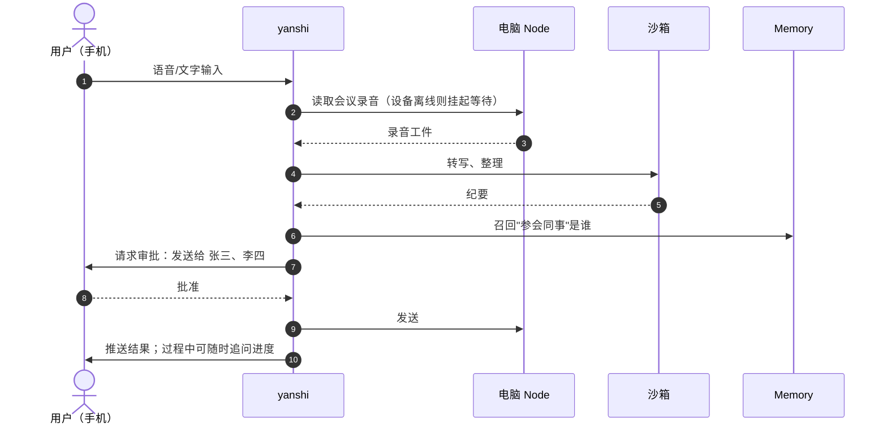
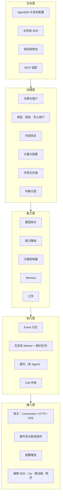
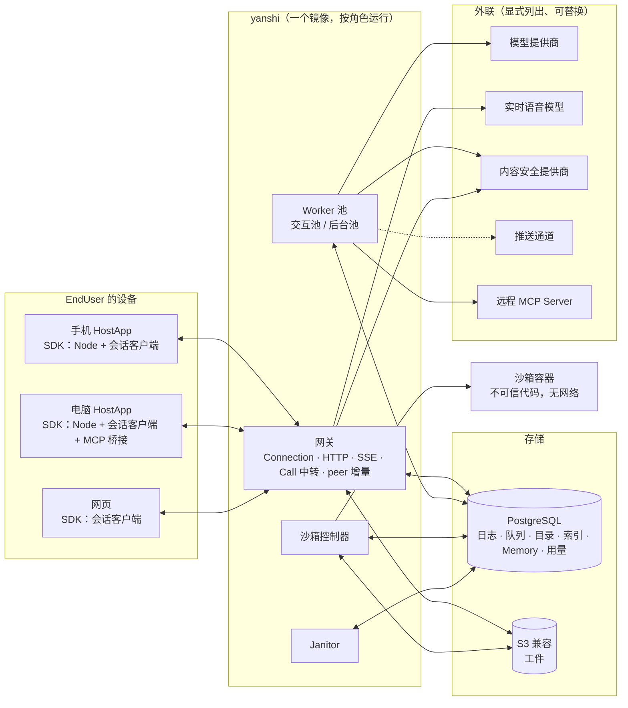
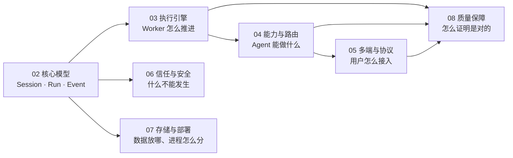

# 01 概览

> 本章回答：yanshi 为谁解决什么问题；它承诺什么、不承诺什么；系统长什么样；哪些约束贯穿全部设计。

## 1.1 问题

一条 C 端业务线想在自己的 App 里放一个"助手"：用户在手机上说一句话，助手去用户的电脑上读文件、在云端算一算、征得用户同意后把结果发出去，过程可能持续一小时，中途手机锁屏、电脑休眠、服务端滚动发布。要把这件事做对，业务线需要同时解决：

- **长时间执行的可靠性**：任务跑了四十分钟，执行它的进程被杀了，进度不能丢；
- **跨设备协同**：云端的 Agent 要能调用用户手机与电脑上的能力，而这些设备随时离线；
- **多端一致**：手机上开始的对话，电脑上打开要能接着看，两边同时操作不能打架；
- **实时与异步共存**：既要毫秒级首字的问答与全双工语音，又要小时级的后台任务；
- **安全与合规**：高风险操作要用户确认，内容要过审核，个人数据要能删干净；
- **成本**：长任务反复把同一段上下文发给模型，钱花在哪里要算得清；
- **模型可换**：今天用一家的模型，明天换另一家，业务代码不改。

这些问题与业务无关，每条业务线各做一遍既昂贵又不一致。yanshi 把它们收进一个运行时：业务线用一份声明式的 **AgentDef** 描述 Agent 做什么，在 App 里嵌入 SDK，其余交给平台。

## 1.2 目标与非目标

### 目标

| # | 目标 | 含义 | 本套文档中的落点 |
|---|---|---|---|
| G1 | 多端 | 手机、电脑通过嵌入业务 App 的 SDK 接入；同一 Session 多端同时在线、跨端接续 | 第 5 章 |
| G2 | 多模态 | 文本、图片、音频、视频、文件统一为内容块；含全双工实时语音（Call） | §2.5、§5.7 |
| G3 | 长任务 | 单个 Run 可持续小时级；可挂起、恢复、中断、插话；节点故障不丢进度 | 第 2、3 章 |
| G4 | 个性化 | 用户级 Memory；默认归属业务线，经用户授权可跨业务线共享 | §6.3 |
| G5 | 执行 | 调用设备上的本地能力、云端沙箱执行代码、接入 MCP 工具 | 第 4 章 |
| G6 | 问答 | 低首字延迟的即时问答，与长任务共存于同一 Session | §3.6 |
| G7 | 分布式 | 服务端无状态、线性扩容、高可用；端云协同；跨节点多 Agent 协作 | §2.4、§4.9、第 7 章 |
| G8 | 生态 | 业务线以声明式 AgentDef + SDK 接入；能力、Agent 可注册、版本化、复用 | §4.8、§7.5 |
| G9 | 模型中立 | 首选火山引擎模型；更换模型不改业务代码，以评测结果为准入依据 | §3.5、§8.3 |

### 非目标

- 不训练模型、不自研推理引擎；私有化场景只做模型接入。
- 不做具体业务应用；只提供参考实现与北极星场景的演示。
- 不重造通用基础设施（数据库、消息系统、对象存储、容器编排），只做可插拔适配。
- 端侧不预设大模型；端侧智能按"规则 → 经典 ML → 小模型"逐级选用，由具体场景决定。

### 关键约束

| 约束 | 含义 | 影响 |
|---|---|---|
| **私有化部署** | 全部组件可在客户 IDC 的 Kubernetes 上自托管、无外网运行；必需的外联项（模型、内容安全、推送）显式列出、可替换 | 存储只依赖 PostgreSQL 与 S3 协议；不引入消息中间件；令牌由业务线签发而不接外部身份服务 |
| **规模未知** | 并发量级暂无法确定 | 架构必须线性扩容，不为固定规模优化；分片键从第一天起就是契约 |
| **技术栈** | 服务端 Go | 单二进制、goroutine 便宜、gomobile 可把 SDK 带到移动端 |
| **由 Agent 开发** | 主要开发者是 AI Agent | "可被 Agent 正确修改"是一等约束：契约先行、模块可独立测试、不变量写成文档与自动检查 |
| **C 端合规** | 内容安全、个人信息保护、生成式 AI 监管 | 是基座能力而非业务线自理：检查在写日志之前、数据可按 Session 删除 |

## 1.3 设计原则

1. **变与不变分离**。基座只承诺语义稳定的原语（Session、Run、Event、Node、Capability、Policy……）；Agent 循环策略、上下文工程、模型选择、工具协议都是可替换插件。
2. **薄 harness**。不把当下模型的缺陷固化进基座；模型变强时，策略插件变薄，基座不动。
3. **Event 日志是唯一事实源**。Run 的全部状态可由日志重建；Worker 无状态，故障即重放。
4. **设备即节点**。手机、电脑是执行网络中的 Node，与云端沙箱、云服务在 Agent 眼中是同一种能力提供者。
5. **快慢分离**。实时交互（Call）走低延迟通道，耗时工作交给后台 Run，两者经 Session 协同。
6. **安全默认**。高风险能力默认需要审批；所有外部输入（网页、文件、工具结果）是不可信数据，不能提升权限。
7. **契约先行**。模块间接口以 IDL 定义；修改一个模块无需理解全系统。
8. **可验证性第一**。每个模块可独立测试；分布式行为用确定性模拟覆盖崩溃、分区、离线。
9. **单进程可运行**。全系统可作为一个二进制在本地启动；这同时是小规模私有化部署形态。
10. **评测即基础设施**。换模型、改提示词、改策略都必须经评测回归与灰度。

## 1.4 北极星场景

**场景 A：跨端长任务。** 用户在手机上说："把我电脑上昨天的会议录音整理成纪要，发给参会的同事。"

覆盖：语音输入 → 云端规划 → 调用电脑读文件 → 沙箱处理 → 用户离开、电脑休眠后任务挂起并恢复 → 结合 Memory 识别"同事" → 发送前在手机上审批 → 推送结果。**状态**：文字版已用真实模型跑通，固定为评测用例；语音输入经 Call 的 run_task 路径实现；推送唤醒仍为桩。

**场景 B：全双工实时协作。** 用户做饭时与助手语音通话："帮我看看电脑上那份 PPT 第三页写了什么……标题改得更口语一点。"

覆盖：全双工 Call、随时打断 → Call 中派生后台 Run 操作电脑 → 结果语音播报 → 跨端状态一致。**状态**：以合成语音评测跑通，改写经审批后写回电脑。

## 1.5 一页架构

### 分层

### 运行时组件

读图要点：

- **所有角色共用一套包与一个镜像**，按扩缩容维度、权限与故障域分成进程；单进程运行全部角色是长期保留的形态（§7.6）。
- **正确性来自 PostgreSQL 中的 Event 日志**，不是来自哪个进程的内存：任何进程随时可以被杀。
- **沙箱容器里没有任何受信组件**：它不连平台、不持凭证，由沙箱外的控制器驱动（§6.6）。
- **外联只有五类**，私有化部署时逐项列出、可关闭或替换。

## 1.6 十条不变量

这些不变量贯穿全部设计，后文反复引用。违反任何一条都算架构回归。

| # | 不变量 | 为什么 | 详见 |
|---|---|---|---|
| I1 | **Event 日志是唯一事实源。** 状态只能由日志投影得到；写入方"看着投影决定事件，先校验、再乐观并发追加，冲突后重新决定" | 线性扩容、故障恢复、多端一致、可回放评测，都从这一条推出 | §2.2 |
| I2 | **契约在 IDL 中。** Event、Connection 协议、投影快照都用 Protobuf 定义，只做向后兼容的修改 | 三个 SDK、存储格式、跨进程传输共用一份契约，机器可检查兼容性 | §5.1、§5.6 |
| I3 | **Worker.Step 是确定性的单步。** 时间来自注入的时钟，ID 来自注入的生成器；影响结果的逻辑在同步路径里 | 确定性模拟可在任意两步之间注入故障并复现 | §3.1、§8.1 |
| I4 | **请求前缀保持稳定。** 系统指令只含 AgentDef 的指令；工具按名排序；Run 内只在尾部追加 | 提供商的前缀缓存是长 Run 成本的主要杠杆 | §3.4 |
| I5 | **评测是效果的裁判。** 改动模型、提示词、AgentDef 或任何给模型看的文本，须运行评测且与基线相比无回归 | 模型可换（G9）的前提是能客观比较 | §8.3 |
| I6 | **模拟测试是执行语义的裁判。** 改动运行时、投影、服务、队列后运行确定性模拟；失败可按种子复现 | 分布式正确性无法靠单元测试证明 | §8.1 |
| I7 | **新存储实现必须通过一致性套件**，在唯一的装配入口构造，并接入差分模拟 | 换存储、加分片有安全网 | §7.1、§8.2 |
| I8 | **外部写入之后须唤醒 Session 的，日志与队列在同一事务提交** | 消除"写了日志、没入队"的丢失唤醒窗口 | §2.6 |
| I9 | **路由调用可以安全重投递，前提是设备 SDK 以调用 ID 去重**，且"开始执行"先落盘再执行 | 非幂等操作（发消息）在任何故障交错下至多执行一次 | §4.2 |
| I10 | **日志与指标只记 ID，不记内容。** 用户输入、模型输出、调用参数与结果只存放在可按 Session 删除的地方 | 个人数据保护；删除能删干净 | §6.7 |

## 1.7 本套文档与系统的对应

第 2 章是全书的根：Run 的状态机、Event 的种类、投影与乐观并发。读懂它之后，其余章节都是在同一套原语上的组合。
