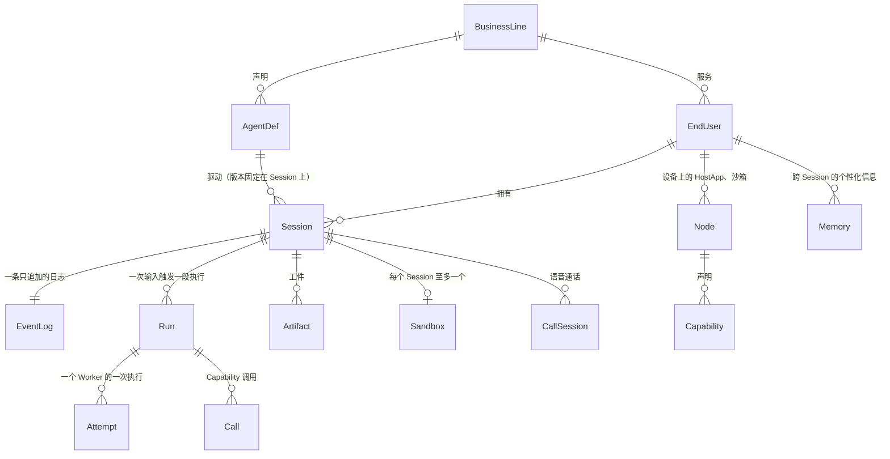
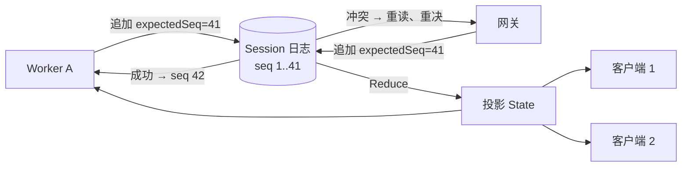
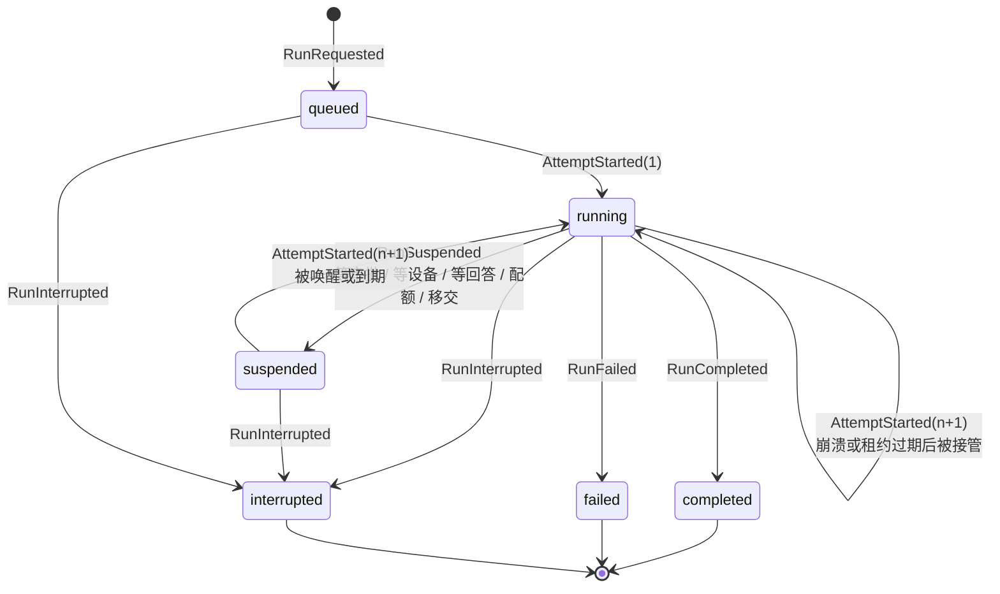
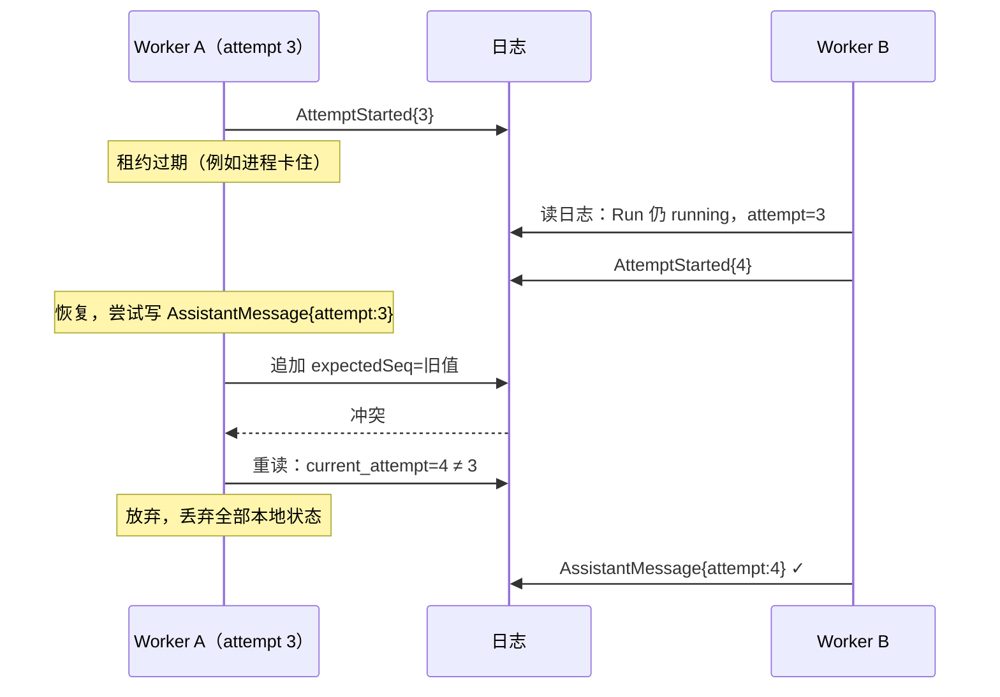
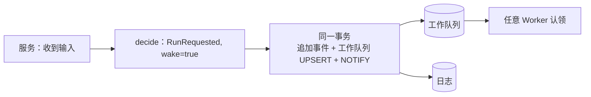
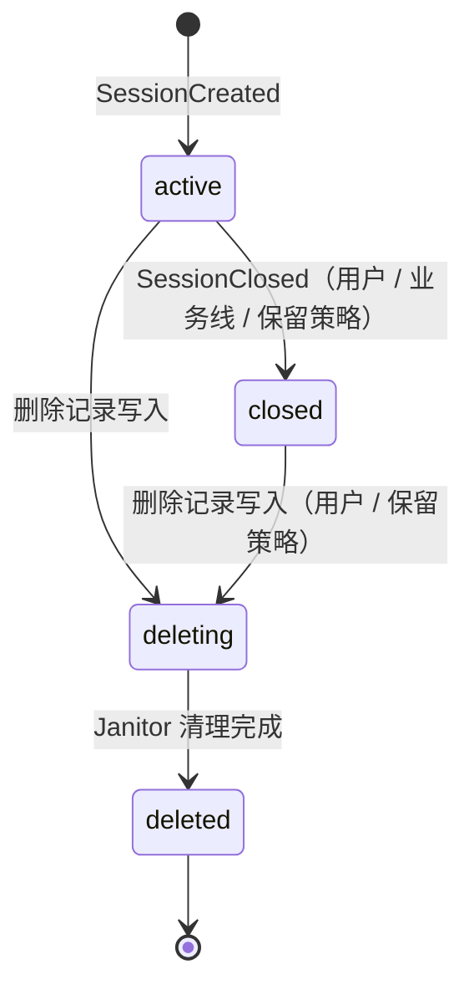
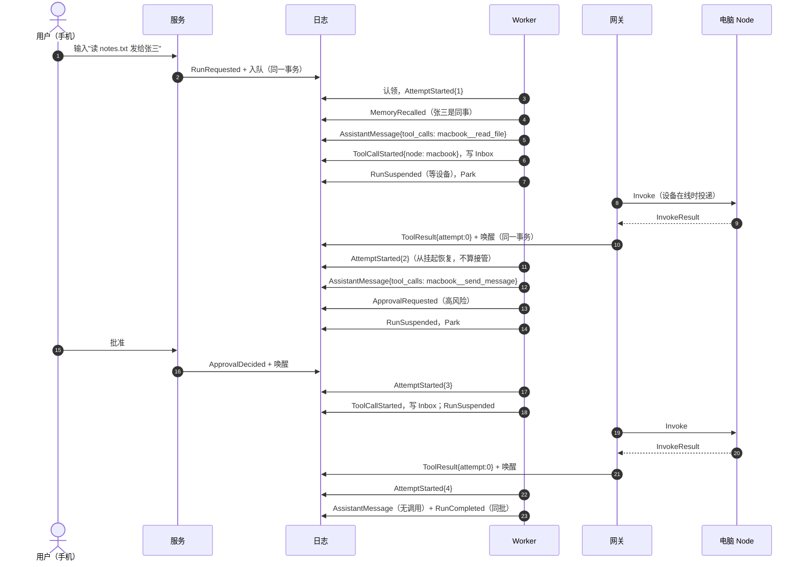

# 02 核心模型

> 本章回答：系统里最基本的几个对象是什么、它们之间什么关系；"Event 日志是唯一事实源"具体意味着什么；多个进程同时写同一个 Session 时怎样保证正确；状态如何从日志得到、如何缓存。

本章是全书的根。第 3–7 章的每一个机制——挂起、审批、压缩、委托、删除、灰度——都是在这里定义的原语上做组合，没有引入第二套状态模型。

## 2.1 对象一览



| 对象 | 一句话 | 生命周期 |
|---|---|---|
| **BusinessLine（业务线）** | 接入平台的一条 C 端业务；租户隔离、配额与计费的单位 | 配置文件声明 |
| **EndUser（终端用户）** | 使用业务线产品的自然人；同一人可用多条业务线 | 由业务线的令牌证明 |
| **AgentDef** | 一份版本化的声明：指令、能力白名单、模型、上下文策略、预算 | 随部署上线；版本的发布状态单独配置（§7.5） |
| **Session（会话）** | EndUser 与某个 AgentDef 之间长期存在的交互容器，可被多台设备同时接入 | active → closed → deleting → deleted |
| **Run（运行）** | Session 内由一次输入触发的一段执行；一个 Session 同一时刻至多一个未终态的 Run | queued → running ⇄ suspended → completed / failed / interrupted |
| **Attempt（尝试）** | 某个 Worker 对一个 Run 的一次执行；故障接管或挂起恢复都开启新的 Attempt | 由 `AttemptStarted` 开始，由下一个 `AttemptStarted` 或 Run 终态结束 |
| **Event（事件）** | Session 日志中只追加、不可修改的一条记录 | 永不修改；随 Session 一起物理删除 |
| **Worker** | 无状态的执行进程，认领 Session 并以 Attempt 推进其中的 Run | 随时可被杀 |

名词的完整定义见附录 A；这里只强调三个容易混淆的点：

- **Session 不是"一次对话"。** 它可以存在数月，包含成百上千个 Run，被手机与电脑同时打开。业务线用保留策略决定它何时自动关闭、删除。
- **Run 不是"一轮问答"。** 一个 Run 可以包含几十次模型调用、几十个设备调用，持续一小时；用户可以在进行中插话（Steer），插话不新建 Run。
- **Attempt 不是"重试"。** 它是正确性机制：每个 Attempt 有单调递增的编号，写入日志的每批事件都带着它，旧 Attempt 的写入会被拒绝（§2.5）。

## 2.2 Event 日志是唯一事实源

每个 Session 拥有一条独立的、只追加的 Event 日志。**Session 与其中所有 Run 的状态都只能由这条日志投影得到**；任何组件都不得持有日志之外的"权威状态"。

日志的三条基本性质：

1. **序号连续。** 每条 Event 有 `seq`，由日志分配，从 1 起在 Session 内连续递增。客户端续传、投影快照、上下文压缩的截断点都以 `seq` 为坐标。
2. **乐观并发追加。** 追加操作带 `expectedSeq`：仅当日志当前末尾等于它时成功，否则返回冲突。一次追加多条 Event 是原子的。
3. **纯函数投影。** 状态 = Reduce(全部 Event)。Reduce 是确定性的：同一段日志在任何进程、任何时刻都得到同一个状态。



这条原则带来的直接后果：

- **Worker 可以随时被杀。** 另一个 Worker 读日志、重建投影、从上次停下的地方继续。
- **多端一致就是多端订阅同一条日志。** 没有"同步"问题，只有"读到哪了"。
- **评测可以回放。** 同一段日志在任何环境产生同样的上下文。
- **代价**：日志压缩、快照、调用幂等都要自己处理（§3.3、§2.6、§4.2）。

> **决策 2.1 · Event 日志是 Run 状态的唯一事实源**（对照 ADR-0004）
>
> **背景**：持久执行有两条路：自研日志加 fencing，或引入 Temporal 一类的工作流引擎。小时级任务、多端一致、可回放评测、线性扩容四个需求指向同一种结构。
>
> **决策**：Session 内所有输入、模型输出、调用与结果都作为 Event 只追加地写入日志；执行 Run 的 Worker 不持有状态，以租约认领 Session，故障后由其他 Worker 重放恢复；多端同步即多端订阅同一条 Event 流。
>
> **取舍与后果**：换来线性扩容、故障恢复、多端一致与可回放。付出的是：上下文压缩（§3.3）、投影快照（§2.6）、非幂等调用的去重（§4.2）都要自己设计；日志只增不减，删除要专门设计（§6.7）。工作流引擎的备选在 M0 时评估过，自研版本经确定性模拟验证后未再回头。
>
> **体现**：系统中没有任何"状态表"是权威的。Session 索引、投影快照、用量记录都是投影或旁路数据；删掉它们重建，行为不变。

## 2.3 Event 的种类

Event 的内容用 Protobuf 定义，一个 `oneof` 列出全部种类。按作用分成五组：

### 会话与 Run 的骨架

| Event | 由谁写 | 含义 |
|---|---|---|
| `SessionCreated` | 服务 | 业务线、EndUser、AgentDef 版本；委托派生的子 Session 还带 `parent`（父 Session、父 Run、父调用、祖先 AgentDef 链） |
| `RunRequested` | 服务 | 一次输入开启新 Run；带客户端输入 ID（去重）与 `from_call`（来自语音通话的派生） |
| `Steered` | 服务 | Run 进行中的追加输入（插话），不改变 Run 状态，只进入上下文 |
| `AttemptStarted` | Worker | 某 Worker 开始第 n 次 Attempt；带本进程的内部地址（跨进程拉取实时增量用，§3.4） |
| `RunSuspended` | Worker | 当前 Attempt 正常结束，Run 等待外部条件；`reason` 为空（等审批或设备）、配额用尽、或 `handoff`（移交） |
| `RunCompleted` / `RunFailed` / `RunInterrupted` | Worker 或服务 | 三种终态；终态后该 Run 不得再有任何事件 |
| `SessionClosed` | 服务 | Session 的终态事件：之后不能再有任何 Run 事件 |
| `AgentSwitched` | 服务 | Session 当前使用的 AgentDef 版本切换（撤回版本时，§7.5） |

### 模型与调用

| Event | 由谁写 | 含义 |
|---|---|---|
| `AssistantMessage` | Worker | 一次模型调用的完整输出：内容块、工具调用请求、思考过程、用量、耗时与结束原因 |
| `ToolCallStarted` | Worker | 一次调用**开始执行**，先落盘再执行；路由调用还带目标 Node 与结果截止时间 |
| `ToolResult` | Worker 或网关 | 调用结果；`attempt = 0` 表示外部结果（设备、用户回答、子 Session 写回），不受 Attempt fencing |
| `ApprovalRequested` / `ApprovalDecided` | Worker / 服务 | 高风险调用的审批请求与用户决定 |
| `ContextCompacted` | Worker | 上下文压缩：`seq ≤ through_seq` 的历史在模型上下文中由摘要代替（§3.3） |
| `MemoryRecalled` | Worker | Run 开始时召回的 Memory，同时是访问记录（§6.3） |
| `DecisionMade` | Worker | 判断层的一次判断：种类、选项、结果、置信度，不含原文（§6.5） |
| `ContentModerated` | Worker | 模型输出被内容安全拦截；只记标签，不记原文（§6.2） |

### 语音通话

| Event | 由谁写 | 含义 |
|---|---|---|
| `CallStarted` / `CallTranscript` / `CallEnded` | 网关的 Call 中转 | 通话开始、双方每句话的转写、结束原因。音频不进日志（§5.7） |

### 内容块

Event 中的多模态内容统一为 **ContentBlock**，五种：

| 块 | 含义 |
|---|---|
| `Text` | 文本 |
| `Media` | 对工件的引用：`artifact://<id>`、MIME 类型、文件名、大小。**字节不进日志** |
| `UIContext` | 用户提交输入时所在界面的内容（界面、对象、选中文字、可见内容、所在设备），按不可信数据对待（§5.4） |
| `Card` | Agent 展示的卡片：标题、Markdown、图片、键值、列表、字段、按钮（§4.5） |
| `CardAction` | 用户在卡片上的动作：按钮或列表项，加填写的字段（§4.5） |

### 谁能写什么

| 写入方 | 可写的 Event | 受 fencing 约束 |
|---|---|---|
| Worker | 骨架中的 Attempt 与终态、模型与调用组的全部 | 是（带自己的 attempt 号） |
| 服务（HTTP、Connection 的请求） | `SessionCreated`、`RunRequested`、`Steered`、`RunInterrupted`、`ApprovalDecided`、用户回答的 `ToolResult`、`SessionClosed`、`AgentSwitched` | 否（外部事件） |
| 网关 | 设备结果的 `ToolResult(attempt=0)`、Call 的三种事件 | 否 |
| 子 Session 的 Worker | 父 Session 的 `ToolResult(attempt=0)`（委托写回） | 否 |
| Janitor | `RunInterrupted`、`SessionClosed`（清理时） | 否 |

投影在追加时校验这张表：设备结果中带卡片、用户输入中带卡片、对已完成调用的结果、对已终态 Run 的事件，都是不合法的写入，追加被拒绝。

## 2.4 Run 的状态机



规则：

- **一个 Session 同一时刻至多一个非终态 Run。** 用户输入到达时，服务看着投影判定：有活跃 Run → 写 `Steered`（插话）；活跃 Run 正在等用户回答提问 → 这条输入就是回答（§4.4）；否则 → 写 `RunRequested`。判定与写入在同一次乐观并发提交中，没有竞态。
- **终态是真正的终态。** 进入 completed / failed / interrupted 后，该 Run 不得再有任何事件，由投影校验强制。
- **Interrupt 保留已产生的输出。** 用户中断后，Session 可以继续接收新输入；已写入的回复与结果都在。
- **Suspend 不占 Worker。** 挂起时当前 Attempt 正常结束，Session 的租约归还并"停放"到某个时刻；条件满足（审批、设备结果、回答）时被唤醒，任意 Worker 可以恢复它。等待什么**不单独记录**，由日志推导：第一个未完成的调用处于"待审批"或"已派发、待结果"，或 `RunSuspended.reason` 标明配额、移交。
- **三种接管的区分**：
  - 从 `suspended` 恢复：正常路径，不计数；
  - `handoff` 后的恢复：Worker 主动移交（优雅停机、交互 Worker 交出长任务），不计数；
  - 在 `running` 状态下开始新 Attempt：上一个 Worker 没有正常结束（崩溃、租约过期），**这才是接管**。接管次数在"无进展"时累计（§3.2），超过上限 Run 失败。

## 2.5 Attempt 与 fencing：正确性来自日志，不来自锁

Worker 无状态，认领一个 Session 后：

1. 读日志、重建投影；
2. 若有 `queued` 或需接管的 Run，追加 `AttemptStarted{attempt = 当前 + 1}`；
3. 此后它追加的每一批事件都带自己的 attempt 号，以乐观并发写入。

若追加冲突，Worker 重读投影，然后：

```
if run 已终态 or run.current_attempt != 我的 attempt:
    放弃                      # 被中断，或被另一个 Worker 接管
else:
    在新末尾上重新决定并追加   # 冲突来自 Steered 等无害事件
```

这就是 **fencing**：即使租约机制出错导致两个 Worker 同时执行同一个 Run，日志也只接受当前 attempt 号的写入，另一个 Worker 的事件被拒绝，它随即放弃。



**工作队列只负责活性。** 队列按 Session 发放带 TTL 的租约，让多个 Worker 不要同时争抢同一个 Session；租约过期后其他 Worker 可以接管。租约不是正确性的来源——它只是让"两个 Worker 同时执行"这种浪费少发生。

**放弃时必须丢弃全部本地状态。** 模拟测试发现：Worker 放弃后若保留本地投影，它仍认为某个调用"已由我开始、尚无结果"，而按需续约可能还没发现租约已被移除，下一步就会再次执行一个非幂等调用。所以放弃意味着从零开始。

## 2.6 投影：Reduce、State 与快照

### State 里有什么

投影（State）是 Reduce 的输出，Worker、服务、客户端都看它：

| 部分 | 内容 | 用途 |
|---|---|---|
| 会话信息 | 业务线、EndUser、当前 AgentDef 版本（考虑过 `AgentSwitched`）、父 Session、关闭状态 | 鉴权、取定义、委托 |
| 最近的 Run | 完整明细：状态、当前 attempt、接管计数、回合数、每个调用的请求 / 开始 / 审批 / 结果 | 推进执行 |
| 更早的 Run | 只剩摘要：ID、状态、attempt、回合数、时间 | Run 列表、幂等检查 |
| 历史（History） | `seq > 最近一次压缩的 through_seq` 的事件，加最新摘要 | 组装模型上下文 |
| 调用 ID 集合 | 全部历史调用 ID，分新旧两层 | 唯一性校验 |
| 最近输入窗口 | 最近 64 条带 ID 的输入及其结果 | 输入去重（§5.2） |
| 进行中的 Call、委托 Run 的身份、判断记录 | | 各自的机制 |

### 投影是有界的

Session 可以活数月、含上千个 Run，投影不能随历史线性增长，否则每次提交前的校验（要克隆投影）和每个快照都越来越贵。有界化的做法：

- **Run**：新 Run 请求时只保留最近 2 个旧 Run 的完整明细，更早的只剩摘要；摘要在副本间共享，克隆不复制。
- **调用 ID**：唯一性仍对全部历史检查（随机 ID 不能当作去重的证明），但分两层存放——旧层不再修改、副本间共享；新层至多 256 个，克隆只复制新层。
- **历史**：只保留最近一次压缩之后的部分（§3.3）。
- **历史访问改读日志**：对已移出投影的 Run 中调用的重复审批或回答、Janitor 请求设备清除本地记录，都经分页扫描日志完成。这些路径罕见或在后台。

**等价性**：裁剪是 Reduce 的一部分，所以全量重放与"快照 + 尾部"得到同一投影；模拟测试每步检查。验收标准：历史扩大十倍时，每次提交校验分配的字节数不随之增长。

### 快照只是缓存

每 200 个事件写一次投影快照，加载时只回放快照之后的事件。快照带**投影版本号**：改动 Reduce 的逻辑或 State 的字段时版本号递增，旧快照一律作废、从日志重建。快照不是事实源：删光快照，行为不变。快照的格式同样用 Protobuf 定义。

## 2.7 决策-提交循环：所有写入方只有一种写法

Worker、服务、网关、委托写回、Janitor——所有写入方都用同一个循环写日志：

```
def update(session_state, decide):
    for attempt in range(MAX_COMMIT_RETRIES):          # 16 次
        decision = decide(session_state)                # 看着投影决定要写什么
        if decision.events is empty: return ok
        result = commit(session_state, decision.events, wake=decision.wake)
        if result is ok: return ok
        if result is conflict:
            sync_after_conflict(session_state)          # 读新事件、更新投影
            if 读不到新事件 and 日志已不存在: return GONE   # Session 已删除
            continue                                     # 重新 decide，而不是重放原事件
        return result                                    # 校验失败（invalid）等，不重试
    return TOO_MANY_CONFLICTS
```

要点：

- **冲突后重新决定，不重放原来的事件。** 冲突说明有人在你之前写了东西，原来的决定可能已经不对（比如 Run 被中断了）。各写入方只描述"看到这个状态时写什么"，以及对"已删除"与"不合法"两种结果的处理。
- **没有第二种重试循环。** 全部写入方共用这一个，模拟测试覆盖它一次就覆盖了所有人。
- **校验在提交前。** Reduce 校验每条待追加事件（终态后无事件、attempt 匹配、调用配对、卡片来源……），不合法的决定不会进入日志。
- **已删除的 Session**：持有租约的 Worker 追加时冲突，同步后却读不到新事件——这被识别为"已删除"，调用方放弃而不是重试。

## 2.8 外部写入与唤醒：原子提交

输入、审批、回答、设备结果写入日志之后，必须有 Worker 来推进 Session。原来的做法是"先追加、再入队"两步，中间进程崩溃就留下一个 Run 永远停在 queued——直到下一次有人输入。这是代码里曾经承认的丢失唤醒窗口。

现在：外部写入方在决定中置 `wake = true`，提交操作把**追加事件与入队放在同一个事务**里（PostgreSQL 实现是一条语句；内存实现同一契约），两者之间没有可以崩溃的窗口。没有原子实现时提交报错，**不退回两步**。



**Worker 自己的提交不唤醒。** Worker 提交 `RunSuspended` 后紧接着要"停放"这个 Session，此时若入队会使停放失效。因此唤醒只用于外部写入：输入、审批、回答、Node 结果、委托写回。

一致性套件专门检查这一契约：追加冲突、提交成功但回包丢失、与停放和删除的交错。模拟测试向外部写入注入"未生效"与"已生效但报告失败"，客户端以同一输入 ID 重试须得到"重复"，停止注入后 Run 无须新输入即可推进——把实现改回两步，模拟测试立刻报活性失败。

## 2.9 工作队列：租约、停放、唤醒

工作队列以 Session 为键，三个操作：

| 操作 | 含义 |
|---|---|
| **Enqueue**（入队） | 该 Session 有工作可做；带类别（业务线、优先级，§3.6）。已在队列中的项改用新类别 |
| **Claim**（认领） | 取得一个 Session 的租约（带 TTL）；可按池限定业务线与最低优先级 |
| **Park**（停放） | 归还租约并声明"在某时刻之前不可认领，除非被 Enqueue 唤醒"——挂起的 Run 用它等待超时 |
| **Release**（释放） | 归还租约，立即可被再次认领 |

执行期间持有者按需续租（距上次续租不足 TTL/3 时跳过）。续租失败意味着租约已被移除（被接管或 Session 已删除），持有者放下工作、丢弃本地状态。

队列是**活性**机制。它保证"有工作的 Session 终将被某个 Worker 认领"，不保证"同一时刻只有一个 Worker 在执行"——后者由 fencing 保证。两者分工清楚，租约机制的任何 bug 都不会破坏正确性。

## 2.10 Session 的生命周期



| 状态 | 含义 | 资源 |
|---|---|---|
| active | 可接收输入；沙箱空闲回收计算资源、保留工作区 | 全部保留 |
| closed | 不再接收输入；对话与工件仍可查看、下载 | 沙箱工作区销毁 |
| deleting | 对外不可见（一律 404），后台正在清理 | 逐项删除 |
| deleted | 只剩不含个人信息的删除记录 | 无 |

关闭不可逆；关闭时若有活跃 Run 先中断它。删除是从所有存储中**物理删除**（含日志），与"只追加"不矛盾：只追加约束的是 Session 存续期间的写入。删除的具体机制、防复活规则见 §6.7。

## 2.11 一个 Run 的完整时序

把以上原语串起来，看一次"读电脑文件并发送"的 Run 在日志里长什么样：



注意：一个只有两次设备调用的 Run 就产生了 4 个 Attempt，每次挂起与恢复都走一遍"认领 → 重建投影 → 推进"。这是有意的——挂起不占 Worker，Session 可以等待数小时；而重建投影的成本由快照与有界投影控制住。真实模型下的长 Run 评测中，一个 Run 内出现 40 余个 Attempt 是常态。

## 2.12 本章的决策

| 决策 | 小节 | 对照 |
|---|---|---|
| Event 日志是 Run 状态的唯一事实源 | §2.2 | ADR-0004 |
| 以 Protobuf 作为跨端与存储契约 | §5.6（契约） | ADR-0006 |
| 外部写入与唤醒原子提交 | §2.8 | 不变量 I8 |
| 投影有界、历史访问改读日志 | §2.6 | 延展性评审裁决 |

## 状态

全部 ✅。有界投影、原子唤醒为 2026-10-11 完成；投影版本号当前为 10。
