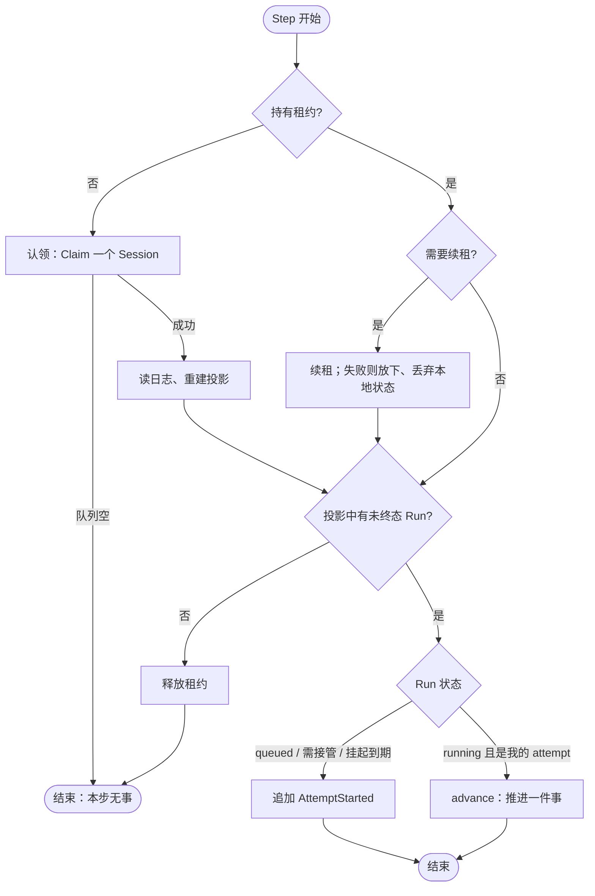
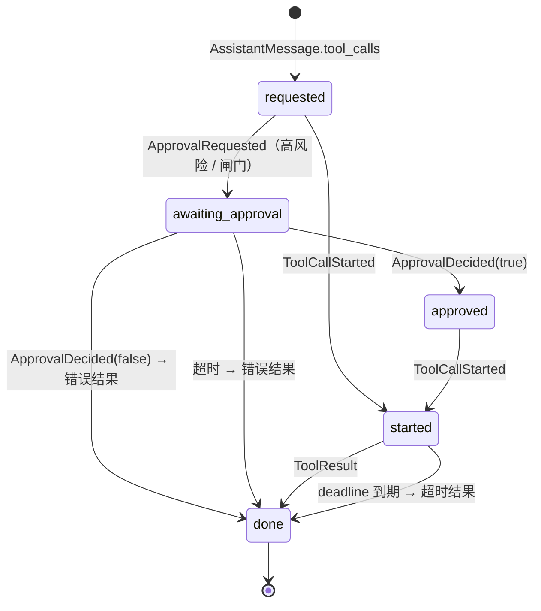
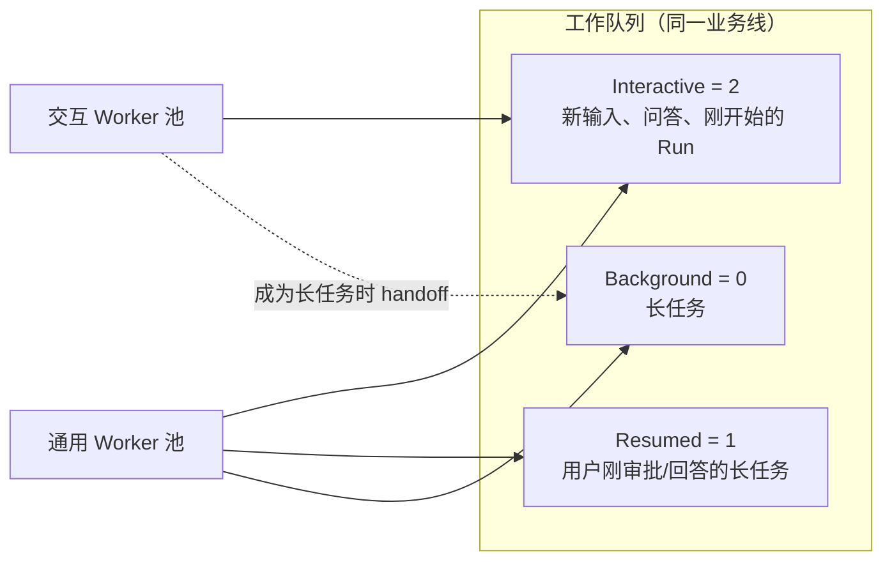

# 03 执行引擎

> 本章回答：Worker 具体怎么推进一个 Run；为什么要把执行切成"确定性的单步"；小时级任务怎样不被上下文窗口、故障接管和成本拖垮；模型调用层做了什么、不做什么；问答与长任务怎样共存。

第 2 章定义了 Run 的状态与日志的写法，本章讲 Worker 这个唯一的"推进者"。它的全部行为可以概括为一句话：**认领一个 Session，看着投影决定下一步做哪一件事，做完写日志，再看。**

## 3.1 Step：确定性的单步

Worker 以 **Step** 为单位推进。每个 Step 同步完成**一件事**，内部不启动任何影响结果的并发：



`advance` 每次只做下面这张表里**第一个**成立的事：

| 顺序 | 条件 | 做什么 | 写什么 |
|---|---|---|---|
| 1 | AgentDef 取不到 | Run 失败 | `RunFailed` |
| 2 | 有未完成的调用 | 推进它一个阶段（§3.2） | `ApprovalRequested` / `ToolCallStarted` / `ToolResult` / `RunSuspended` |
| 3 | 回合数达到 AgentDef 的上限 | Run 失败 | `RunFailed` |
| 4 | 第一回合且配置了召回 | 召回 Memory（§6.3） | `MemoryRecalled` |
| 5 | 是委托派生的子 Session | 确认父调用仍在等待，否则中断自己（§4.9） | `RunInterrupted` |
| 6 | 有尚未判断的外部调用结果 | 注入检测（§6.5） | `DecisionMade` |
| 7 | 估算的请求大小超过阈值 | 上下文压缩（§3.3） | `ContextCompacted` |
| 8 | 否则 | 调用模型 | `AssistantMessage`（无调用时同批 `RunCompleted`） |

为什么要这样切：

- **可注入故障。** 确定性模拟（§8.1）在任意两个 Step 之间杀掉 Worker、让租约过期、让模型报错，并检查不变量。Step 越小，可注入的位置越多，覆盖越细。
- **可重放。** 时间来自注入的时钟，ID 来自注入的生成器，每个 Step 的输入只有"当前投影"。同一种子下的交错完全可复现。
- **可移交。** 两个 Step 之间是天然的移交点：优雅停机、交互 Worker 交出长任务（§3.6）都在这里发生，不必等租约过期，也不必重做一次模型调用。

Step 内部有一个"执行期间"（during）的概念：模型调用、MCP 请求、注入判断这类可能耗时数十秒的操作，在它里面进行；期间按需续租，租约被接管或 Run 被中断时取消操作、作废结果。这保证一个 Step 的时长不会超过租约的保护。

### 错误预算

Step 出错不等于 Run 失败。两个预算：

- **模型错误**：同一 Attempt 内连续模型错误超过 3 次 → `RunFailed`。上下文超长错误也计入（压缩缓解不了就失败，而不是无限重试）。
- **Step 错误预算**：同一 Run 的 Step 连续出错超过 2 分钟 → `RunFailed`。它针对的是确定性的错误（配置错、程序错）；存储短暂不可用时续租也会失败，Worker 放下租约并清零计时，所以存储故障不会耗尽这个预算。

只有**白名单本身有误**这类配置错误才立即失败；查设备目录、查 MCP 工具列表的瞬时故障只是本步重试。

## 3.2 Capability 调用的生命周期与幂等

一次调用经历三个事件：`AssistantMessage.tool_calls`（请求）→ `ToolCallStarted`（**执行之前**落盘）→ `ToolResult`。按调用的执行位置分三类：

| 类型 | 执行者 | `ToolCallStarted` 之后 |
|---|---|---|
| 进程内 | Worker 本身（时间、卡片、Memory、远程 MCP） | 同一 Step 内执行、写结果 |
| 路由到 Node | 设备、沙箱、子 Session | 写入目标的 Inbox，Run 挂起；结果由网关或子 Worker 以 `attempt = 0` 写回 |
| 路由到用户 | 用户本人（`ask_user` 提问） | 不经 Inbox，Run 挂起；回答由服务写回 |



**故障恢复时的幂等规则**（Worker 接管后看到一个未完成的调用）：

```
if 有请求、无 ToolCallStarted:
    从未执行 → 可以安全执行
elif 有 ToolCallStarted、无结果:
    可能已产生副作用
    if capability 声明为幂等: 重新执行
    else: 写入错误结果 "outcome unknown"，交给模型决定后续
    # 绝不重复执行有副作用的调用
```

对路由调用，这条规则在设备 SDK 一侧还要再做一遍（§4.2）：平台可以放心地重新派发，因为 SDK 以调用 ID 去重。

**进展的定义。** 接管上限限制的是"无进展的连续接管"：当前 Attempt 提交了 `AssistantMessage`、`ToolResult` 或 `ContextCompacted` 才算进展；`ToolCallStarted` **不算**——否则一个每次执行都弄崩 Worker 的幂等调用会形成"开始 → 崩溃 → 接管"的无限循环。上限为 4；从挂起恢复与移交都不计入，所以小时级任务可以挂起、恢复任意多次。

## 3.3 长任务：上下文压缩

### 问题

M0 的执行语义能让 Run 在故障后恢复，但三件事会让小时级 Run 跑不完：

1. **上下文无界增长**：把整个 Session 的历史交给模型，几十轮调用后必然超过窗口。
2. **单个调用结果可能很大**：设备读一个大文件、沙箱输出很长，一条结果就占满窗口。
3. **接管上限按整个生命周期累计**：Worker 滚动发布几次就把额度用光（已改为"无进展"口径，§3.2）。

### Compaction 是一条 Event

**上下文压缩**把 Session 中较早的历史替换为一段摘要，记录为 `ContextCompacted{through_seq, summary}`。之后组装模型上下文时，用"最新摘要 + `seq > through_seq` 的历史"代替完整历史。原始事件不删除。

> **决策 3.1 · 上下文压缩记录为 Event**（对照 ADR-0012）
>
> **背景**：另一种做法是每次组装上下文时临时截断或临时摘要。
>
> **决策**：由 Worker 调用模型生成摘要，连同截断位置作为 Event 追加到日志。
>
> **取舍与后果**：临时截断会丢失早期目标与副作用记录；临时摘要的结果不确定，接管者、回放和评测会看到不同的上下文，违反不变量 I1。写进日志之后：重放确定；摘要生成受 Attempt fencing 约束（被中断或接管时作废，什么也不提交）；日志不删任何内容，审计与客户端展示不受影响。代价是摘要质量直接影响长任务正确性，摘要指令因此属于须评测回归的文本。
>
> **体现**：日志里能看到每次压缩发生在哪、摘要写了什么；调试控制台可以直接展开摘要。

### 投影规则

- 必须由当前 Attempt 追加，且 Run 没有未完成的调用。
- `through_seq` 严格大于上一次压缩的，且小于当前 seq。
- **闭合边界**：在 `through_seq` 处，此前请求的所有调用都已有结果。截断后的上下文不会出现"有请求、无结果"的残缺配对。
- 投影只保留 `seq > through_seq` 的历史加最新摘要，Worker 的内存随窗口有界。

### 何时压缩、截断在哪里

压缩是 `advance` 中的一个独立 Step（§3.1 第 7 行）。触发与选点都是**确定性计算**，不读外部状态：

```
估算 = 按内容字节数与固定媒体开销的保守估算
if 上一条 AssistantMessage 之后没有压缩过:
    估算 = max(估算, 上次 input + 上次 output + 其后新增事件的估算)   # 用真实用量校准

if 估算 > compact_at × window:
    候选 = [闭合边界 b for b in 历史 if b 不是最后一个事件
                                    and 摘要前缀 + 被压缩的历史 ≤ 摘要请求预算]
    截断点 = 仍能保留约 keep_recent token 原文的最晚候选，否则最晚候选
    if 没有候选: 直接调用模型
    else: 一次摘要模型调用 → 提交 ContextCompacted
```

积压远超阈值时一次压缩可能不够，需要连续几次；每次都严格推进 `through_seq`，所以一定会结束。**兜底**：提供商把"上下文超长"错误映射为专门的错误类型，Worker 在下一个 Step 强制压缩；估算偏低时靠这条路径恢复。

### 配置与策略

压缩策略是可替换插件：运行时决定何时压缩、截断在哪里、怎么提交，策略只负责生成摘要。默认策略用 AgentDef 的模型（可另指定摘要模型），摘要指令要求保留：用户的目标、约束与未完成事项；**已经执行、产生过副作用的操作，以及结果未知的操作**（防止压缩后重复发消息）；用到的工件 ID、文件路径、设备名。

AgentDef 的上下文配置段：

| 项 | 含义 | 默认 |
|---|---|---|
| `window` | 模型上下文窗口（token） | 64000 |
| `compact_at` | 估算超过窗口的这个比例时压缩 | 0.75 |
| `keep_recent` | 压缩后保留原文的历史量 | 16000 |
| `max_tool_result` | 单条调用结果在上下文中的上限，超出截断成"开头 + [已截断：原始约 N tokens]" | 8000 |
| `summary_model` | 留空与主模型相同 | 空 |

窗口是模型的属性，但目前没有模型元数据注册表，所以跟着模型写在 AgentDef 里——这也符合"换模型只改 AgentDef"。

### 实测与两次迭代

- **真实模型验证**：40 份销售日报逐个读取后求总额与前三名，窗口设为 8000 迫使多次压缩，第 15 次调用后杀掉 Worker。3/3 通过，平均 45 次调用、3.3 次压缩、1 次接管；累计值跨三次压缩与一次接管保持正确。固定为评测用例。
- **试验未采纳：先按规则省略旧调用结果再摘要。** 编码 Agent 的研究认为这最划算，实现后 A/B：汇总类任务里模型反而去重新读取被省略的文件，调用与 token 翻倍，一次答错。助手类长任务在汇总前每条结果都要用，先让模型把数据提炼进摘要才对。结论：不引入。
- **已采纳：摘要请求复用主请求的前缀。** 摘要请求原本以自己的系统指令开头、把历史渲染成一段文本，缓存命中 0%。改为与主请求共享系统指令、工具定义与截断点之前的上下文，只在末尾追加压缩指令，命中率从约 40% 升到约 70%，折算省 20%–32%。细节见 §3.4。

## 3.4 实时增量与前缀缓存

### 增量不进日志

模型的 token 增量**不进入日志**，只经 Session 级的实时总线扇出，标注 Run、Attempt 与"接在日志哪个位置之后"。日志只记录完整的 `AssistantMessage`。客户端订阅 = 从某个 seq 起的已提交事件 + 实时增量；断线重连只需带上最后见到的 seq，丢失的增量会被随后提交的完整消息覆盖。

**思考过程**同样流式推送、与正文分开累积，随回复写入 `AssistantMessage.reasoning`（超过 32 KB 截断，与回复一起过内容安全），**不发回给模型**——不占上下文、不改变前缀。

### 跨进程：从执行进程直接拉取

多进程部署下，执行 Run 的 Worker 在进程 A、客户端连在进程 B 是常态。

> **决策 3.2 · 实时增量从执行进程直接拉取**（对照 ADR-0013）
>
> **背景**：两种常见做法是数据库的 NOTIFY 广播，或引入消息中间件。
>
> **决策**：Worker 开始 Attempt 时把本进程的内部地址写进 `AttemptStarted`；订阅方跟随日志，看到活跃 Run 的当前 Attempt 在别的进程，就连到那个地址拉取增量；Attempt 换了就切换，Run 挂起或终态就断开。
>
> **取舍与后果**：NOTIFY 在提交时要拿一把全局锁，所有发通知的事务都会在这里串行化，且每个监听进程收到全部 Session 的通知，开销随"增量速率 × 进程数"增长；消息中间件是私有化部署要多运维的组件。直接拉取不新增存储或注册表，"谁在产生增量"与 fencing 用同一事实源。代价：进程间要能互访内部端口；执行进程崩溃到被接管之间没有增量（本来就是尽力而为）；对外 API 要清除这个内部地址。
>
> **体现**：同一进程上同一 Session 的多个订阅者共用一条上游连接；流量只在"生产者 → 消费者"之间流动，与进程总数无关。

### 晚加入者补齐

生成中途打开的设备要能从头看到正在生成的文字。增量总线为每个 Session 缓存正在生成的草稿；新订阅者先收到一条 `snapshot` 增量（到目前为止的全文，含思考），再收后续增量；生成结束时发 `end`，缓存清除。缓存与扇出在同一把锁下，Snapshot 与其后的增量之间不漏不重。草稿超过 256 KiB 时不再补发。

客户端的规则只有三条：Snapshot 替换草稿；普通增量追加；`end` 或 seq 更大的 `AssistantMessage` 到达时以提交内容为准。

### 请求前缀保持稳定

小时级 Run 的成本大头是每次模型调用重复发送的前缀；提供商的前缀缓存命中部分价格远低于普通输入。于是请求组装有三条约定（不变量 I4）：

1. **系统指令只含 AgentDef 的指令。** 当前 Run 的 Memory 召回放在该 Run 的用户输入之前（输入被压缩后放在摘要之后），不放在系统指令里。实测：召回放系统指令时，召回结果的顺序随输入变化，一变整个前缀失效。
2. **工具按名称排序**，不随设备列表或 MCP Server 的返回顺序变化。设备在线状态不进工具描述：手机频繁上下线会使同一 Run 之后每次请求的前缀失效。
3. **Run 内只在尾部追加。**

评测报告有"缓存命中"列，改动 Transcript 或请求组装时用它确认没有退化。当前数字：单个 Run 的多数用例 84%–95%；多次压缩的长 Run 约 70%（压缩是主要损失来源）。

## 3.5 模型调用层

模型网关让业务与运行时只依赖一套抽象：对话模型（流式）、嵌入、实时语音模型（§5.7）。模型以 `provider/model` 引用，当前提供商：火山方舟（默认，对话与嵌入）、私有化 OpenAI 兼容服务、腾讯云 TokenHub、离线复述、脚本化（调试与模拟）、压测模型，以及只用于评测评分的 Codex。思考强度写在引用后缀上（`:minimal | :low | :medium | :high`）。

### 时限、重试与准入

每个真实提供商由一层"守卫"包装，各自计数：

| 约束 | 默认 |
|---|---|
| 一次调用的时限（不含排队与重试等待） | 10 分钟；超时不重试 |
| 总时限：排队、每次尝试、重试等待都计入 | 15 分钟；剩余时间等不到下一次重试时立即放弃 |
| 流停滞：两次收到数据的最长间隔 | 2 分钟 |
| 建连、TLS、等待响应头 | 10 秒、10 秒、2 分钟 |
| 暂时性失败的重试 | 2 次，指数退避 1 秒起、至多 30 秒带抖动；提供商给出更长的 `Retry-After` 时以它为准 |
| 并发上限 / 发起速率 | 默认不限；排队时交互调用优先（§3.6） |

- **可重试**：408、409、425、429、5xx、529；流中途报告的错误；连接中断与流停滞。
- **不重试**：上下文超长、参数错误、鉴权失败、超时、取消。
- **已输出过增量后不重试**：订阅者已经看到了部分输出，重试会让它们看到两份。这种失败交给 Worker：本步出错，下一步重新调用，计入模型错误预算。

时限、退避与准入只影响调用的节奏和失败方式，**不改变执行语义**；确定性模拟使用脚本化模型，不经过守卫。准入目前是单进程的，多进程的总并发等于进程数乘以上限（§7.6）。

### 火山方舟的接入事实

都用真实请求确认过：思考强度以 `reasoning_effort` 发送；图片以 data URL、语音消息以 `input_audio`（wav/mp3/m4a）发送，由 Worker 从工件内联（单个不超过 4 MB）；多模态嵌入只提供合成向量的接口，所以每段文本单独请求；思考过程以单独增量推送。思考强度的权衡：`low` 先思考约 27 秒才出正文，`minimal` 首字约 0.7 秒；各 Agent 当前取 `minimal`，以响应速度为先，代价是模型不总按指令用卡片展示结果。

## 3.6 工作类别：问答与长任务共存

### 问题

工作队列原本是全局先进先出。多条业务线接入后无法给某条业务线专用 Worker；小时级长 Run 与需要低首字延迟的问答排在同一条队伍里，长任务占满 Worker 时问答没人管（G3 与 G6 的冲突）。

> **决策 3.3 · 工作队列按类别认领：业务线与优先级**（对照 ADR-0029）
>
> **背景**：等所有队列实现写定再加类别参数，就要同时改每个实现与模拟测试，所以尽早放进接口。
>
> **决策**：入队带类别（业务线、优先级）；认领按池（可限定业务线与最低优先级）。优先级由 Run 的**服务量**决定，不按经过的时间：活跃 Run 的模型回合与上下文压缩合计达到 6 次，或累计输出达到 16000 token，即为**长任务**（Background）；否则为交互级（Interactive）。一部分 Worker 只认领交互级；它们持有的 Run 成为长任务后，在两步之间以 `handoff` 挂起并归还，由通用 Worker 恢复。
>
> **取舍与后果**：按时间判定会在积压时把排队超过阈值的新 Run 成批降级，交互 Worker 反而空闲；按 AgentDef 声明则没有配置的得不到保护。按服务量判定只看已做了多少工作，确定、可重放。代价是每个长任务多写一对事件（移交），客户端看到一次短暂挂起。业务线之间的加权公平认领留待分片层一起设计，目前用池做隔离。
>
> **体现**：交互 Worker 池（默认为 Worker 数的四分之一）与后台池；`RunSuspended{reason: "handoff"}`；队列指标按优先级区分等待时长。

### 恢复名额

用户对长任务做出审批或回答后，多半还在等结果。于是：审批或回答写入时，Run 得到一个**不可叠加的恢复名额**，由下一个 `AttemptStarted` 消费，按事件重放。有名额的长任务以 `Resumed` 优先级入队——介于 Background 与 Interactive 之间，只提高它在后台池中的认领次序，交互 Worker 不认领它。因此"每个长任务至多移交一次"不变。



一个细节：租约期间审批把项提升为 `Resumed`，持有者随后按自己可能未同步的投影归还、写回 `Background`，名额就丢了一个周期。归还时**只提升不降低**优先级，两个实现同改并有一致性用例。

### 优雅停机

进程收到终止信号后不再认领新工作。持有 Run 的 Worker 完成当前这一步（最多等 `drain-timeout`），然后以 `handoff` 挂起并归还租约，其他进程立即接手——不必等租约过期，也不必重做整次模型调用。沙箱控制器与 Janitor 同样归还租约。

### Submit 准入

业务线中等得最久的交互工作超过阈值时，拒绝该业务线的新 Run（503 与 `Retry-After`），回落到恢复阈值以下才恢复（滞回）。只拦新 Run：插话、同一输入 ID 的重试、中断、审批与回答属于进行中的工作，照常接受——积压时的容量由此留出。等待时长取自队列的积压统计，是排队时长的直接测量。默认不启用，阈值依据线上指标确定。

## 3.7 Worker 的横切逻辑

一次模型调用的 Step 里串着多种横切逻辑，按固定顺序：


顺序的理由：计量在内容安全之前——token 在返回时已经消耗，被拦截也要计费；内容安全在写日志之前——违规原文不能进日志（§6.2）；提醒在写入之后、后台进行——不阻塞 Step，丢了也只是尽力而为。

评审认为这一串应改成固定顺序的"阶段"，让新策略以阶段接入而不改 Worker 本体；目前未做，等下一个横切需求到来时顺手做（§10.3）。

## 3.8 本章的决策

| 决策 | 小节 | 对照 |
|---|---|---|
| 上下文压缩记录为 Event | §3.3 | ADR-0012 |
| 实时增量从执行进程直接拉取 | §3.4 | ADR-0013 |
| 工作队列按类别认领；长任务按服务量判定；恢复名额 | §3.6 | ADR-0029 及其修订 |
| 思考过程流式推送并随回复写入日志 | §3.4 | ADR-0034 |
| 接管上限改为"无进展的连续接管" | §3.2 | 长任务设计 |
| 摘要请求复用主请求前缀；不做"先按规则省略结果" | §3.3 | 评测裁决 |

## 状态

全部 ✅。Submit 准入已实现但默认关闭；模型准入为单进程；Worker 阶段化未做。
