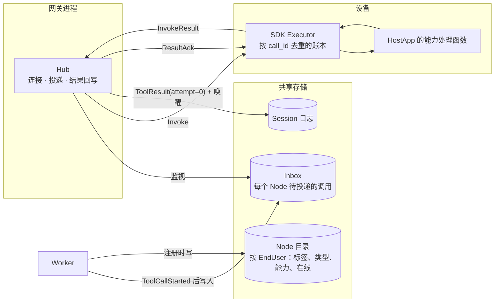
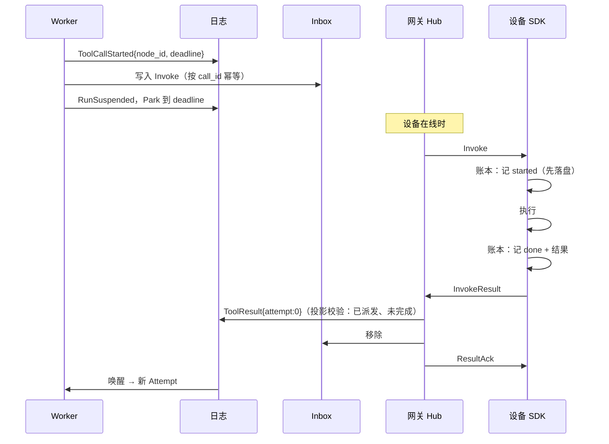
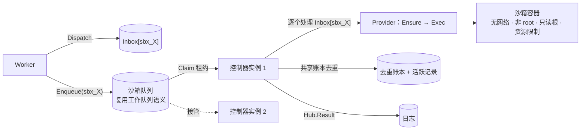
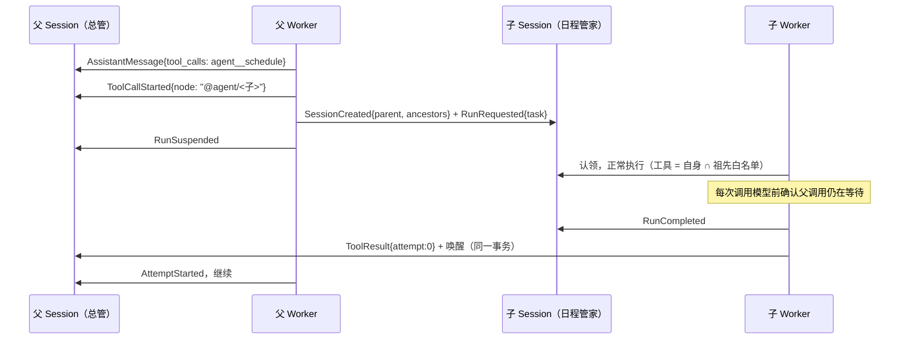
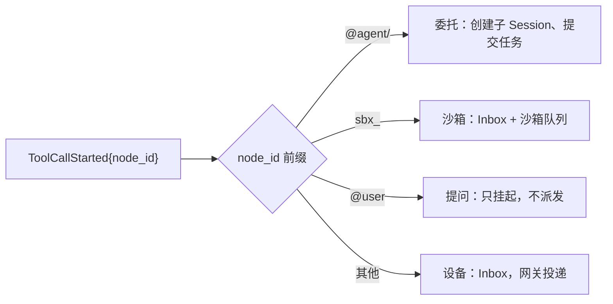

# 04 能力与路由

> 本章回答：Agent 能做什么、这些"能做"从哪里来；调用一台随时离线的手机时怎样做到"一定送达、至多执行一次、结果一定回来"；审批、提问、卡片、沙箱、工件、MCP、委托这些看起来各不相同的东西，为什么在平台里是同一种机制。

本章的核心观念只有一个：**凡是 Agent 能调用的东西都是 Capability，凡是不在 Worker 进程内执行的 Capability 都走同一条路由。** 设备上的能力、云端沙箱、另一个 Agent、用户本人，对模型来说是同一种工具，对平台来说是同一种"派发 → 挂起 → 外部结果写回"的调用。

## 4.1 Capability 模型

**Capability** 是 Node 声明的一项可被 Agent 调用的动作，带输入输出契约、风险等级与幂等性。

### 五个来源

| 来源 | 在 AgentDef 白名单中怎么写 | 模型看到的工具名 | 谁执行 | 详见 |
|---|---|---|---|---|
| 进程内 | `clock_now`、`ask_user`、`show_card`、`memory_save` … | 原名 | Worker 本身 | 本章各节 |
| 设备 | `device:<glob>`，如 `device:*`、`device:read_*` | `<设备标签>__<能力>`，如 `macbook__read_file` | 设备上的 HostApp | §4.2 |
| 沙箱 | `sandbox:<glob>` | `sandbox__<能力>` | 沙箱控制器 | §4.6 |
| 远程 MCP | `mcp:<server>/<glob>` | `mcp_<server>__<tool>` | Worker 内的 MCP 客户端 | §4.8 |
| 另一个 Agent | `agent:<glob>` | `agent__<名称>` | 派生的子 Session | §4.9 |

命名约定有意区分：双下划线 `__` 是"来源__能力"的分隔符，所以进程内能力用单下划线；设备标签只含小写字母、数字与连字符，不会与 `mcp_` 前缀冲突。平台据此判断一条调用结果是否来自外部（名字含 `__`），这个判断被内容安全、Memory 写入闸门、注入检测复用。

### 风险与幂等

每个 Capability 声明两个属性：

- **风险**：`RISK_HIGH` 的调用在派发前必须得到用户审批（§4.3）；MCP 工具未声明只读即视为高风险。
- **幂等**：故障恢复时是否可以重新执行（§3.2）。读文件幂等，发消息不幂等。

### 工具解析

Worker 在每次模型调用前解析一次工具列表（白名单 × 当前可用的 Node、MCP Server、可委托的 Agent），执行调用时再按名解析一次；Node 消失时返回错误结果。每个 EndUser 的 Node 列表在进程内缓存 10 秒。工具描述附上设备类型，**不附在线状态**——描述是请求前缀的一部分，设备频繁上下线会让缓存失效（不变量 I4）。调用离线设备时 Run 挂起，设备上线后继续。

### 保留的 Node 标识

平台保留两类 Node ID 前缀，设备不能用它们接入：`sbx_`（沙箱的虚拟 Node，`sbx_<Session ID>`）与 `@`（用户本人 `@user`、委托目标 `@agent/<子 Session ID>`）。否则一台持有合法令牌的设备可以冒名收到他人沙箱的调用、回写伪造结果。设备标签 `sandbox` 与 `agent` 同样保留。

## 4.2 设备即节点：Node、Inbox 与路由调用

### 问题

设备上的 Capability 与进程内 Capability 有三点本质不同：**远程且异步**（结果可能几秒后回来，也可能几小时）；**随时离线**（手机被系统挂起、电脑合盖，离线是常态）；**有副作用、需授权**。所以 Worker 不能阻塞等待设备。

> **决策 4.1 · 设备即节点：端侧能力经嵌入 HostApp 的 SDK 暴露**（对照 ADR-0002）
>
> **背景**：另一种做法是一个统一的 yanshi 独立客户端提供设备能力。
>
> **决策**：手机与电脑上的本地能力，由嵌入业务线 HostApp 的 SDK 以 Node 身份主动连接云端并声明 Capability 来提供；对 Agent 而言，设备、沙箱、云服务上的 Capability 是同一种东西，由能力路由统一处理在线状态、审批、超时与幂等。
>
> **取舍与后果**：一台设备上多个 HostApp 是多个 Node；Capability 的可见性受业务线边界约束（Session 只能看到同一业务线的 Node）。Node 必然频繁离线，离线成为一等语义：调用设备的 Run 必须能挂起等待，并可经推送唤醒。
>
> **体现**：模型看到的工具叫 `macbook__read_file`，与 `sandbox__run_python` 并列；调用它的 Run 在日志里是一次挂起与恢复。

### 组件

- **Node 目录**按 EndUser 记录该用户的 Node：标签、类型、能力、在线状态。离线的 Node 仍在目录中。一个 Node ID 只属于一个 EndUser，归属在注册的写入中判定（并发首次注册至多一方成功）。标签由 HostApp 提供，同一用户下自动去重。
- **Inbox** 是某个 Node 待投递的调用集合，按 `call_id` 幂等。
- **Hub** 是网关核心逻辑：同步、可被模拟测试驱动；WebSocket 只是它的传输层。

### 路由调用的生命周期

六条规则：

1. **派发即持久化。** Worker 先提交 `ToolCallStarted`，再写 Inbox。Worker 不关心设备是否在线。
2. **投递由网关负责。** 持有该 Node 连接的网关监视其 Inbox，把未投递的调用推给设备；断线重连后整个 Inbox 重新投递。
3. **去重由设备 SDK 负责。** SDK 以 `call_id` 为键持久记录执行状态（未执行 → 执行中 → 已完成及结果）。重复投递返回缓存结果；发现"执行中"（App 在执行中被杀）时，幂等能力重新执行，否则返回"结果未知"。**"开始执行"先落盘、再执行**——顺序反了就可能重复执行（不变量 I9）。因此平台对路由调用总是可以安全地重新派发。
4. **外部结果不受 fencing。** 网关以 `attempt = 0` 追加结果；投影只接受针对"已派发、未完成"的路由调用的外部结果。追加成功后才确认（`ResultAck`）并移出 Inbox；存储故障时不确认，连接关闭，设备重连后从账本重新返回结果。
5. **超时。** `deadline` 到期仍无结果时，Worker 追加超时错误结果；迟到的设备结果因调用已完成而被丢弃。
6. **中断。** Run 被中断后，服务从 Inbox 移除其未完成的调用；网关对已投递的调用向设备发 `Cancel`（尽力而为）。

**离线唤醒**：派发时若 Node 离线，调用推送唤醒 HostApp。目前为日志桩；真实推送通道属于私有化部署须显式列出的外联项。

### 模拟测试的覆盖

模拟世界中的 Node 随机上线、下线、在执行过程中崩溃（SDK 账本保留），加入随机审批决定与时钟跳跃（触发超时）。不变量：**非幂等的设备 Capability 对同一 `call_id` 至多执行一次**，即使发生重复投递、Worker 接管或设备崩溃。

## 4.3 审批

执行高风险 Capability 前，由 EndUser 在某台设备上做单次确认。

- 审批请求以 `ApprovalRequested{summary, deadline}` 出现在事件流中，EndUser 的**任一设备**都能看到、都能决定；默认等待 1 小时。
- 被拒绝或超时的调用以错误结果交还模型，由模型决定后续。
- 投影强制：请求过审批的调用，必须在得到批准后才能有 `ToolCallStarted`。
- 重复审批返回冲突，不会产生重复效果。
- 审批不只来自风险等级：Memory 写入闸门（§6.4）判定需要用户批准时，同样走 `ApprovalRequested`，说明文字写明原因。已请求过审批的调用一律走完审批，即使之后上下文变化使闸门不再触发。

审批与 Grant（§6.3）的区别：审批是对**一次调用**的确认；Grant 是对**跨业务线读取 Memory**的持久授权。

## 4.4 提问：ask_user

Agent 需要用户在几个明确候选中选择，或补充少量结构化信息时，调用内置能力 `ask_user`：问题、至多 8 个选项（可带配图）、至多 6 个字段（text / number / date / time）、是否多选。

> **决策 4.2 · Agent 的提问是路由到用户本人的调用**（对照 ADR-0025）
>
> **背景**：提问需要挂起、截止、外部结果、中断撤回、接管后重放——路由调用已经有这些，并经模拟测试覆盖。
>
> **决策**：`ask_user` 沿用路由调用的生命周期，目标是用户本人（Node ID `@user`），不经任何 Inbox。Worker 记下 `ToolCallStarted{node_id: "@user", deadline}` 后挂起；用户在任一设备上点选或填写，回答作为该调用的外部结果写入并唤醒 Run；用户直接打字回复时，这段文字就是回答而不是插话；截止（默认 24 小时）无回答则超时；中断 Run 时提问随之作废。
>
> **取舍与后果**：不新增"提问 / 回答"事件类型，投影不改。模型看到的只是一次普通调用与 JSON 结果（选中的选项带标签，模型不必对照 ID）。客户端从 `AssistantMessage.tool_calls` 中读出问题，由该调用是否已有结果判断是否仍待回答——任一设备回答后其他设备随之收起。`@user` 不是 Node，撤回时没有 Inbox 项要移除，执行路径须跳过派发。
>
> **体现**：参数不合法（只有一个选项、选项 ID 重复）时不打扰用户，错误直接交还模型改正；回答按问题校验（选项存在、单选只选一个、必填有值、格式正确），再过内容安全，最后写入。

**提问过度**是真实问题：加入 `ask_user` 后的第一轮评测里，模型把它当成低成本的确认手段，解读简报时停下来问口径。工具说明改为以限制开头（"仅在无法继续时提问……分析、解读、写作、推荐类的请求不要提问，按合理假设完成并说明假设"）后恢复。这是"给模型看的文本须评测"的一个实例。

## 4.5 卡片：show_card 与卡片动作

C 端对话里很多结果用文字说不清，或说清了也不好操作：订好的闹钟带"再加一个 / 取消"、一段行程、几个候选的图文对比、确认前改一下时间的小表单。

> **决策 4.3 · 卡片是 show_card 的结果，卡片动作是一条输入**（对照 ADR-0032）
>
> **背景**：备选有只用 Markdown（按钮与回传做不到）、采用 Adaptive Cards 等现成标准（体量大、三个 SDK 都要跟进）、让模型直接输出结构化内容（格式因提供商而异，校验失败无处交还）、卡片动作作为单独请求类型。
>
> **决策**：卡片是契约中的内容块（标题、副标题、头图；正文至多 20 个元素：Markdown、图片、键值、列表、字段；至多 6 个按钮）。模型经内置工具 `show_card` 展示；平台校验参数后，把规范化的卡片与一行说明作为**调用结果**写入日志，只接受 Worker 写入的 `show_card` 结果中带卡片。卡片**不阻塞** Run。用户点按钮或列表项时，客户端提交一条带 `CardAction` 的**输入**：有进行中的 Run 则并入，等回答时作为回答，否则开新 Run。同一 `card_id` 再次展示即替换。
>
> **取舍与后果**：卡片文字是调用参数，与回复一起过内容安全；动作按日志中的那一版卡片核对（动作存在、字段合法、必填已填），显示文字取自卡片而非客户端；输入 ID 由调用 ID 与动作推导，**同一版卡片上的同一动作只生效一次**，与点了几次、在几台设备上点无关。图片只能是本 Session 的工件或内置图标——外部地址可以追踪用户，也不随 Session 删除。模型看不到卡片本身，只看到那一行说明：内容就是它自己写的参数，重复放进上下文只会占窗口。
>
> **体现**：模型看到"[卡片动作] 用户在卡片 alarm 上选择了「好的」（动作 ok），填写：repeat=工作日"。需要等用户选择才能继续的，仍用 `ask_user`——阻塞等待用户只有一条路径。

## 4.6 云端沙箱

Agent 编写并运行 Python 来处理数据、计算、出图，单次执行最长分钟级。

### 沙箱即 Node

每个 Session 的沙箱是一个虚拟 Node（`sbx_<Session ID>`），工具名 `sandbox__<能力>`：

| 能力 | 幂等 | 说明 |
|---|---|---|
| `run_python` | 否 | 执行一段 Python |
| `exec` | 否 | 在工作区执行 shell 命令 |
| `write_file` / `read_file` | 是 | 读写工作区文件 |
| `import_file` / `export_file` | 是 | 工件 → 工作区 / 工作区 → 工件（§4.7） |

在隔离沙箱内执行**默认不需要审批**：破坏面被限制在沙箱内。标准输出各截断到 16 KB 返回模型。

> **决策 4.4 · 沙箱内不放任何受信组件：由沙箱外的控制器作为 Node**（对照 ADR-0008）
>
> **背景**：另一种做法是在沙箱内运行 SDK 连回网关，像一台设备。
>
> **决策**：沙箱控制器运行在沙箱之外，作为 Node 从 Inbox 领取调用，经容器运行时把命令送入沙箱执行；沙箱内只有用户与模型的代码，不持任何凭证、不连接平台。
>
> **取舍与后果**：模型生成的代码不可信，与持凭证的组件同处一个环境就可能冒充 Node 或伪造结果。控制器在外，沙箱复用全部路由机制（Inbox、去重、挂起、超时、中断）；去重账本由控制器持久化在共享存储中，任何控制器实例都能接管。沙箱默认无网络，连回平台的通路根本不存在。
>
> **体现**：生产部署中只有沙箱控制器这个角色持有容器或 K8s API 权限，网关与 Worker 不碰沙箱（§7.6）。

> **决策 4.5 · 每个 Session 一个沙箱工作区**（对照 ADR-0009）
>
> **背景**：备选是每次调用一个干净环境（无法多步协作）或每个 EndUser 一个（跨 Session 互相污染，清理粒度过粗）。
>
> **决策**：首次调用时创建，同一 Session 的所有 Run 共享工作区文件系统；空闲超时后回收计算资源、保留工作区，下次调用恢复。
>
> **取舍与后果**："下载数据 → 分析 → 出图"可以跨多步、跨多个 Run，并在挂起数小时后继续。同一沙箱内调用串行（由沙箱租约保证）。工作区的持久化方式随实现而变。
>
> **体现**：Session 关闭即销毁工作区；删除由 Janitor 完成。

### 派发与执行

- 持有租约的控制器独占该沙箱；执行期间持续续租；控制器崩溃后，接管者看到账本中的"执行中"：`exec` / `run_python` 返回结果未知，读写文件重做。
- 中断撤回 Inbox 条目；执行中的控制器监视 Inbox，发现被撤回时取消执行。
- **生命周期**：首次执行时创建（幂等）；每次执行记入活跃记录；任一控制器周期性回收空闲超过阈值的沙箱（停计算、留工作区）；Session 关闭或删除后由 Janitor 销毁。控制器创建或恢复沙箱之后复查 Session 是否已关闭或删除，是则销毁——这一条是模拟测试发现的：关闭时控制器可能已经读到了待执行的调用。

### 实现与生产形态

当前只有 Docker 实现：默认无网络、丢弃全部能力、禁止提权、非 root、只读根文件系统加临时目录、限制 CPU / 内存 / 进程数、可选 gVisor 运行时；工作区是命名卷，容器删除后保留；命令超时在沙箱内强制。

> **决策 4.6 · 生产沙箱运行在 Kubernetes + gVisor 上**（对照 ADR-0010，**已暂缓**）
>
> 原决策：生产沙箱以 Pod 形式运行，经 RuntimeClass 使用 gVisor 隔离（不依赖硬件虚拟化，客户 IDC 可普遍部署）。2026-10-09 暂缓：后续可能选用云厂商的沙箱服务，届时作为同一接口的一个实现接入。选型时须一并决定：云厂商沙箱只用于公有云部署（私有化仍需自托管实现），还是修订私有化约束。在此之前该决策不作为实施依据。见 §10.2。

## 4.7 工件

**Artifact** 是 Run 产出或用户、设备提供的、可独立引用的文件（录音、图表、表格）。字节不进日志，日志中只以 `Media{uri: "artifact://<id>", mime, name, size}` 引用。

- **不可变**，带哈希、大小、MIME、文件名；单个至多 512 MB。
- **归属一个 Session**，Session 决定其业务线与 EndUser；工件只对其所属 Session 可见，跨 Session 共享未定义（这直接影响委托，§4.9）。
- **元数据与字节分离**：元数据在 PostgreSQL，字节在本地文件系统（单进程）或 S3 兼容存储。

> **决策 4.7 · 以 S3 API 作为工件存储契约**（对照 ADR-0011）
>
> 平台只依赖 S3 协议，私有化由客户选任何 S3 兼容实现（SeaweedFS、MinIO、Ceph RGW）。设备与沙箱经平台 API 上传下载，不直接访问对象存储；对象存储无需对外暴露，也无需预签名 URL。开发环境因 MinIO 社区版镜像不再可得而改用 SeaweedFS，只影响开发编排。

### 流转

| 路径 | 方式 |
|---|---|
| 用户上传 | HTTP 上传后，以 Media 内容块作为输入提交 |
| 设备 → 云 | 能力处理函数经 SDK 上传，结果中返回 Media 引用 |
| 云 → 设备 | 能力参数携带工件 ID，处理函数经 SDK 下载 |
| 沙箱 ↔ 工件 | `import_file` / `export_file`，由控制器在沙箱外完成——沙箱本身没有网络、不持凭证 |
| 下载 | HTTP，受所属 Session 的鉴权约束 |

**对模型的呈现**：一行文本 `[artifact art_x: chart.png, image/png, 7.6 KB]`，模型把 ID 传给下一个工具即可在设备与沙箱之间接力。用户消息中的图片工件（≤ 4 MB）内联给模型以支持视觉理解；工具结果中的图片只以文本呈现。

**输入中的 Media 只能引用本 Session 的工件**：带内联字节、外部链接或别的 Session 工件的输入被拒绝，类型与大小以工件元数据为准。这样内容安全检查的对象就是模型看到的内容，文件内容也不会进日志。

## 4.8 MCP 适配

MCP Server 是现成的工具生态。平台把它们接成 Capability 提供者，两种方式：

| 方式 | 谁运行 Server | 谁调用 | 数据在哪 |
|---|---|---|---|
| **远程 MCP** | 业务线或第三方，Streamable HTTP | Worker 内的受信客户端，业务线级凭证 | 业务线的服务 |
| **设备端桥接** | EndUser 的电脑（stdio 子进程或本机 HTTP） | HostApp 中的 SDK，经 Inbox 路由 | 留在用户本机 |

> **决策 4.8 · MCP Server 作为 Capability 提供者：远程由 Worker 调用，本机经设备桥接**（对照 ADR-0017）
>
> **背景**：云端运行 stdio 型 Server 与用户级 OAuth 都是候选。
>
> **决策**：远程 Server 由业务线登记（名称、所属业务线、URL、从环境变量注入的凭证头、工具白名单、免审批清单），Worker 进程内的受信客户端调用，语义与进程内 Capability 相同；用户电脑上的 Server 由 SDK 桥接成设备 Capability。未声明只读的工具默认需要审批，只能由业务线逐个放宽。
>
> **取舍与后果**：云端不运行 stdio 型 Server——它们是不可信代码，只能放进沙箱，而沙箱默认无网络，多数 Server 却要联网，安全边界需另行设计。第一阶段不做用户级 OAuth——令牌保管、刷新与删除的工作量和风险显著更大，业务线级凭证已覆盖"业务线把自有服务开放给 Agent"的主要场景。远程 MCP 的 URL 就是私有化部署中需要放通的外联项。
>
> **体现**：平台只连接登记过的 URL，模型无法指定任意地址。

### 调用语义与注解映射

远程 MCP 工具按**进程内 Capability** 执行：先落盘 `ToolCallStarted`，在执行期间调用 Server（被中断或接管时取消 HTTP 请求并通知 Server），结果写 `ToolResult`。崩溃恢复按幂等性处理。

| MCP 注解 | 平台的解读 |
|---|---|
| `readOnlyHint: true` | 低风险，无需审批；幂等 |
| `idempotentHint: true` | 幂等 |
| 未声明只读 | **需要审批**；业务线可在登记中逐个放宽 |
| 明确 `destructiveHint: true` | 需要审批，**不能**放宽 |

第三方的注解只当作提示，放宽审批必须经业务线明确登记。每次调用带上业务线、EndUser、Session 的请求头，业务线的 Server 据此按用户处理数据——它可以信任这些值，因为调用来自持业务线凭证的平台。

**结果映射**：文本 → Text；图片、音频 → 保存为本 Session 工件；资源链接 → 一行描述；结构化内容 → JSON 文本；错误 → 错误结果。单个结果超过 64 KB 截断。工具结果一律视为不可信数据。

工具发现：启动时列出，缓存 5 分钟；调用时发现不存在立即刷新。

### 设备端桥接

电脑上的 HostApp 连接本机 MCP Server，SDK 把它们的工具声明为该 Node 的 Capability（名称 `<server>_<tool>`，模型看到 `<标签>__<server>_<tool>`）。调用沿用设备节点的全部机制：Inbox、离线挂起、去重、审批、超时。用户数据与 Server 的凭证都留在本机。

## 4.9 委托：多 Agent 协作

### 问题

一个 Agent 把任务交给另一个 Agent 时，平台要保证**送达、只执行一次、结果一定回来、父子生命周期一致**——这与设备路由是同一个问题。

> **决策 4.9 · 委托是路由到派生子 Session 的调用**（对照 ADR-0031）
>
> **背景**：备选有在一个 Run 内开子线程（崩溃恢复、审批、计量都要另做一套，模拟测试无从覆盖）、父 Worker 轮询子 Session（占 Worker 或定期唤醒）、专用编排服务（新增组件与契约）。
>
> **决策**：
> 1. **Agent 是一种 Capability。** 白名单 `agent:<glob>`，工具名 `agent__<名称>`，说明取自目标 AgentDef 的 `description`，版本按发布配置对 EndUser 分流。
> 2. **委托是一次路由调用，目标是派生的子 Session。** 父 Run 提交 `ToolCallStarted{node_id: "@agent/<子 Session ID>"}` 后挂起；子 Session ID 由父 Session 与调用 ID 推导，任务以推导的输入 ID 提交——重复派发因此幂等。子 Run 继承 Run 的全部语义：租约、fencing、挂起、审批、提问、计量、删除。
> 3. **结果由子 Session 的 Worker 写回。** 子 Session 没有活跃 Run 时，Worker 把委托 Run 的终态作为父调用的外部结果写入，并在同一事务中唤醒父 Session，然后才归还子 Session。写回幂等。
> 4. **委托不扩大权限。** 子 Session 记录祖先 AgentDef 链；子 Run 的工具是自身白名单与**每个祖先**白名单的交集。子 Session 属于同一业务线、同一 EndUser；审批与提问照常路由到用户本人。
> 5. **超时、中断与删除沿用已有路径。** 父调用的时限取目标 AgentDef 的 `delegation.timeout`（默认 1 小时）；超时与父 Run 的中断经撤回路由调用的同一处中断子 Run；Janitor 删除父 Session 时从父日志中的委托目标找到子 Session 一并删除。
>
> **取舍与后果**：路由调用按顺序执行，同一父 Run 同时未完成的委托至多一个（`max_fanout` 为将来预留）；工件只对所属 Session 可见，父子之间只传文字；删除父级联删除子，关闭父只中断进行中的子 Run。
>
> **体现**：演示 Agent "总管"委托"日程管家""出行助手""研究员"；经总管委托时日程管家不能发短信（总管白名单没有），直接对话时可以（需审批）。评测用例检查这一点。

### 实现中的几个要点

- **深度与扇出**：子 Session 的深度 = 祖先数 + 1；委托出去的子 Session 深度超过委托方 AgentDef 的 `delegation.max_depth`（默认 2，即顶层可委托、子不再委托）时，工具返回错误结果而不派发。
- **任务被拒绝时直接告诉父调用**：子 Session 已删除或关闭、配额用尽、任务被内容安全拒绝时，派发写回错误结果而不是等到超时。
- **孤儿防护**：父 Run 中断后撤回子 Run 是尽力而为；兜底是子 Worker 每次调用模型之前确认父调用仍在等待，不在等了就以 `parent_done` 中断自己。中断已终态的 Run 时仍撤回未完成的派发。
- **复活防护**：派发在创建子 Session 之后对子 Session 本身"先写后查"删除记录——它恰在此前被删除并清理完毕时，撤回刚重建的索引与日志并告诉父调用。
- **固定身份**：委托 Run 记在子 Session 投影的固定位置，不依赖 64 条的输入去重窗口（用户可以向子 Session 提交输入把它挤出去）。
- **Memory 写入闸门**：子 Session 的任务由父 Run 的模型写成，可能含父 Run 读到的外部内容；子 Session 一律视为受外部内容影响，任务不计入用户原话（§6.4）。
- **可见性**：子 Session 对 EndUser 可见、可订阅；客户端按 `parent` 折叠展示；子 Run 的审批与提问在父 Session 的待处理中也能看到，否则父 Run 会一直等着。

"何时委托、委托给谁"是规划判断而不是分类，起步用 LLM；小模型在这一点上没有证据（§6.5）。

## 4.10 派发链

Worker 面对一个路由调用时，按固定顺序决定去哪里：

五种目标、一种生命周期。它们共享：`ToolCallStarted` 先落盘；外部结果以 `attempt = 0` 写回并在同一事务唤醒；超时由 `deadline` 统一处理；中断经同一处撤回；模拟测试用同一组不变量检查。

## 4.11 本章的决策

| 决策 | 小节 | 对照 |
|---|---|---|
| 设备即节点 | §4.2 | ADR-0002 |
| 提问是路由到用户本人的调用 | §4.4 | ADR-0025 |
| 卡片是 show_card 的结果，卡片动作是一条输入 | §4.5 | ADR-0032 |
| 沙箱内不放受信组件 | §4.6 | ADR-0008 |
| 每个 Session 一个沙箱工作区 | §4.6 | ADR-0009 |
| 生产沙箱 K8s + gVisor（暂缓） | §4.6 | ADR-0010 |
| S3 API 作为工件存储契约 | §4.7 | ADR-0011 |
| MCP Server 作为 Capability 提供者 | §4.8 | ADR-0017 |
| 委托是路由到派生子 Session 的调用 | §4.9 | ADR-0031 |

## 状态

设备路由、审批、提问、卡片、沙箱（Docker）、工件、MCP、委托均 ✅。离线推送唤醒 ⚪（桩）；生产沙箱 Provider ⚪（待选型）；委托的并行扇出、父子共享工件、A2A、注册中心 ⚪。
