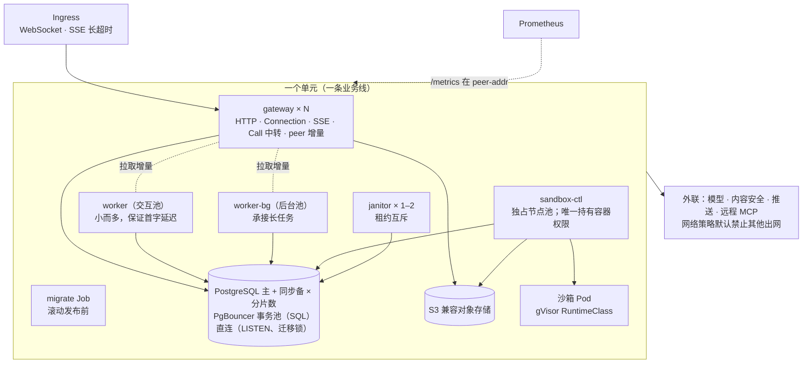

# 07 存储与部署

> 本章回答：数据放在哪里、为什么只依赖 PostgreSQL 与 S3；"现在不分片"与"从第一天起守住分片键"怎样同时成立；通知怎样做到空闲负载有上界；用量与配额为什么独立于日志；AgentDef 的版本怎样灰度与回滚；生产环境进程怎么分、为什么不是微服务。

## 7.1 存储的形状

### 全部接口化，两套实现

每一类数据都定义为一个小接口，有**内存实现**（单进程开发、模拟测试、评测）与 **PostgreSQL 实现**（多进程部署），工件的字节另有本地文件系统与 S3 两种实现。两套实现通过同一套**一致性套件**（§8.2），并在确定性模拟中做**差分测试**：同一种子在两种实现上产生逐字节相同的日志。

| 数据 | 内容 | 键 |
|---|---|---|
| 事件日志 | Session 的 Event | Session |
| 工作队列 / Janitor 队列 / 沙箱队列 | 租约、类别、停放时刻、就绪时刻 | Session（沙箱队列由沙箱 Node ID 推导） |
| 投影快照 | 每 200 个事件一份，带投影版本 | Session |
| Node 目录与 Inbox | 设备登记、待投递调用 | EndUser |
| 沙箱账本与活跃记录 | 调用去重状态、最近执行时间 | Session |
| 工件元数据 | 哈希、大小、MIME、名称 | Session |
| Session 索引 | 业务线、EndUser、Agent、时间 | EndUser |
| 删除记录 | Session、业务线、时间（不含 EndUser） | Session / 全局（删除请求） |
| Memory、Grant、访问索引 | | EndUser |
| 用量明细与小时聚合 | 不含 Session 与内容 | EndUser |
| 在场记录 | 带有效期 | Session |
| 推送设备登记 | 平台、令牌、最近使用 | EndUser |

### 唯一的装配入口

"给定一套存储实现与配置，返回整套组件"只有一个地方做：存储由装配包按"内存"或"PostgreSQL"构造；核心对象图（日志 Store、Hub、Memory 服务、能力目录、委托、派发链、服务、提醒）由同一个装配函数构造。serve、模拟测试、评测、e2e 测试都经它取得对象，serve 只决定每个角色起多少个 Worker、控制器与 Janitor。新增跨切面的策略（故障注入、判断、提醒、计量、准入）接入装配选项，不再各自布线；测试替身在存储的接缝上包装，或在返回的对象图上替换字段。

这是分片前的必做项：分片层会把每个存储再乘以分片数，装配只有一处才改得动。

## 7.2 PostgreSQL 基线

> **决策 7.1 · 以 PostgreSQL 作为持久化存储基线**（对照 ADR-0007）
>
> **背景**：候选有 Kafka / Pulsar 作日志（顺序追加天然，但乐观并发追加与按 Session 随机读不便，且仍需另一个库放队列与目录）、FoundationDB（事务与扩展性最佳，但私有化运维门槛高）、自研日志存储（时机未到）。
>
> **决策**：事件日志、工作队列、Node 目录与 Inbox 等全部持久化实现统一基于 PostgreSQL：日志表以（Session，seq）为主键，唯一约束天然实现乐观并发追加；队列用"选取并跳过已锁定行"认领；LISTEN/NOTIFY 实现等待，以限速校准兜底。
>
> **取舍与后果**：私有化部署要求依赖少、客户 IDC 普遍具备运维能力，一个组件覆盖全部存储接口。单个主库是写入上限，线性扩容靠按 Session 分片到多个集群（Session 之间无跨分片事务），或替换为 PG 协议兼容的分布式数据库；业务代码只依赖接口，不感知分片。开发与测试用容器启动 PostgreSQL。
>
> **体现**：追加一批事件是**一条语句**：检查末尾、插入、入队（唤醒时）、发通知，全部在一个事务里。

### 迁移

数据库变更只通过**新增**编号的迁移文件，不修改已有迁移。迁移以独立任务在滚动发布前执行；serve 可以配置为不执行迁移、缺迁移时拒绝启动。在大表上建索引用并发建索引语句，这类迁移首行标注"不在事务中"，且只含这一条语句并可重复执行。当前 15 个迁移，涵盖日志与队列、沙箱、工件、生命周期、Memory、快照、用量（含分片与缓存 token 列）、在场、推送设备、工作类别、恢复优先级、就绪时刻。

## 7.3 分片键是契约

### 为什么现在就定

容量测算（亿级月活：峰值约每秒 3 千个 Run、4.5 万条 Event）超出单库能力，扩容的办法是把数据按键分到多个库。分片层可以以后再做，但从现在起，表结构与访问方式就得守住键的边界——否则下一张新表就可能把两类键混在一起，到分片时拆不开。

> **决策 7.2 · 数据按 Session 或 EndUser 分片**（对照 ADR-0028）
>
> **决策**：两类键，外加不分片的全局表。每张表登记它的键；测试检查迁移中的每张表都已登记且键列存在。
>
> | 键 | 表 |
> |---|---|
> | **Session** | 事件日志、投影快照、工作队列与 Janitor 队列、工件元数据、在场、删除记录；沙箱的队列、账本与活跃记录 |
> | **EndUser** | Node 目录与 Inbox、Session 索引、Memory、Grant 与访问记录、用量、推送设备 |
> | **全局** | 删除请求（不含 EndUser） |
>
> EndUser 键**不含业务线**：Grant 让一条业务线读取同一 EndUser 在另一条业务线的 Memory，按（业务线，EndUser）分片会使召回与注销跨分片。键经哈希映射到固定数量的槽位，槽位再映射到分片；扩容迁移的是槽位，不改变任何键的哈希。
>
> **访问规则**：（1）在线路径按键访问：查询条件含键的等值条件。（2）不按键的访问（按其他列、按时间扫描、队列认领）分片后要遍历所有分片，只允许出现在 Janitor 的删除与保留策略、按时间的清理、低频的业务线服务端查询三类路径中，并逐表登记。（3）**一条 SQL、一个事务只涉及一个键**；跨键的效果靠可重复的多步写入完成（先写日志再写 Inbox）。（4）新的存储接口在参数中带上键；目前在线路径只凭对象 ID 访问的地方登记为"缺口"，分片层投入使用前须补上。（5）通知频道按分片命名，进程只监听有订阅者的频道。
>
> **取舍与后果**：没有选全按 Session 分片（列出用户的 Session、召回、注销都要遍历所有分片）或全按 EndUser 分片（只带 Session ID 的请求要先查归属，且日志按用户聚集后重度用户所在分片更热）。分片后队列认领在每个分片内进行；业务线级汇总变成各分片的部分和；Node ID 改为 EndUser 内唯一。
>
> **体现**：现在不分片，这里只约束表结构与访问方式。实现分片层时接口不变，按键路由，经一致性套件与差分模拟验证。队列的一致性契约已从"全局按入队顺序"改为"分片内有序"。

## 7.4 通知、空闲负载与热路径

### 通知的三条防线

PostgreSQL 的 NOTIFY 是事务性的，活着的 LISTEN 连接不会漏通知；通知只在三种情形下丢，各有对策，于是**等待者不再各自轮询**：

| 情形 | 对策 |
|---|---|
| 频道的 LISTEN 尚未生效 | 等待者等 LISTEN 生效（至多 5 秒）再做第一次检查；生效时唤醒该频道的订阅者重查 |
| 连接断开或半开 | 心跳：LISTEN 连接每 10 秒向自己的私有频道发通知，10 秒内没回来即重建；连接上的所有语句统一限时。重建后缓存作废，连接的"代"加一，全部键按每秒 2000 个分批重查 |
| 其余无法预见的情形 | 校准：按轮转顺序唤醒订阅者重查，每个键至多每 5 分钟一次、每进程每秒至多 50 个键 |

空闲时每个进程的兜底查询因此有上限（每秒 50 次），与订阅数无关——此前每个等待者每 2 秒查一次，百万空闲订阅就是 50 万 qps。PostgreSQL 的相关事实：同一事务、同频道、同负载的通知只合并为一条（负载带末尾 seq，不受影响）；通知队列满时**提交失败**而不是成功后丢通知；监听方的长事务会延迟交付。

通知负载带上新的末尾 seq，等待者直接使用，只在缓存缺失时查询；缓存按键 LRU。

### 共享事件流

同一进程中同一 Session 的全部本地订阅共用一个读者（§5.2）。提交事务里的 NOTIFY 末尾对账保留：发布失败的末条事件由读者等到的末尾 seq 补上——否则"提交成功但发布失败、又恰好是最后一条"既无缺口也无断线，订阅者永远收不到。

### 每个 Run 的数据库语句

压测（每个 Run 3 次模型调用、2 次工具调用、一条 SSE）中每个 Run 的语句数从 83 降到 34：追加合并为一条语句（原来事务中五条）；入口不再为校验归属先读一遍 Session；配额读缓存的已用金额（5 秒，本进程的花费立即计入）；同一分钟内的输入不更新索引；Node 列表缓存 10 秒；事件流等删除通知结束而不是每 15 秒查一次。剩下的 34 次大部分是固有的：追加 9、事件流读日志 9、加载 Session 4、记录用量与复查删除 6、队列 4（入队已与写日志合并）、删除记录检查 1。再往下降要改结构：提交的进程把事件直接推给订阅者、只在缺口时回读（§10.3）。

空闲 Worker 的轮询：同一进程内同一池同一时刻最多一个空闲 Worker 轮询；入队时发通知立即唤醒，否则以 50 ms 到 1 秒退避。空闲时 4 进程 × 32 Worker 的数据库查询从每秒 1218 次降到 4.2 次。

## 7.5 计量与配额

### 目标

为每条业务线控制成本上限，防止单个 EndUser 滥用：记录每次模型调用与沙箱执行的用量，按价格表折算为金额，在业务线（每月）与 EndUser（每日）两层施加配额。不做对外开票与支付、按 AgentDef 区分配额、预付费余额。

> **决策 7.3 · 用量独立于 Event 日志计量，配额为软上限**（对照 ADR-0019）
>
> **决策**：用量按价格表折算为金额（微元，整数），记录在独立的用量存储中，不放进日志，也不从日志推导。记录中不含 Session、Run 与任何内容，只有业务线、EndUser 与数量；注销 EndUser 时其标识被匿名化。用量在模型调用**返回后、写日志前**记录。配额在提交新 Run 与每次模型调用之前检查，超额时拒绝新 Run、挂起进行中的 Run；检查与扣减不原子。
>
> **取舍与后果**：Session 会被物理删除，而结算必须在删除之后仍可核对——所以用量不能依附于日志；为了让这份长期保存的数据不成为个人数据，它不含 Session 与内容。"返回后、写日志前"是因为 token 在返回时已经消耗，之后写日志失败（Attempt 被接管、Session 被删除）也应计费；这使计量可能多于日志，不会少于日志（记录失败除外）。软上限的超出量至多是检查时在途调用的费用；没有做额度预留——它需要预估单次费用并处理退回，对 C 端小额调用不值得。
>
> **体现**：计量是日志之外的第二份事实，只用于计费与配额，不参与执行语义；因配额挂起是一个普通的 `RunSuspended`。

### 计量点

| 类别 | 时机 | 幂等键 |
|---|---|---|
| 模型调用（含压缩、判断） | 返回后、写日志前；失败不计 | 调用 ID |
| 沙箱执行 | 控制器执行完一次调用，按时长；空闲保活不计 | `call_id`，重投递不重复计费 |
| Call 每轮 | 收到用量时；文本与音频分别计价 | 由 `CallStarted` 的事件 ID 与轮次组成 |

记录失败（数据库不可用）时记日志与指标后继续：少计一次，而不是重新调用模型多花一次钱。注销与在途计量的竞争按"先写、后查"：写入用量之后检查 Session 的删除记录，已删除（不论原因）即匿名化这条用量——只看"注销"原因不够，Session 可能先被单独删除、之后才注销账号（模拟测试发现）。

### 价格表与配额

价格表是部署配置：每个模型的输入、缓存输入、输出单价（带思考强度后缀的引用按不带后缀计价），实时语音模型另有音频单价，沙箱按小时。金额按记录时的价格计算，之后调价不影响已有记录。任一业务线配置了配额时，所有 AgentDef 引用的模型都必须有价格，否则启动失败——没有价格的模型等于不受配额约束。

配额写在业务线配置中：每月、每 EndUser 每日、时区（日月边界须与整点对齐，因为聚合按小时）。检查点：

- **提交新 Run**：任一层超额即拒绝，带重置时间；插话不新建 Run，不检查。
- **每次模型调用之前**（含压缩）：超额则 Run 挂起，`reason` 标明哪一层，`until` 为重置时间。
- **恢复**：停放到"重置时间与当前 + 10 分钟中较早者"。Worker 认领时若仍超额，直接重新停放，**不写任何事件**——避免月度超额期间每 10 分钟往日志里写一对事件。

### 存储

明细表（主键为 ID，用于幂等与报表）加按小时的聚合表（金额与 token）。配额检查只读聚合：EndUser 一天至多 24 行，业务线一个月至多 744 × 16 行。业务线合计行是热点：同一业务线的每次模型调用都更新它，并发在行锁上排队——按用量 ID 的哈希分成 16 片，读取时求和；压测中记录语句平均耗时 0.275 → 0.09 ms。明细与聚合按保留期清理（默认 400 天，覆盖年度对账）。

## 7.6 AgentDef 与灰度发布

### AgentDef

一个文件一个（名称，版本），随部署上线。内容：指令、模型引用（含思考强度）、能力白名单、回合上限、上下文压缩配置、Memory 召回条数、委托配置（超时、深度、扇出）、Call 配置（实时语音模型、音色、通话指令）、一两句供委托方选择的 `description`。

### 发布配置

> **决策 7.4 · AgentDef 灰度按 EndUser 分流，回滚以事件切换版本**（对照 ADR-0020）
>
> **背景**：备选有数据库加管理接口（多进程立即一致，但要新增平台管理员身份）、Session 永远固定在原版本（有问题的版本会继续服务已有会话直到结束）。
>
> **决策**：发布状态放在一个随部署分发的配置文件中：每个 Agent 的稳定版本、灰度版本与比例与白名单、撤回的版本；运行时每 10 秒重新加载，校验失败保留原配置。创建 Session 时按 hash(Agent 名, EndUser) **稳定分流**，版本在 Session 中固定。撤回一个版本时，固定在它上面的 Session 在**下一个 Run 开始时**切换到稳定版本，记录为 `AgentSwitched`；Session 当前使用的版本由日志投影得到。
>
> **取舍与后果**：版本在 Session 创建时固定，十秒级的配置不一致无害。按 EndUser 稳定分流：同一用户的新 Session 总在同一版本；比例调大时已在灰度中的用户仍在灰度中。切换只在 Run 之间：进行中的 Run 的上下文、调用与审批都基于原版本，中途切换会破坏一致性。普通的全量发布（改稳定版本）不迁移已有 Session。撤回版本的文件要等其 Session 都已切换或结束后再删。
>
> **体现**：Session 的当前版本不再总是创建时的版本，读版本一律读投影；指标与用量按 `name@version` 区分，可按版本比较成本与失败率。

```
def pick_version(agent, end_user, release):
    if end_user in release.canary.end_users: return release.canary.version
    if fnv64a(agent + end_user) % 10000 < release.canary.percent * 100:
        return release.canary.version
    return release.stable
```

**评测门槛**：新版本进入灰度或成为稳定版本之前，必须用该版本运行评测且与基线相比没有回归（§8.3）；评审时检查，运行时不强制。

## 7.7 生产部署形态

### 原则

> **决策 7.5 · 私有化部署，不依赖公有云托管服务**（对照 ADR-0001）
>
> 所有组件可在客户 IDC 的 Kubernetes 上自托管、无外网运行；存储、消息、对象存储、模型推理都经可插拔适配层接入。确需外联的项（模型提供商、内容安全提供商、推送通道、远程 MCP Server）显式列出、可关闭或替换。"首选火山引擎模型"仅指默认适配器。单二进制模式既用于开发，也是小规模私有化部署形态，长期维护。

- **进程边界沿扩缩容维度、权限与故障域划分；包边界沿领域划分。** 同一个镜像、同一套包，按角色裁剪后以不同的 Deployment 运行。
- **单进程形态长期保留**：开发、模拟测试与小规模部署运行全部角色；生产只是把角色分到不同进程，执行语义不变，模拟测试仍然覆盖它。
- **一条业务线一个单元**：令牌、配额、AgentDef、内容安全、保留策略都以业务线为单位，一条业务线落一个单元不需要改代码；单元内再按 Session 分片。一个 Session 只属于一个单元，入口按业务线路由。

### 拓扑



### 角色

| 角色 | 承担 | 扩缩信号 | 部署要点 |
|---|---|---|---|
| gateway | HTTP、Connection、SSE、Call 中转、向其他进程提供本进程的实时增量 | 连接数、握手速率、Call 并发 | headless Service 使进程间地址稳定；PodDisruptionBudget 限制同时下线数；终止宽限期大于排空超时 |
| worker（交互池） | 只认领交互级工作 | 交互队列的等待时长 | 长任务在两步之间移交给后台池 |
| worker-bg（后台池） | 认领任意工作 | 后台队列深度、模型并发余量 | Worker 数可以很大，实际受模型并发与提供商账号上限约束 |
| sandbox-ctl | 沙箱控制器 | 沙箱队列深度 | 单独节点池 + gVisor；**只有这个角色持有容器或 K8s API 权限** |
| janitor | 关闭、删除、保留策略、清理、队列统计 | 固定 1–2 个 | 靠租约互斥；小规模可并入后台池 |
| Call 中转 | 音频中转、转写、run_task | 并发通话数（每路约 160 KB/s） | 初期留在 gateway；挤占 SSE 时拆成同镜像的独立角色 |

每个角色只是 serve 的一个子集（`-roles gateway,worker,sandbox,janitor`），没有 gateway 的进程不监听对外地址、存活与就绪检查在内部地址上；没有 sandbox 的进程照常登记沙箱工具，调用由其他进程的控制器执行。角色之间不新增任何契约。已验证"只有 gateway"与"只有 worker、janitor"两个进程共用 PostgreSQL 完成 Run。

### 基础设施要点

- **PostgreSQL**：每分片一主一同步备。已确认的 Event 不能因故障切换丢失或 seq 倒退，所以**同步复制是硬要求**，旧主须被隔离后新主才能接受写入。SQL 经事务池复用；LISTEN 与迁移锁必须直连（事务池不保留会话状态），所以 serve 需要两个 DSN。故障切换后通知器重连、清空缓存并唤醒全部等待者，日志末尾对账补上期间的事件。
- **就绪探针**：数据库可达、本进程的 LISTEN 连接已建立、迁移已全部应用；滚动发布时流量不会打到尚未监听通知的 Pod。
- **配置分发**：AgentDef、发布配置、业务线公钥、价格表、MCP 登记以挂载卷分发，所有进程同一版本。
- **容量与扩缩信号**：模型准入等待、连接数、握手拒绝、认领结果、队列等待与积压（按队列、业务线、优先级）。模型并发是全局约束：按账号上限除以持有该提供商的进程数配置，弹性扩容时须联动，或实现共享令牌服务。

### 为什么不按领域拆微服务

拆进程的判据只有四条：扩缩维度不同、权限与故障域不同、资源形态不同（连接型、计算型、带宽型）、发布节奏不同。上面的角色全部来自前三条；第四条在本项目不成立：单仓库、契约统一、一次发布一个镜像。

按领域拆（Session 服务、Memory 服务、用量服务……）会直接损害现有资产：热路径是同步串联的（提交要经内容安全、配额、写日志、入队），每拆一刀多一跳网络与一个失败点；"一个事务只涉及一个键"是同进程、同连接池里才便宜的约束，跨服务后要么退化为多步写入，要么引入分布式事务；每个服务边界都要新增契约、一致性套件与差分模拟的接入，而确定性模拟把整套语义放在一个进程里重放，是项目最大的质量资产；章程要求单进程可运行，模块化单体天然满足。

当某个角色出现第四条判据（独立团队、独立发布）时再拆，拆的粒度仍是角色，不是领域。

### 状态

角色开关、两个 DSN、就绪探针、队列指标 ✅；Kustomize 部署清单（每个角色一个 Deployment、迁移 Job、网关的 Service 与 PDB、网络策略）已写、**未在集群上验证** 🟡；PostgreSQL 高可用演练、容量矩阵、通知分片的归属路由、分片层、跨单元迁移、多地域 ⚪。

## 7.8 本章的决策

| 决策 | 小节 | 对照 |
|---|---|---|
| PostgreSQL 作为存储基线 | §7.2 | ADR-0007 |
| 数据按 Session 或 EndUser 分片 | §7.3 | ADR-0028 |
| 用量独立于日志，配额为软上限 | §7.5 | ADR-0019 |
| AgentDef 灰度按 EndUser 分流，回滚以事件切换 | §7.6 | ADR-0020 |
| 私有化部署 | §7.7 | ADR-0001 |
| 模块化单体、按角色分进程 | §7.7 | 部署设计 |
