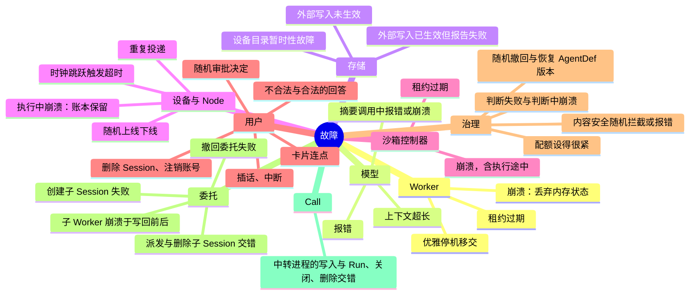
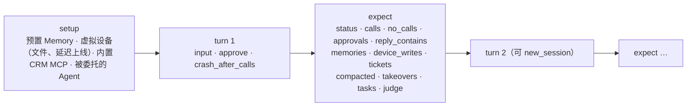
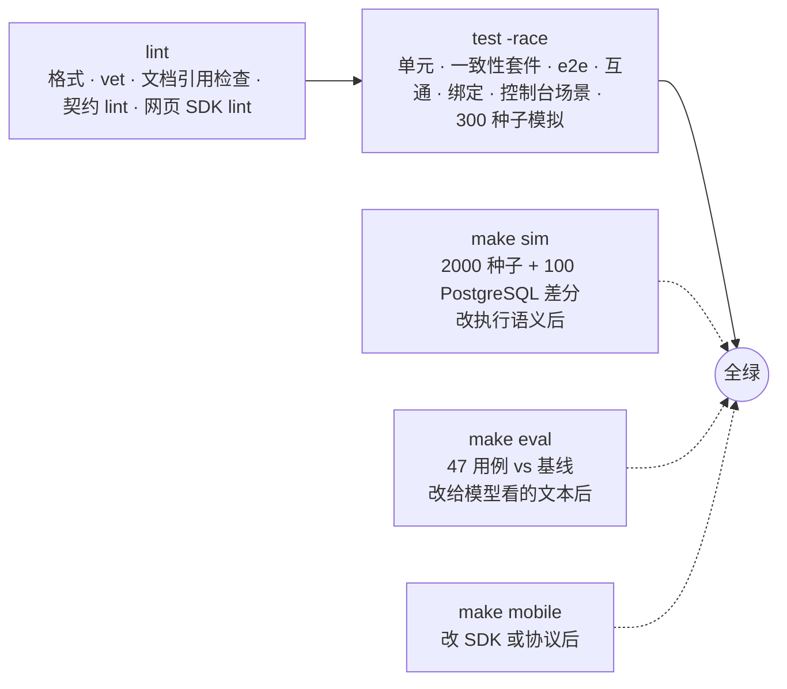

# 08 质量保障

> 本章回答：一个分布式、带随机故障、模型输出不确定的系统，怎样证明自己是对的；"对"分几层、各由什么裁判；提交前的完成标准是什么；为什么评测不在完成标准里却同样强制。

正确性分三层，各有裁判：

| 层 | 问题 | 裁判 | 何时运行 |
|---|---|---|---|
| 执行语义 | 任何故障交错下，日志是否合法、Run 是否收敛、副作用是否至多一次 | 确定性模拟测试 | 改运行时、投影、服务、队列后 |
| 存储契约 | 每种存储的两套实现是否行为一致 | 一致性套件 + 差分模拟 | 每次提交 |
| 效果 | 模型在固定用例上是否做对、是否退化 | 评测与基线 | 改任何给模型看的东西后 |

此外还有单元测试、e2e（真实 HTTP / WebSocket 传输）、网页 SDK 互通测试、移动端绑定测试、控制台验证场景，以及可在真实进程上按需注入的服务端故障。

## 8.1 确定性模拟测试

### 做什么

用固定随机种子驱动多个 Worker、沙箱控制器、Janitor、模拟客户端与模拟设备；所有组件使用虚拟时钟与脚本化模型，ID 由确定性生成器给出。每一步：

```
loop:
    actor = rng.choose(workers + clients + devices + controllers + janitor)
    maybe_inject_fault(rng)          # 崩溃、租约过期、模型报错、存储故障……
    actor.step()                     # Worker.Step 是天然的原子步
    check_invariants()               # 独立于写入方重新投影每个 Session 日志
after faults stop:
    assert all runs reach terminal state within bounded steps   # 活性
```

失败时打印种子与最后几步，同一种子完全复现。默认 300 个种子；完成标准中的 `make sim` 跑 2000 个种子加 100 个 PostgreSQL 差分种子。

### 注入什么



### 检查什么

**日志合法性**：每个 Session 的日志能被 Reduce 接受；由快照加剩余日志恢复的投影与完整回放**逐字节一致**。

**执行语义**：

- 终态后无事件；Attempt 单调；每个调用至多一个结果；至多一个活跃 Run；
- **非幂等调用对同一调用 ID 至多执行一次**（设备、沙箱、委托，即使重复投递、接管、崩溃）；
- 每个 Run 完成时没有未完成的调用；
- 同一输入 ID 至多生效一次；提问不经 Inbox（任何时候都没有投给用户本人的待投递项）；
- 交互 Worker 不为长任务调用模型（成为长任务后应在下一步前移交）；
- 暂时性的目录故障不能一次就让 Run 失败；
- 脚本化模型收到的每个请求估算大小都不超过窗口；上下文中的调用配对完整；每次压缩的截断点都是闭合边界。

**治理**：被拦截的输出原文从不出现在日志中，每个 `ContentModerated` 之后的回复是拒答且没有调用（不变量的镜像与检查点对写入日志的值调用**同一函数**，送检文本不会分叉）；每个 Session 已提交的模型 token 不超过已记录的 token；每层已用金额不超过"限额 + Worker 数 × 单次调用费用上限"；因配额挂起的 Run 在额度恢复后都能结束；注销的 EndUser 不在用量记录中出现；每个新 Run 开始时 Session 的版本不是撤回的版本；判断都是影子模式。

**删除**：删除完成后所有存储中不再有该 Session 的任何数据（对登记列表中的每处检查）；删除记录写入后不再出现该 Session 的新事件、工件、沙箱、在场记录。

**委托**：无环；子 Run 终态后父调用在有限步内有且只有一个结果；父 Run 终态后其所有子 Run 在有限步内终态；父 Session 删除后子 Session 在有限步内删除；深度上限在任何交错下不被突破；子 Session 的来处与父日志一致。

**提醒**：每条提醒对应日志中已写入的事件；同一件事至多提醒一次。

**投影有界**：保留明细的 Run 至多 3 个，摘要与 Run 合起来覆盖日志中的每个 Run。

### 覆盖统计

每类注入的故障与走到的路径都计数（崩溃、接管、结果未知、重投递、压缩、压缩期间崩溃、跨压缩接管、长 Run 完成、丢失唤醒的交错、恢复名额认领、委托、子 Session 删除竞争、级联撤回失败、判断退路、配额挂起与恢复、版本切换、输入与输出拦截、写入闸门审批……约 50 项），确保"注入了但没走到"不会悄悄发生。新增故障类型或路径时，同时注入并加入统计。

### 它发现过什么

模拟测试不是形式上的覆盖，下面是它直接发现、随后成为规则的问题：

| 发现 | 成为的规则 |
|---|---|
| Worker 放弃租约后保留本地投影，下一步再次执行非幂等调用 | 放弃时丢弃全部本地状态（§2.5） |
| 关闭 Session 时沙箱控制器已读到待执行的调用，工作区残留 | 控制器创建或恢复沙箱后复查关闭与删除（§4.6） |
| Session 先被单独删除、之后注销账号，在途用量带着原 EndUser 留下 | Session 已删除（不论原因）即匿名化这条用量（§7.5） |
| 调用开始之后到达的插话使上下文变为含外部内容，写入闸门回头请求审批 | 闸门只在调用开始之前判定（§6.4） |
| 内容安全模拟按 1/12 拦截输出，长 Run 几乎跑不满 | 长 Run 模式下改为约 1/400 |
| 把原子唤醒改回两步、把委托写回去掉、去掉子 Session 的删除复查——分别被活性失败、"已删除的 Session 有事件"发现 | 变异检验：故意去掉机制，测试必须失败 |

**变异检验**是这里的常规做法：去掉输出替换、去掉输入检查、去掉模型调用前的配额检查、去掉写入后的删除检查、去掉 Submit 中的版本切换，分别被对应的不变量发现。这证明不变量不是平凡通过。

### 差分测试

同一种子在内存实现与 PostgreSQL 实现上运行，比较指纹：日志逐字节一致，在场记录、推送设备等旁路数据也纳入指纹。这是"新存储实现必须通过一致性套件并接入差分模拟"（不变量 I7）的后半句。

## 8.2 一致性套件

每一类存储接口有一个套件，内存与 PostgreSQL 实现都必须通过：

| 套件 | 覆盖 |
|---|---|
| 事件日志 | 追加、冲突、读取、删除；**原子唤醒**（追加冲突、提交成功但回包丢失、与停放和删除的交错） |
| 工作队列 | 入队、认领、续租、停放、释放、类别与优先级、分片内有序、租约期间提升为 `Resumed` 后归还不降级 |
| Node 目录与 Inbox | 注册归属、标签去重、Inbox 幂等与监视 |
| 沙箱账本与活跃记录 | 去重状态、空闲回收 |
| 工件元数据与字节 | 不可变写入、按 Session 删除 |
| Session 索引与删除记录 | 列表、按 EndUser 查找、删除记录即刻生效 |
| Memory 与 Grant | 类别过滤、上限、按 Session 删除、按 EndUser 删除、Grant 生效与撤销 |
| 投影快照 | 版本号作废 |
| 用量 | 幂等、时间范围、合计行、匿名化后合计不变、清理 |
| 在场 | 只有显示内容变化才递增版本、过期不列出、等待被变化唤醒、按 Session 删除 |
| 推送设备 | 登记、最近使用、撤销 |

套件写一次，所有实现共用；新增实现只需把它接进来。

## 8.3 评测与基线

### 为什么需要

换模型、改提示词、改 AgentDef、改召回或压缩策略，效果变化无法靠单元测试发现；而"模型可换"（G9）的前提是能客观比较。

> **决策 8.1 · 评测使用仓库内的固定用例集与不同系列的评分模型**（对照 ADR-0018）
>
> **决策**：用例放在仓库中，每个用例多次运行（默认 3 次），确定性断言与模型评分并用，并与提交在仓库中的基线比较，出现回归时失败。评分模型与被评测模型属于**不同系列**（当前为 Codex 的 gpt-6.1-sol），以减少模型偏袒自己回答的倾向。线上 Session 不直接回放，只能经导出工具转为用例骨架，取得用户同意并脱敏后加入。
>
> **取舍与后果**：直接回放线上 Session 覆盖真实分布，但属于对个人信息的再处理。不放进每次提交的完成标准：评测消耗真实 token，结果有波动；改为在相关变更时强制运行。基线是仓库的一部分，有意的效果变化须随代码一起更新基线，评审时可见。阈值偏宽（通过率下降 0.34、评分下降 0.5）以减少误报。
>
> **体现**：换评分模型后评分不可与旧基线比较，基线随之全量重建；因评分模型额度用尽而无法判定的用例不写入基线。

### 用例的形状



- **确定性断言**：调用（glob）、审批次数、状态、回复文本、Memory 存在与不存在、设备副作用、压缩与接管次数、派生任务数。
- **评分断言**：评分模型按标准打 1–5 分，≥ 4 为通过；它看到用户输入、调用及结果摘要（3000 字节）、最终回复。
- **进程内运行**：内存存储、真实模型网关；虚拟设备是进程内的 Node，与 e2e 一样经 Hub、Inbox 路由；沙箱可选；每次运行用新的 EndUser。
- `-model` 覆盖 AgentDef 的模型，在同一用例集上比较不同模型；`-agent-version` 评测尚未成为默认的版本（灰度门槛）。
- `-logs` 保存每次运行的 Session 日志，用于查看摘要内容、调用顺序。

### 用例集（47 个）

| 组 | 检验 |
|---|---|
| 场景 A、多步规划、设备离线恢复、大文件沙箱、MCP 工单 | 端到端能力 |
| 长 Run 账本、压缩后回顾 | 上下文压缩与接管 |
| Memory 系列（保存、召回、更新、冲突、遗忘不复活、健康类、拒绝证件号、投毒、闸门） | 个性化与写入闸门 |
| 审批拒绝、文件注入、界面上下文注入与引用 | 安全默认 |
| ask_user 系列、澄清后发送 | 提问的时机 |
| 卡片系列 | 结构化展示与动作 |
| 委托系列、总管不升权 | 多 Agent |
| 设备歧义消解 | 判断的规则层 |
| Call 系列（以合成语音送入真实通话） | 语音模型只经 run_task 做事 |

评测报告每个用例的通过率、各断言失败次数、评分均值、token 用量、耗时、**缓存命中**，以及平均调用、压缩与接管次数。

### 评测驱动的改动

这些改动都是评测而不是直觉决定的：`ask_user` 工具说明改为以限制开头（提问过度）；真实 Node 的大文件截断附上说明（模型相信了部分内容）；评分模型看到的调用结果从 200 字节放宽到 3000（误判"编造"）；健康类 Memory 的引入；"先按规则省略旧调用结果"不采纳；摘要请求复用主请求前缀；通话指令加上"你自己记不住通话之外的事"；思考强度取 `minimal`（响应速度优先，接受效果下降）。

## 8.4 e2e、互通与绑定测试

| 测试 | 传输 | 覆盖 |
|---|---|---|
| e2e | 真实 HTTP + WebSocket，脚本化模型，内存或 PostgreSQL | 两台设备订阅同一 Session 拼出一致草稿；同一连接既是 Node 又是客户端；他人 Session 不可见；令牌到期重连续订；输入 ID 跨连接去重；两实例共享 PostgreSQL 时互见在场；审批到执行；MCP 远程与桥接；委托级联与孤儿停止；注销用户后 Docker 卷也已移除；Call 的中转顺序、打断、后台任务播报、被取代、关闭；跨实例的 SSE 收到执行实例的增量 |
| 网页 SDK 单元 | 假 WebSocket | Hello 与 client_only、错误码、续订、同 ID 重试、断线结果未知、AbortSignal、草稿与提问规则 |
| 网页互通 | 启动网关，以 Node.js 运行 TypeScript | 晚加入 Snapshot、在场、另一台设备回答、重复回答冲突、duplicate、not_found |
| 移动端绑定 | 字节进出 | 请求与事件、原生能力上传工件、拒绝放在响应中、启动后不能再声明能力 |
| `make mobile`（不在完成标准中） | Xcode、JDK | 生成 xcframework；Swift 冒烟程序在本机与 iOS 模拟器对网关跑一遍；Android 只编译 Java 绑定 |
| 授权矩阵 | HTTP | 每个接口 × {本人、同业务线其他用户、其他业务线、本业务线服务令牌、其他业务线服务令牌、无令牌}；新增接口不加入即失败 |

## 8.5 调试控制台与验证场景

多端语义很难让人看见，也难以手工复现。调试控制台在一个页面里提供三个视图，共用一组模拟设备与当前 Session：

| 视图 | 做什么 |
|---|---|
| **对话** | 一台设备全屏聊天：文字、图片与文件、语音消息、通话；卡片、审批与提问在对话里处理；思考过程可折叠；每次模型调用显示 token、首字延迟、耗时、结束原因；详情抽屉看调用的各步时间、参数与结果 |
| **设备** | 手机、电脑、手表、音箱、车机、网页，各一条 Connection；上线、下线、断网、崩溃；模拟应用状态（闹钟、日程、短信、导航……）；每个能力可切换执行方式：自动、手工填写结果、返回错误、不回应、执行中崩溃 |
| **控制台** | 时间线（按 Run 与 Attempt 分泳道，委托嵌套显示，故障为红线）、事件、帧（可手工构造帧发给网关）、投影、故障注入、进程指标、验证场景 |

控制台**只使用公开的 Connection 协议与 HTTP API**，不比其他客户端多任何权限；唯一的调试专用接口是故障注入与进程指标。模拟设备按协议以文本帧接入，语义与 SDK 一致（续订、同 ID 重试、按调用 ID 记账），便于用它检查网关。

**脚本化模型**让没有模型密钥时也能演示与验证：按最后一条输入中的命令行事（调用某工具、提问、流式输出、输出思考），结果确定；e2e 用同一个模型。

**验证场景**（18 个，一键运行，也在完成标准中以 Node.js 跑一遍）：多端实时同步、晚加入者补齐草稿、断线续传、输入去重、设备能力路由、高风险审批、设备离线挂起与恢复、执行中崩溃的重投递与去重、提问由另一台设备回答、插话与中断、在场与正在输入、他人 Session 不可见、思考过程、卡片、委托、子 Agent 提问、服务端故障注入、图片与设备返回的工件。新增多端语义时，同时在这里增加场景。

### 服务端故障注入

> **决策 8.2 · 服务端故障注入只在调试部署中开启**（对照 ADR-0033）
>
> **背景**：控制台原先只有设备侧的故障，执行语义里更重要的部分（模型失败与重试、流中断、Worker 崩溃后被接管、内容安全不可用）只有模拟测试覆盖，在真实进程上看不见。
>
> **决策**：`serve -faults` 开启，默认关闭。开启时在模型提供商、内容安全提供商、设备目录查询外各包一层，Worker 每步之后检查是否"崩溃"；没有规则时这些包装不改变任何行为。故障类型与模拟测试对应（模型错误、限流、流中断、延迟、Worker 崩溃、内容安全不可用、目录不可用），注入的是与真实故障**相同的错误**，走相同的处理路径。规则经调试接口管理，可限定 Session 与次数；用户令牌只能对自己的 Session 注入。规则只在进程内存、只影响本进程；每次注入记录规则、类型与 Session ID，不含内容。
>
> **取舍与后果**：没有选按环境变量注入（要重启，不能在观察一次交互时按需注入）；没有注入存储故障（模拟已覆盖，真实数据库上注入代价与风险更高）。上线清单要求生产不带 `-faults`。

## 8.6 完成标准

**`make check` 是提交前的完成标准，必须全绿。** 它包含：



需要 Docker（PostgreSQL、S3 兼容存储、沙箱镜像）与 Node.js、pnpm；对应测试由环境变量启用，未设置时跳过。文档引用检查保证文档中提到的路径与标识符存在。

两条"不在完成标准里但同样强制"的纪律写在仓库的工作约定中：改动运行时、投影、服务、队列后运行 `make sim`；改动模型、提示词、AgentDef 或任何给模型看的文本后运行 `make eval` 并与基线比较。前者约 10 分钟，后者约 20 分钟并消耗真实 token，所以不放进每次提交的标准，但评审时检查。

## 8.7 压测与观测

**压测方法**不依赖真实模型：压测模型按参数模拟延迟与工具调用（一个 Run 含 3 次模型调用、2 次工具调用）；压测客户端并发打开 S 个 Session、连续提交 Run，测吞吐、端到端延迟与首个增量延迟；编排脚本起 P 个进程各 W 个 Worker，抓取指标。

**首轮结果**（开发机，PostgreSQL 在 Docker 中）：1 → 2 → 4 进程吞吐 50.5 → 102.6 → 185.6 Run/s（3.67×，相对理论上限 87%）；稳定负载下杀掉一个进程，6812 个 Run 全部完成，被杀进程的 32 个 Run 全部被接管，被接管的 Run 多花的时间等于租约 TTL（默认改为 10 秒后为 11.3 秒）；空闲查询从每秒 1218 次降到 4.2 次。

**指标**（Prometheus，暴露在内部地址）：模型调用耗时与 token（含缓存命中与思考）、重试、准入等待、总时限超时；Run 终态与时长（按 Agent 版本）；Attempt（开始 / 接管 / 恢复）；提交冲突；Session 加载事件数与耗时；队列认领结果、等待时长、积压与最老等待；压缩；HTTP 请求；连接数与跨进程增量流；握手拒绝；内容安全检查与切换；用量金额与配额拒绝；判断结果；注入的故障。指标只记 ID 与业务线名，不记内容。

## 8.8 本章的决策

| 决策 | 小节 | 对照 |
|---|---|---|
| 评测使用固定用例集与不同系列的评分模型 | §8.3 | ADR-0018 |
| 服务端故障注入只在调试部署中开启 | §8.5 | ADR-0033 |
| 确定性模拟是执行语义的裁判 | §8.1 | 不变量 I6 |
| 新存储实现必须通过一致性套件与差分模拟 | §8.2 | 不变量 I7 |

## 状态

全部 ✅。链路追踪 ⚪；生产规模的容量矩阵须在目标环境实测 ⚪。
