# 09 决策总表

> 本章回答：项目至今做出的全部架构决策是什么、各自在本套文档的哪一节展开。每条决策的"背景 → 决策 → 取舍与后果 → 体现"都写在所属章节里，本章只做导航与全局观。

## 9.1 按主题

### 事实源与执行

| # | 决策 | 一句话 | 展开 | 状态 |
|---|---|---|---|---|
| D-04 | Event 日志是 Run 状态的唯一事实源 | 状态只由日志投影得到；Worker 无状态，以租约认领、以 Attempt 号 fencing | §2.2 | 采纳 |
| D-12 | 上下文压缩记录为 Event | 摘要与截断点写进日志，重放确定、受 fencing 约束、原始事件不删 | §3.3 | 采纳 |
| D-13 | 实时增量从执行进程直接拉取 | 执行进程地址记在 `AttemptStarted`，订阅方跟随日志；不用 NOTIFY 广播也不引入消息中间件 | §3.4 | 采纳 |
| D-29 | 工作队列按类别认领 | 入队带业务线与优先级；长任务按服务量判定；交互 Worker 移交长任务；审批后的恢复名额 | §3.6 | 采纳，2026-10-11 修订 |
| D-34 | 思考过程流式推送并随回复写入日志 | 与正文分开累积，32 KB 截断，过内容安全，不发回模型 | §3.4 | 采纳 |
| — | 外部写入与唤醒原子提交 | 输入、审批、回答、Node 结果的追加与入队在同一事务；无原子实现时报错不退回两步 | §2.8 | 不变量 I8 |
| — | 投影有界、历史访问改读日志 | 旧 Run 只留摘要、调用 ID 分层共享；重放与快照等价 | §2.6 | 延展性评审裁决 |

### 能力与路由

| # | 决策 | 一句话 | 展开 | 状态 |
|---|---|---|---|---|
| D-02 | 设备即节点 | 端侧能力经嵌入 HostApp 的 SDK 以 Node 身份暴露；离线是一等语义 | §4.2 | 采纳 |
| D-08 | 沙箱内不放任何受信组件 | 受信控制器在沙箱外作为 Node；沙箱无网络、无凭证 | §4.6 | 采纳 |
| D-09 | 每个 Session 一个沙箱工作区 | 跨 Run 保留文件系统，空闲回收计算、保留工作区 | §4.6 | 采纳 |
| D-10 | 生产沙箱运行在 Kubernetes + gVisor | 可能改用云厂商沙箱服务，须与私有化约束一并决定 | §4.6 | **暂缓** |
| D-11 | 以 S3 API 作为工件存储契约 | 只依赖 S3 协议；设备与沙箱经平台 API 上传下载 | §4.7 | 采纳 |
| D-17 | MCP Server 作为 Capability 提供者 | 远程由 Worker 以业务线凭证调用，本机经设备桥接；未声明只读默认审批 | §4.8 | 采纳 |
| D-25 | Agent 的提问是路由到用户本人的调用 | `ask_user` 沿用路由调用生命周期，目标 `@user`，不经 Inbox，不新增事件 | §4.4 | 采纳 |
| D-31 | 委托是路由到派生子 Session 的调用 | Agent 即 Capability；子 Run 继承全部语义；结果由子 Worker 写回；权限取交集 | §4.9 | 采纳 |
| D-32 | 卡片是 show_card 的结果，卡片动作是一条输入 | 平台校验后写入结果；不阻塞；动作按版本核对、按动作去重 | §4.5 | 采纳 |

### 多端与协议

| # | 决策 | 一句话 | 展开 | 状态 |
|---|---|---|---|---|
| D-05 | 实时交互（Call）与异步执行（Run）分离 | 媒体不进日志；耗时工作由 Call 派生 Run，结果回注 | §5.7 | 采纳 |
| D-06 | 以 Protobuf 作为跨端与存储契约 | 同一契约既是日志格式也是传输格式；只做向后兼容的修改 | §5.6 | 采纳 |
| D-24 | 每个 HostApp 实例一条 Connection | 兼任 Node 与会话客户端；请求与 HTTP 走同一路径 | §5.1 | 采纳 |
| D-26 | 端侧 SDK 共享契约 | 移动端绑定 Go 核心，网页按协议实现，消息类型一律生成 | §5.6 | 采纳 |
| D-27 | Call 经网关中转，语音模型只通过 run_task 做事 | 设备不直连厂商；Agent 能力不直接交给语音模型 | §5.7 | 采纳 |

### 信任与安全

| # | 决策 | 一句话 | 展开 | 状态 |
|---|---|---|---|---|
| D-03 | Memory 默认归属业务线，经授权共享 | 不做全局画像，也不完全隔离；Grant 可撤销 | §6.3 | 采纳 |
| D-14 | 由业务线签发短期令牌，平台只验证 | JWT，平台只持公钥；404 不泄露存在性；不做吊销列表 | §6.1 | 采纳 |
| D-15 | Session 数据以物理删除方式清除 | 先写删除记录、再由 Janitor 物理删除；不选加密销毁 | §6.7 | 采纳 |
| D-16 | 召回记为 Event，Grant 按业务线对 + 类别 | 召回同时是访问记录；撤销从下一个 Run 起生效 | §6.3 | 采纳，健康部分由 D-22 修订 |
| D-21 | 内容安全在写日志之前检查，失败即拒绝 | 违规原文不进日志；提供商不可用不放行 | §6.2 | 采纳 |
| D-22 | 健康信息按业务线的单独同意开启 | 独立类别；业务线声明已取得同意才能写入与召回 | §6.3 | 采纳 |
| D-23 | Memory 写入闸门 | 外部内容影响下、用户原话中无依据的写入须经批准；只收紧 | §6.4 | 采纳 |
| D-30 | 判断记为 Event，只收紧不放宽，失败退默认 | 规则、小模型、LLM 分层；影子模式先行 | §6.5 | 采纳 |

### 存储与部署

| # | 决策 | 一句话 | 展开 | 状态 |
|---|---|---|---|---|
| D-01 | 私有化部署，不依赖公有云托管服务 | 全部可自托管、无外网运行；外联显式列出可替换 | §7.7 | 采纳 |
| D-07 | 以 PostgreSQL 作为持久化存储基线 | 一个组件覆盖全部存储接口；按 Session 分片扩容 | §7.2 | 采纳 |
| D-19 | 用量独立于日志计量，配额为软上限 | 不含 Session 与内容；返回后、写日志前计量；不做预留 | §7.5 | 采纳 |
| D-20 | AgentDef 灰度按 EndUser 分流，回滚以事件切换 | 配置文件热加载；稳定分流；`AgentSwitched` | §7.6 | 采纳 |
| D-28 | 数据按 Session 或 EndUser 分片 | 两类键写成契约；一条 SQL、一个事务只涉及一个键 | §7.3 | 采纳 |
| — | 模块化单体、按角色分进程 | 进程边界沿扩缩容、权限与故障域；不按领域拆服务 | §7.7 | 部署设计 |

### 质量

| # | 决策 | 一句话 | 展开 | 状态 |
|---|---|---|---|---|
| D-18 | 评测使用固定用例集与不同系列的评分模型 | 基线随仓库提交；不回放线上 Session；不放进完成标准但强制 | §8.3 | 采纳，评分模型 2026-10-11 修订 |
| D-33 | 服务端故障注入只在调试部署中开启 | `-faults` 时装配；无规则时不改变任何行为；注入真实错误 | §8.5 | 采纳 |

编号 D-xx 对应仓库决策记录 ADR-00xx，便于互查。

## 9.2 决策之间的依赖

```mermaid
flowchart TB
    D01["D-01 私有化"] --> D07["D-07 PostgreSQL"]
    D01 --> D11["D-11 S3 契约"]
    D01 --> D14["D-14 业务线签发令牌"]
    D01 --> D13["D-13 增量直接拉取"]
    D04["D-04 日志是事实源"] --> D12["D-12 压缩是 Event"]
    D04 --> D16["D-16 召回是 Event"]
    D04 --> D30["D-30 判断是 Event"]
    D04 --> D20["D-20 灰度以事件切换"]
    D04 --> D21["D-21 写日志前检查"]
    D04 --> D13
    D02["D-02 设备即节点"] --> D08["D-08 沙箱控制器是 Node"]
    D02 --> D17["D-17 MCP 桥接"]
    D02 --> D25["D-25 提问是路由调用"]
    D02 --> D31["D-31 委托是路由调用"]
    D02 --> D24["D-24 一条 Connection"]
    D24 --> D26["D-26 SDK 共享契约"]
    D06["D-06 Protobuf 契约"] --> D26
    D06 --> D32["D-32 卡片是内容块"]
    D05["D-05 快慢分离"] --> D27["D-27 Call 经网关"]
    D15["D-15 物理删除"] --> D19["D-19 用量独立于日志"]
    D15 --> D18["D-18 不回放线上数据"]
    D03["D-03 Memory 归属业务线"] --> D16
    D16 --> D22["D-22 健康类单独同意"]
    D16 --> D23["D-23 写入闸门"]
    D23 --> D30
    D07 --> D28["D-28 分片键"]
    D28 --> D29["D-29 工作类别"]
    D10["D-10 K8s + gVisor（暂缓）"] -.-> D08
```

读图：三个根决策——**私有化**（限定能用什么组件）、**日志是事实源**（限定状态怎么来）、**设备即节点**（限定能力怎么接）——几乎推出了其余全部。评审时如果要质疑一条决策，先看它的上游：上游不变，下游通常没有别的选择。

## 9.3 被拒绝的方案

把各决策"没有选什么"集中列出，评审时常被问到：

| 没有选 | 原因 | 对应决策 |
|---|---|---|
| Temporal 等工作流引擎 | 自研日志 + fencing 经确定性模拟验证即可，少一个组件 | D-04 |
| Kafka / Pulsar 作日志 | 乐观并发追加与按 Session 随机读不便，仍需另一个库 | D-07 |
| FoundationDB | 私有化运维门槛高 | D-07 |
| NOTIFY 广播 token 增量 | 提交时全局锁串行化；开销随"速率 × 进程数"增长 | D-13 |
| NATS / Redis 作事件总线 | 私有化多一个组件；PG 内可先做共享 feed 与小事件内联 | D-13、评审裁决 |
| 在沙箱内运行 SDK 连回网关 | 不可信代码与凭证同处一个环境 | D-08 |
| 每次调用一个干净沙箱 / 每个 EndUser 一个 | 无法多步协作 / 跨 Session 污染 | D-09 |
| 云端运行 stdio 型 MCP Server | 不可信代码，沙箱又无网络，边界需另设计 | D-17 |
| 用户级 OAuth（MCP） | 令牌保管与删除的工作量与风险显著更大 | D-17 |
| 新增"提问 / 回答"事件类型 | 路由调用已有全部语义 | D-25 |
| 在一个 Run 内开子线程 / 父 Worker 轮询 / 专用编排服务 | 另做一套恢复与计量 / 占 Worker / 新增组件 | D-31 |
| 只用 Markdown / Adaptive Cards / 模型直接输出结构化内容 | 做不到回传 / 体量大 / 校验失败无处交还 | D-32 |
| 为会话客户端另开一条连接 | 耗电、重连逻辑重复 | D-24 |
| Go 核心编译 WebAssembly 用于网页 | 体积 MB 级；网页不需要执行器与账本 | D-26 |
| 设备直连语音模型厂商 / 厂商 RTC | 要下发 API Key / 多一个产品，私有化更难 | D-27 |
| 业务线服务端调用平台换取令牌 / OIDC | 多一次往返且平台持私钥 / 各业务线体系不同 | D-14 |
| 加密销毁 | 每次读写加解密；私有化不一定有 KMS | D-15 |
| 写入后再标记违规内容 | 每个读取路径都要过滤 | D-21 |
| 组装上下文时临时检索 Memory | 结果随时间变化，无访问记录 | D-16 |
| 按单条授权 / 整业务线授权 | 用户无从判断 / 粒度过粗 | D-16 |
| 用小模型判断 Memory 内容是否可疑 / 一律审批 | 准确率不足且非确定 / 打扰用户 | D-23 |
| 判断高置信度时免审批 | 把分类器变成安全闸门 | D-30 |
| 直接回放线上 Session 评测 | 个人信息再处理 | D-18 |
| 评测放进 `make check` | 消耗 token 且结果波动 | D-18 |
| 全按 Session 分片 / 全按 EndUser 分片 | 用户级查询要遍历 / 只带 Session ID 的请求要先查归属 | D-28 |
| 按时间判定长任务 / AgentDef 声明优先级 | 积压时成批降级 / 无声明的得不到保护 | D-29 |
| 额度预留 | 需预估费用与退回，小额调用不值得 | D-19 |
| 数据库加管理接口做发布配置 | 要新增平台管理员身份；十秒不一致无害 | D-20 |
| 按环境变量注入故障 / 注入存储故障 | 要重启 / 真实数据库上风险高且模拟已覆盖 | D-33 |
| 先按规则省略旧调用结果再摘要 | 评测负面：汇总类任务重新读取、token 翻倍 | §3.3 |
| 按领域拆微服务 | 损害热路径、单键事务、确定性模拟、单进程可运行 | §7.7 |
