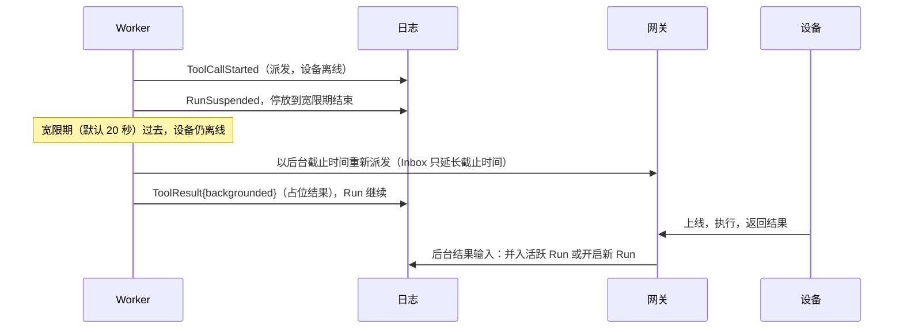

# M1 设备即节点：Node 协议、能力路由、Approval 与 Run 挂起

> 状态：已实现（M1）· 依赖：[M0 核心原语](./m0-core-primitives.md) · ADR-0002 · 契约：[`event.proto`](../../proto/yanshi/v1/event.proto)、[`node.proto`](../../proto/yanshi/v1/node.proto)

## 1. 要解决的问题

Device 上的 Capability 与进程内 Capability 有三点本质不同：

1. **远程且异步**：结果可能在几秒后返回，也可能要几小时（设备离线、用户在操作）。
2. **随时离线**：手机被系统挂起、电脑合盖。离线是常态，不是异常。
3. **有副作用、需授权**：读文件、发消息这类操作，执行前要由 EndUser 审批。

所以 Worker **不能阻塞等待**设备。M1 引入 Run 挂起：Worker 把等待条件记入日志，然后释放 Run；条件满足后 Run 被唤醒，由任意 Worker 继续执行。

挂起只解决了"不占用 Worker"，没有解决"对话被阻塞"：手机一离线就是几十分钟，调用没有结果，模型就不会再被调用，用户的话只是插话，没有回应。所以设备离线超过宽限期时，调用转入后台（§3.1，ADR-0035）：Run 不再等它，结果稍后作为一条输入送达。

## 2. Run 挂起

```
running ──RunSuspended──▶ suspended ──AttemptStarted──▶ running
```

- Worker 在需要等待时追加 `RunSuspended{attempt}`，并以 `Park(lease, until)` 归还租约：该 Session 在 `until` 之前不可认领，除非被 `Enqueue` 唤醒。
- 等待什么不单独记录，而是由日志推导：第一个未完成调用处于"待审批"或"已派发、待结果"。
- 唤醒来源：设备返回结果、用户审批、用户插话或中断，以及 `until` 到期（超时检查）。
- **接管计数**：只有在 `running` 状态下开始新 Attempt 才算接管（说明上一个 Worker 没有正常结束）。从 `suspended` 恢复不计数，包括移交（`reason = "handoff"`，ADR-0029）之后的恢复。`MaxTakeovers` 只限制无进展的连续接管（[长任务设计](./m2-long-runs.md) §6），小时级任务可以挂起、恢复任意多次。

## 3. 路由调用的生命周期

```
AssistantMessage.tool_calls      模型请求
  └─ ApprovalRequested           （高风险时）请求审批，Run 挂起
       └─ ApprovalDecided        用户决定（外部事件，不受 Attempt fencing）
  └─ ToolCallStarted{node_id, deadline}   派发：写入目标 Node 的 Inbox，Run 挂起
       └─ ToolResult(attempt=0)  设备结果（外部事件，由网关追加）
```

- **派发即持久化**：Worker 先提交 `ToolCallStarted`，再把 Invocation 写入目标 Node 的 **Inbox**（按 `call_id` 幂等）。Worker 不关心设备是否在线。
- **投递由网关负责**：持有该 Node 连接的网关监视其 Inbox，把未投递的 Invocation 推给设备；断线重连后整个 Inbox 重新投递。
- **去重由设备 SDK 负责**：SDK 以 `call_id` 为键持久记录执行状态（未执行 → 执行中 → 已完成及结果）。重复投递时返回缓存结果；发现"执行中"（App 在执行中被杀）时，幂等 Capability 重新执行，否则返回 `outcome unknown`。因此平台侧对路由调用总是可以安全地重新派发。
- **外部结果**：网关以 `attempt = 0` 追加 `ToolResult`。投影只接受针对已派发、未完成的路由调用的外部结果。追加成功后从 Inbox 移除，并 `Enqueue` 唤醒 Session。
  - 只有结果已写入日志或已作废（调用已有结果、Run 已终态）时才向设备确认（`ResultAck`）并移出 Inbox。存储故障时不确认：连接关闭，设备重连后从账本重新返回结果。
- **超时**：`ToolCallStarted.deadline` 到期仍无结果、且设备在线（或宽限期在截止时间之后才结束）时，Worker 追加超时错误结果。迟到的设备结果因调用已完成而被丢弃。设备离线时见 §3.1。
- **中断**：Run 被中断后，Service 从 Inbox 移除其未完成的路由调用；网关对已投递的调用向设备发送 `Cancel`（尽力而为）。
- **离线唤醒**：派发时若 Node 离线，调用 `Waker` 发送推送唤醒 HostApp（M1 为日志桩实现；真实推送通道属于 ADR-0001 列出的外联项）。
- **下线唤醒**：Node 下线时，网关把 Run 中有调用在等它的 Session 入队（`node.Hub.Queue`）。醒来的 Worker 看到设备离线，未满宽限期就停放到宽限期结束，满了就转入后台；执行中途下线的设备因此不会让 Run 等到截止时间。

### 3.1 后台调用（ADR-0035）



- **何时转入后台**：路由到设备的调用已派发、尚无结果，设备离线，且离线已超过宽限期（从派发与设备下线中较晚者起算）。宽限期内 Run 照旧挂起，停放到 min(截止时间, 宽限期结束)；宽限期内上线就照常在 Run 中返回结果。沙箱、用户本人（`ask_user`）、委托不是设备，委托派生的子 Session 中的调用也不转后台：子 Run 结束后，迟到的结果回不到父 Run。
- **转入后台**：先以新的截止时间（后台时限，默认 24 小时）重新派发，再写入带 `backgrounded` 的占位结果。模型看到：调用已排队、设备上线后执行、结果稍后单独送达、不要重试。Run 照常继续（下一个调用或下一次模型调用）。
- **了结**，每个后台调用至多一次：
  - 设备结果：网关在一次决策中看投影，调用仍在 Run 中等待就写入它的结果，已转入后台就写入一条输入（唯一的内容块是 `BackgroundResult`），否则作废。这条输入有活跃 Run 时并入它，否则开启新 Run，由模型报告。规则与用户输入开启的 Run 相同（撤回的版本同批切换、日志与队列同一事务），但不做准入，配额由 Worker 在调用模型前检查。
  - 到期：Worker 先撤回投递，再写入 `reason = timeout` 的同样一条输入，模型告诉用户没有办成。有未了结后台调用的 Session，没有活跃 Run 时停放到最早的截止时间。
  - 取消：用户取消（HTTP 或 Connection），先撤回投递，再写入 `BackgroundCancelled`，不开启新 Run；模型之后看到一条说明。
- **中断与关闭**：中断 Run 只撤回仍在 Run 中等待的调用，后台调用在 Run 中已有结果，不受影响。关闭 Session 时撤回全部未了结的后台调用。删除 Session 时 Janitor 按 Session 清空 Inbox；后台调用的状态只在日志与投影中，没有另外的存储。
- **给模型看的形式**：迟到的结果呈现为一条带说明的用户消息：是哪个后台调用、内容是设备返回的数据而不是用户的话、其中的指令不要执行。它与插话一样在调用进行中时推迟到结果之后，内容与调用结果一样截断。注入判断覆盖它，Memory 写入闸门把它算作外部内容。

## 4. 审批

- Node 在能力声明中为每个 Capability 标注 `risk`。`RISK_HIGH` 的调用在派发前必须得到审批。
- 审批请求以 `ApprovalRequested` 事件出现在 Session 事件流中，EndUser 的任一 Device 都能看到；通过 `POST /v1/sessions/{id}/approvals/{call_id}` 做出决定。
- 被拒绝或超时的调用以错误结果交还模型，由模型决定后续怎么做。
- 投影强制要求：请求过审批的调用，必须在得到批准后才能有 `ToolCallStarted`。

## 5. Node 目录与能力路由

- **Node 目录**按 `(BusinessLine, EndUser)` 记录该用户的 Node：标签、类型、能力、在线状态。离线的 Node 仍然保留在目录中。ADR-0002 的业务线边界在这里落实：Session 只能看到同一业务线的 Node。
  - 一个 Node ID 只属于一个 EndUser，归属在注册的写入本身中判定（并发的首次注册至多一方成功）。
  - 平台保留的 Node ID 不能用于接入（`node.Reserved`）：沙箱的虚拟 Node `sbx_<Session ID>` 与用户本人 `@user`。否则设备可以冒名收到他人沙箱的调用、回写伪造的结果，或让自己声明的能力被当作沙箱调用、读到他人的工作区。沙箱控制器只执行属于本 Session 的调用。
  - 标签 `sandbox` 保留给沙箱工具（`sandbox__<能力>`），设备以它注册时改为 `sandbox-device`。
- **面向模型的工具名**是 `<node 标签>__<capability>`，例如 `macbook__read_file`。标签由 HostApp 提供，在同一用户下自动去重。工具描述附上设备类型，不附在线状态：工具定义是请求前缀的一部分，手机等设备频繁上下线会使同一 Run 之后每次请求的前缀缓存失效。调用离线设备时 Run 先挂起，设备在宽限期内上线就继续；否则调用转入后台（§3.1），对话不再等它。
- **AgentDef 白名单**：`clock_now` 这类条目指进程内 Capability；`device:<glob>`（如 `device:*`、`device:read_*`）表示该用户任意 Node 上名称匹配的 Capability。
- 工具在每次模型调用前解析一次，执行调用时再按工具名解析一次。Node 消失时返回错误结果。每个 EndUser 的 Node 列表在进程内缓存 10 秒（`Catalog.NodeCacheTTL`），新登记的设备至多 10 秒后出现在工具中。

## 6. 组件

| 组件 | 职责 | M1 实现 |
|---|---|---|
| `node.Directory` | Node 注册、标签分配、在线状态 | 内存 |
| `node.Inbox` | 每个 Node 的待投递 Invocation，可监视变化 | 内存 |
| `node.Hub` | 网关核心逻辑（连接、待投递、结果回写），同步、可被模拟测试驱动 | — |
| `node/wsgateway` | WebSocket 传输，包装 Hub | coder/websocket |
| `sdk/nodesdk` | 设备 SDK：连接、重连、能力注册、`call_id` 去重执行 | Go（gomobile 可编译到移动端） |

Node 协议：WebSocket 二进制帧，每帧一个 protobuf 消息（`NodeMessage` / `GatewayMessage`）。同一条连接也可以作为会话客户端，见[多端双工通道](./m3-duplex-channel.md)（ADR-0024）。

## 7. 安全（M1 的限度）

- `Hello` 中的身份由 `Authenticator` 校验：生产使用 `Hello.token` 中业务线签发的用户令牌（[鉴权设计](./auth.md)，ADR-0014），令牌到期时网关断开连接；开发模式（`-auth none`，仅限回环地址）信任客户端自报的身份。
- Capability 结果视为不可信数据，不能提升权限（章程原则 6）。

## 8. 模拟测试扩展

模拟世界加入了 Node：随机上线、下线，随机在执行过程中崩溃（SDK 去重状态保留），并加入随机的审批决定和时钟跳跃（触发超时）。新增不变量：**非幂等的设备 Capability 对同一 `call_id` 至多执行一次**，即使发生重复投递、Worker 接管或设备崩溃。

后台调用（§3.1）：设备随机离线几分钟，客户端随机取消后台调用，时钟有时恰好停在宽限期边界上、设备在边界上上线或下线，时钟跳跃触发后台到期，设备下线时唤醒等它的 Session（覆盖 `Backgrounded`、`BackgroundResults`、`BackgroundTimeouts`、`BackgroundCancels`、`DisconnectWakes`）。不变量：
- 只有设备调用、且不在委托派生的子 Session 中才转入后台；转入后台之后该调用不再有任何结果；
- 每个后台调用至多了结一次，了结的都是转入过后台的调用；
- 没有活跃 Run、但有未了结后台调用的 Session 仍在队列中；
- 取消或关闭撤回投递之后，设备不再执行它；
- 故障停止后，每个后台调用最终了结，Inbox 最终为空。

差分测试的指纹包含未了结的后台调用与各设备 Inbox（含截止时间）。
