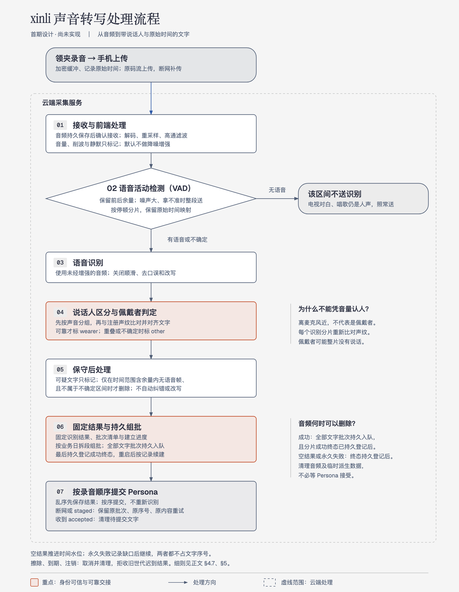

# xinli 的声音转写方案

> 状态：设计（未实现），2026-11-01 · 取代原“语音识别选型与评测”系列：选型对象从 ASR 扩大为整条转写链路 · 配套：[评测](./xinli-transcription-eval.md)、[评分表](./xinli-transcription-scorecard.md)、[领夹与 HostApp](./xinli-transcription-hardware.md) · 调研：[链路组件](../research/2026-11-xinli-transcription-components.md)、[ASR 厂商](../research/2026-11-xinli-asr-vendors.md) · 依赖：ADR-0036、ADR-0050；[Persona 架构](./persona-architecture.md) §4.1；[旁听业务线 xinli](./xinli-captures.md) 的有序文字采集 · 术语见 [xinli 应用层术语](../../apps/xinli/CONTEXT.md)

本文回答：从领夹录下的声音，到交给 Persona 的带说话人的文字片段，中间每一环做什么、放在哪里、哪些要通过评测来选。怎么评、怎么选见[评测](./xinli-transcription-eval.md)；本文可独立阅读，背景在 §1。

## 0. 结论

1. **选型对象是整条转写链路**（§3），不只是 ASR。前端处理、语音检测与分片、识别、说话人与佩戴者判定、后处理都是可替换的环节；评测与选型的单位是“链路配置”，即每一环各选一种实现的组合（[评测](./xinli-transcription-eval.md) §1）。
2. **源头优先。** 整理 Agent 只读文字、听不到音频，音频识别后即删除；链路丢掉或改错的内容，后面无法可靠修复（§2）。所以越靠前越保守：宁可多送、多标记，不删、不改写。
3. **硬件不变。** 现有领夹没有端侧 VAD 与佩戴者发声信号。首期处理都在云端采集服务；稳定后，高通滤波、轻量增强与 VAD 可原样迁到 HostApp，减少上传流量（§4.1）。下一代硬件的要求见[领夹与 HostApp](./xinli-transcription-hardware.md)。
4. **原始音频送识别。** 公开证据一致表明，增强（降噪）后再送识别通常更差；首期送识别与语音检测都用原始音频，“增强副本供 VAD”“增强后送识别”只作评测变体，实测更好才采用（§4.2）。
5. **佩戴者判定只靠声音本身。** 已注册佩戴者的声纹是主要依据，近场声学特征只作辅助；证据不足一律 `other`（§4.5）。
6. **后处理不改写原话。** 首期不做大模型纠错与数字规范，关闭识别接口的顺滑与敏感词替换；幻觉过滤只删除时间范围内没有语音帧的输出（§4.4、§4.6）。
7. **识别前的语音检测是主要成本杠杆。** 主流接口按送入时长计费；佩戴、送识别、计费三种时长分开计量（§6）。

## 1. 背景

### 1.1 xinli 做什么

用户全天佩戴一个领夹式录音设备。xinli 把用户一天里与他人的对话整理成交谈摘要，按主题归到项目里；记下双方的承诺（“我周五前把方案发你”“你下周三来复查”），在之后的对话中出现改期、完成或取消时修订它们，并按期限提醒；每周回顾沟通习惯；用户也可以随时提问，比如“还有哪些没办完”。

这些功能都建立在转写出的文字之上。转写错了，后面的摘要、承诺与提醒都会跟着错。

### 1.2 转写的产出

链路的产出是一组文字片段，每段包含：

| 字段 | 含义 |
|---|---|
| 说话人 | `wearer`（佩戴者），或 `other`、`other-<标识>`（他人，标识用来区分不同的他人） |
| 文字 | 这一段说的话，每段 1–2000 字 |
| 时间 | 说这段话的时间，带时区 |
| 他人的身份（可选） | 业务线比对声纹后给出的稳定 ID，例如同一位同事在不同天都是 `P-0012`；只有他人可带 |

片段按批次提交，每批 1–200 段（`capture.Segment`、`capture.Batch`）。供应商的片内编号只表示局部聚类，不能按编号、发言顺序或发言时长映射为 `wearer`。不能确认的文字按 `other` 处理；不确定的原因只在受控评测记录中区分，不新增内核说话人类型。跨分片不能直接复用供应商局部编号表示同一他人；需由适配器限定标识作用域并遵守整个标签 32 字符的约束，稳定身份另按可选的 `speaker_ref` 处理。

片段只有上面四个字段。链路内部产生的置信度、背景或媒体标记不随片段交出；要交给 Persona 或整理 Agent，须先改采集契约与可信页的渲染（§4.6、§9）。

### 1.3 已经确定的约束

- **说话人决定信任。** 佩戴者的话算用户本人的话；他人的话算外部内容，与网页、邮件同等对待。记忆的写入、对指令性内容的警惕，都依据说话人字段（ADR-0036、ADR-0050）。系统无法自行验证这个标签，所以**把他人的话标成佩戴者，会让外部内容被当作用户原话**，既是效果问题，也是安全问题（具体后果见[评测](./xinli-transcription-eval.md) §5.3 的 T1）。
- **承诺按说话人核对。** 整理 Agent 交出的每条承诺都要引用原话。“我答应的”至少要引用一段佩戴者的话，“对方答应的”至少要引用一段他人的话，否则标为“未核实”：照常展示，但不按期限提醒。说话人标错，承诺要么记到错的人头上，要么因为核对不通过而不提醒。
- **音频不保留。** 音频及由它派生的增强副本、语音检测与说话人特征，只在识别完成之前缓存；网络故障时由 HostApp 暂存，之后补传。“识别完成”指**识别分片已持久登记终态**，不等 Persona 接受：成功时，它产生的全部文字批次已落盘到待提交队列（`Sender.Enqueue` 之后）；结果为空或永久失败时，相应终态已持久登记。在此之前删除音频会让内容永久丢失（§4.7、§5）。
- **日志不记内容。** 日志与指标只记 ID（分片、会话等）、时长与计数，不记文字。
- **识别不进内核。** 整条链路在应用层（采集服务与 `apps/xinli/recognition`）；内核只渲染、审核 Persona 返回的可信页（ADR-0050）。
- **已有接入。** “按住说话”已接入火山引擎的录音文件识别极速版（[按住说话](./speech.md)）。它识别的是几秒钟的一句话，与全天旁听的需求不同，不能直接沿用为结论。

### 1.4 xinli 对转写的特殊要求

1. **归属与转写分别验收。** 他人被标成佩戴者会提升外部内容的信任，不能被较低的字错率或价格抵消；全部降为 `other` 或漏掉整句也不算合格，要同时检查佩戴者召回与漏识别。
2. **三个说话人问题分开。** 片内区分回答“哪些话是同一个人说的”；跨分片佩戴者判定回答“这些话是不是已知的用户本人”，是必测项；跨分片、跨天识别同一位他人是可选能力，不作为首期前提。声纹 ID 可跨请求复用，不代表实际识别已稳定，更不能假定每片都有佩戴者发言。
3. **新鲜度以分钟级为目标，但批处理不天然满足。** 每日整理可以异步，随时提问需要当天较新的原文。以从说完话到业务线可查询的延迟和完整账单选择，不预设批处理便宜很多。
4. **真实领夹与自然对话是主要分布。** 佩戴者近场、他人远场，覆盖办公室、会议室、餐厅、车内、街道，以及衣物摩擦、移动、抢话、口音、方言、中英夹杂和电视外放。全天录音中静音、环境声与旁人闲聊占很大比例。
5. **关键信息忠实保留。** 人名、日期、数字、否定、情态和改口要保留。原话“周五……不，下周一给你”，转写必须保留这些内容；顺滑、书面语改写与去口误会删掉它们。

## 2. 为什么是整条链路

每一环都可能造成后面无法挽回的损失：

| 环节 | 典型错误 | 后面能否修复 |
|---|---|---|
| 设备与编码 | 削波、端侧激进降噪、低码率失真 | 不能：信号已经丢了 |
| 语音检测与分片 | 漏掉整句或远场短回应，切掉首尾字，在句中切分 | 不能：音频已删除，整理 Agent 不知道漏了什么 |
| 增强（若送识别） | 吃掉弱音节、引入识别模型不熟悉的失真 | 不能 |
| 识别 | 错字、漏字、在噪声处凭空生成文字 | 有限：热词可减少专名错误；Agent 只能按上下文猜测，猜错也不自知 |
| 说话人 | 他人标成佩戴者；佩戴者标成他人 | 前者无法从文字察觉，是安全问题；后者使承诺核对失败 |
| 后处理 | 规范化或纠错改掉了否定、日期、数字 | 不能：交出的就是改过的原话 |
| 组批与时间 | 时间映射错、业务日错分 | 可以修复，但会先影响提醒与整理 |

因此设计上遵循三条：

- **不可逆的操作最保守。** 删除音频、不送识别、改写文字，这三类操作只在证据充分时做；拿不准就保留、送识别、只加标记。
- **每一环都能单独开关与对照。** 任何处理都要能与“不做”配对比较，节省多少与损失多少一起报告（[评测](./xinli-transcription-eval.md) §2）。
- **在线链路不引入看不见的改写。** 识别器的原始输出、每一环的配置版本都可复算（评测时进受控存储，生产只保留计量）。

## 3. 链路总览

领夹经蓝牙把录音交给手机 HostApp，手机经 HTTPS 上传，云端采集服务把音频转换成带说话人与原始时间的文字，再按序提交 Persona。下图展示首期默认处理路径；具体参数与评测变体见 §4。

[打开流程图 HTML 源文件](./diagrams/xinli-transcription-flow.html)。图中将接收与前端处理合并展示，将组批与提交分开展示，节点编号表示图内顺序。音频清理与待提交文字清理是两个时点：全部文字批次持久入队且分片成功终态已登记后清理音频；Persona 返回 `accepted` 后才清理待提交文字。空结果、永久失败与生命周期取消的处理见 §4.7、§5。

| 位置 | 首期做什么 | 以后可以做什么 |
|---|---|---|
| 领夹 | 只拾音与编码；确认并调整固件中的增益、降噪与码率（§4.1） | 下一代硬件的端侧 VAD 与佩戴者发声信号（[领夹与 HostApp](./xinli-transcription-hardware.md)） |
| HostApp | 接收、缓冲、时间映射、上传、补传；不做信号处理 | 迁入高通滤波、轻量增强与 VAD，只上传有声段（§4.1） |
| 采集服务 | 接收音频至组批提交的全部环节 | 保留复核：HostApp 做了 VAD 后，服务端仍可二次检测 |

**接口边界。** 从接收与解码到后处理的环节在识别适配器（`recognition.Recognizer`）之后，产出 `capture.Segment`；组批与提交沿用有序文字采集契约。**上传分片**只服务于传输与补传，固定时长、不按语音切；**识别分片**由服务端在停顿处切出，是 `recognition.ChunkRef` 所指的对象（§4.3）。两者分开，HostApp 不做 VAD 时也能在停顿处切分。

## 4. 各环节

每一环写明默认做法、作为评测变体的候选，以及不能做的事。候选组件的依据见[链路组件调研](../research/2026-11-xinli-transcription-components.md)与 [ASR 厂商调研](../research/2026-11-xinli-asr-vendors.md)。

**优先评测候选（2026-11-01）。** 以下五张能力表推荐的是“先测什么”，不是已选定的生产方案。推荐理由来自官方接口、模型说明与本链路需求的匹配判断，不代表已在中文领夹录音上验证有效。模型、权重、运行依赖与商用 API 档位须分别固定版本；代码许可不自动覆盖模型权重，公开功能也不代替数据协议。具体效果指标与评估方法见[评测 §5.2](./xinli-transcription-eval.md#52-环节指标)。

**音频准备与质量检查**

| 具体能力 | 默认方案与优先候选 | 推荐理由 | 验证重点 |
|---|---|---|---|
| 解码、重采样与高通滤波 | 设备原码流解码一次；按接口要求重采样；约 80–100 Hz 高通与关闭高通配对 | 先建立处理少、可复算的基线，避免重复有损编码；高通针对低频轰鸣与碰撞，不为“听着干净”增加处理 | 实际编码器仍待确认；低声、远场和短回应是否因处理而丢失，见 §4.1–§4.2 |
| 电平、削波与设备静默检测 | 波形幅度、接近录音上限的样本比例、连续零值或低幅度区间等规则检测 | 这些能力用于发现录音质量异常，先用可解释的规则即可；不需要引入文字理解模型 | 安静环境与设备故障能否区分；只标记和计量，不据此删除音频 |
| 轻量增强 | **默认关闭**；优先试 [GTCRN](https://github.com/Xiaobin-Rong/gtcrn)，以 [DPDFNet](https://github.com/ceva-ip/DPDFNet) 作另一实现；先测增强副本供 VAD，增强送 ASR 另列配置 | 两者都有面向低算力／流式处理的公开实现；适合检验“少送噪声的收益是否超过新增损失”，也便于以后评估端侧迁移 | VAD 是否漏掉弱人声；识别是否增加错字、漏句；不能把听感或增强模型自身分数当作转写收益 |

**语音检测与分片**

| 具体能力 | 默认方案与优先候选 | 推荐理由 | 验证重点 |
|---|---|---|---|
| 语音活动检测（VAD） | [FireRedVAD](https://github.com/FireRedTeam/FireRedVAD) 与 [Silero VAD v6 系列](https://github.com/snakers4/silero-vad) 并行比较 | FireRed 提供流式／非流式检测和公开漏检、误检报告；Silero 有轻量实现及 ONNX 部署路径，适合作为算力与迁移成本对照 | 同一领夹数据上比较远场、低声、1 秒以内回应；门槛与余量一起调，不能直接沿用公开榜单排名 |
| 声音事件标记 | 粗分类先试 FireRedVAD 的 mVAD／AED（说话、唱歌、音乐）；需要细分类时比较 [YAMNet](https://www.tensorflow.org/hub/tutorials/yamnet) | 前者与 VAD 同系列，便于接入对照；YAMNet 覆盖较多声音类别，可辅助定位笑声、音乐等场景中的误识 | 只作内部标记；不能把音乐／媒体标记直接变成跳过规则，也不能据此证明声音来自电视或真人 |
| 分片、拼接与时间映射 | 停顿切分的规则实现，比较 2／5／10 分钟；默认不重叠，按模型输入上限再拆调用片段 | 不需要额外模型；可直接控制等待时间、调用次数和边界损失，映射回原始时间后能逐段核验 | 句首句尾是否被切掉、真实重复是否被误去重、跨午夜时间是否正确；拼接与取整费用一起算 |

**文字识别**

| 具体能力 | 默认方案与优先候选 | 推荐理由 | 验证重点 |
|---|---|---|---|
| 商用 ASR：火山 | [录音文件识别标准版 2.0](https://docs.volcengine.com/docs/doubao-voice/task-submission-http-1?lang=zh)，配明确版本的说话人分离配置 | 提供文件识别、分句与说话人输出，适合组成完整候选；项目已有同供应商的按住说话接入经验，可复用部分接入经验，但不等于旁听效果已通过 | 按分片长度核对 [SSD 模式](https://docs.volcengine.com/docs/doubao-voice/speaker-separation?lang=en)；实测关闭顺滑、ITN 等开关与分钟级新鲜度，不能把极速版或不同分离版本的成绩混用 |
| 商用 ASR：腾讯 | [会议 2.0：`16k_zh_en_meeting`](https://cloud.tencent.com/document/product/1093/37823)，启用对应说话人分离 | 官方将该引擎定位于多人对话，适合检验抢话和会议场景下的识别与分人组合 | 异步完成时效、短回应与重叠的误归属、改写开关；片内分人仍须另接佩戴者判定 |
| 商用 ASR：讯飞 | [新录音文件转写大模型](https://www.xfyun.cn/doc/spark/asr_llm/Ifasr_llm.html)，通用角色分离优先；声纹角色分离另列变体 | 同一接口提供角色分离、声纹角色分离和顺滑控制，可比较“厂商组合能力”与“独立声纹方案” | 关闭顺滑与口语规整后是否保留原话；声纹注册、使用及删除条款须单独核实，不能因有声纹参数就认定身份可靠 |
| 商用 ASR：阿里 | [Fun-ASR](https://help.aliyun.com/zh/model-studio/fun-asr-recorded-speech-recognition-http-api) 与 [Paraformer-v2](https://help.aliyun.com/zh/model-studio/paraformer-recorded-speech-recognition-restful-api) 分开建配置；后者保留为成本对照候选 | 两者都有非实时文件识别接口，适合在相同录音上比较模型效果与完整账单；可把识别、分人和佩戴者判定分别替换 | 具体模型的热词、分人、过滤与改写参数须分别核验；成本优势待账单证实，不把开源同名模型与商用 API 混为一项 |
| 自建 ASR | 优先比较 [FireRedASR2-AED](https://github.com/FireRedTeam/FireRedASR2S) 与 [Qwen3-ASR-1.7B](https://github.com/QwenLM/Qwen3-ASR) | FireRed AED 提供时间戳与置信度，便于定位边界和可疑输出；Qwen3-ASR 提供多语言识别及独立的文字与音频时间对齐模型，适合作不同识别路线的对照 | 独立分人和声纹仍须补齐；验证输入上限、对齐误差、幻觉及目标机器吞吐；开源参照不自动进入生产排名 |
| 热词 | 所选 ASR 的热词／上下文接口；统一采用用户确认的联系人和项目名，关闭热词作对照 | 直接检验专名是否更容易识别；先控制词表和权重，避免为纠正少量专名再加一层改写 | 没出现热词的负例也要测；接口容量、截断、用户隔离和删除都须检查 |

**说话人归属**

| 具体能力 | 默认方案与优先候选 | 推荐理由 | 验证重点 |
|---|---|---|---|
| 片内说话人区分 | [pyannote community-1](https://huggingface.co/pyannote/speaker-diarization-community-1) 与 [3D-Speaker](https://github.com/modelscope/3D-Speaker) | 前者提供可本地运行的分人流程及与转写对齐的输出；后者提供说话人模型与分人方案，可与中文声纹候选组合 | 相似音色、短句误并、同人误拆及文字归属；比较前固定时间容差，不能把匿名编号直接当作佩戴者 |
| 重叠讲话检测 | 优先复用所选分人方案的重叠检测／分段模型，与独立的人工重叠区间比较；首期不靠源分离恢复原话 | 共用已引入的模型，先验证能否发现“这里不能安全归给一个人”；pyannote 的分段能力可作候选 | 必须检查保留重叠信息的输出；[exclusive 输出只保留一个说话人](https://www.pyannote.ai/blog/community-1)，不能据此证明没有重叠。漏检可能升级他人文字，误报则损失佩戴者召回 |
| 佩戴者声纹与辅助特征 | 自建 [CAM++](https://arxiv.org/abs/2303.00332) 优先测算力，配 [ERes2NetV2](https://arxiv.org/abs/2406.02167) 比较短语音；近场特征只作开关对照 | CAM++ 以较低计算开销提取声纹，ERes2NetV2 专门研究短时验证；[3D-Speaker](https://github.com/modelscope/3D-Speaker) 提供两者实现及中文数据上的报告。自建便于控制向量保留和删除 | 注册与测试分开，每片重新验证；按簇比对仍要防他人短句误并。按实际门槛评估误识、误拒与跨天变化；音量不能单独授予 `wearer` |

**文字后处理**

| 具体能力 | 默认方案与优先候选 | 推荐理由 | 验证重点 |
|---|---|---|---|
| 幻觉检测与删除 | 规则检查重复、异常字速、低置信度及调参集归纳的幻觉词表；默认只标记，删除条件按 §4.6 | 规则可追溯、可关闭对照，不引入额外文本生成；能分别统计可疑输出、真正删除与误删 | 专测“VAD 漏检但 ASR 识别正确”的真话；VAD 门控与依赖同一掩码的删文必须联合关闭对照 |
| 标点、数字规范与大模型纠错 | 标点先用 ASR 自带；ITN 与大模型纠错**首期关闭**；若评测规范化，只作独立变体 | 尽量保留改口、否定和口语数字；把忠实原文作为稳定基线 | 检查“一点”“两三个”“周五……不，下周一”等，不用通顺度代替正确性；不自动合并多系统输出 |

商用候选在数据条款落实前只做资料预审；真人音频按已授权范围测试。表中未列的组件仍可作为探索对照，完整清单见调研；新增候选不改变既定门槛。各节点通过局部比较后，仍须回到完整链路验证，不能把单个组件的公开成绩当作 xinli 的上线结论。

### 4.1 采集、编码与上传

**先确认现有硬件的事实**，再定上传配置。这些都不需要改硬件：

| 待确认 | 为什么重要 |
|---|---|
| 麦克风数量、采样率、上行声道数 | 单声道上传时，云端无法做波束成形；采样率低于 16 kHz 会限制识别 |
| 端侧是否有 AGC、降噪、回声消除，能否关闭或调弱 | 端侧失真无法在云端撤销（§2） |
| 蓝牙传输的编码与码率，能否通过固件 OTA 调整 | **已确认（2026-11-01、11-07）：Opus 编码，16 kHz 采样，20 ms 一帧，约 16:1 压缩**，按 16 bit 单声道 PCM 的 256 kb/s 计约为 16 kb/s（定码率时每帧约 40 字节），排除了 8 kHz 窄带。待确认：定码率还是可变码率、是否开启带内 FEC 与 DTX、编码器实现与复杂度档位、蓝牙丢包时的处理，以及码率能否经 OTA 提高。约 16 kb/s 处在公开英语数据中 Opus 接近无损的边界附近，中文没有数据，须评测量化 |
| 设备时钟与帧序号 | 静音裁切与补传后还原原始时间 |
| 削波余量（最大声压） | 佩戴者近讲容易削波，削波无法修复 |

默认取向：关闭或调弱端侧激进降噪与快速 AGC；**HostApp 原样上传设备码流，不在手机上解码后重新有损编码**，云端只解码一次，避免两次有损编码叠加；设备码率造成的损失在评测中量化，损失显著且固件允许时再提高码率（[评测](./xinli-transcription-eval.md) §4.5）。以后 HostApp 做了 VAD、只上传有声段时，同样按原码流裁切上传。

**Opus 码流的封装与时间：**

- Opus 包本身不带长度与时间。HostApp 逐包保留设备帧序号，按包封装上传（Ogg Opus 或带长度前缀的私有格式），不能把多包直接拼接；时间映射的粒度是 20 ms 一帧。
- 时间只按帧序号推算，不按收到的包数推算：若开启了 DTX，静音期间包会变稀；蓝牙丢包时序号出现缺口。缺口在解码时用丢包补偿或静音填满原时长并登记为缺口，不压缩时间轴，否则后续 `at` 全部前移。
- 送识别时不重新有损编码：要么解码为 16 kHz PCM 送出，要么在 20 ms 包边界切开、重新封装为 Ogg Opus 原码流送出（供应商支持时，体积约为 PCM 的十六分之一）。从码流中间开始解码时，解码器状态需要短暂收敛，这段落在 VAD 前置余量里。两种送法的效果与费用在评测中对照（[评测](./xinli-transcription-eval.md) §4.5）。

**HostApp：**

- 加密缓冲，容量与最大期限明确；服务端持久保存后才确认设备与手机可清除。
- 每次连接同步并保留设备单调帧序号到 UTC 的映射，检测漂移、重启和手机时间变化。`at` 来自录音实际时刻，不是上传或识别完成时刻；业务日用固定时区。
- 上传分片固定时长，带分片 ID、帧序号、原始起止 UTC、编码参数与采集世代；重试复用原 ID。
- 首期全量上传。按设备码流约 16 kb/s 计，每天 5 小时约 36 MB，每月约 1.1 GB；原始 PCM 多 16 倍，不可行。流量成为问题时，把前端处理与语音检测的轻量部分迁入 HostApp。
- 擦除、到期与注销时清理**领夹、手机与服务端**的缓冲和在途任务。设备离线时记为“待清除”，重连后先同步生命周期状态并执行清除、取得完成确认，再决定是否上传；不能因设备暂时离线就认为物理清除已经完成，也不能给旧内容换新世代重交。现有领夹是否有本地缓存、能否远程擦除须确认；有缓存但不能擦除时列为产品限制。

### 4.2 前端处理

| 处理 | 默认 | 说明 |
|---|---|---|
| 解码与重采样 | 开 | 统一为识别器所需格式；转码耗时与质量计入配置 |
| 高通滤波（约 80–100 Hz） | 开；关闭作评测对照 | 去掉低频轰鸣、碰撞与部分摩擦声，几乎不影响语音 |
| 电平、削波、静默设备检测 | 开，只标记与计量 | 削波无法修复，用于发现设备与佩戴问题；不据此删除音频 |
| 增强副本供 VAD | 关，作评测变体 | 设想是嘈杂环境中减少 VAD 误触发；没有找到直接证据，也有厂商建议 VAD 用原始输入，须对照漏检与误检 |
| 增强后送识别 | 关，作评测变体 | 增强引入的失真是识别变差的主因；若某些场景实测有益，优先试“增强结果加回一定比例原始信号”，不送纯增强信号 |

本文所说的“原始音频”指解码与高通滤波之后、未经增强的音频；VAD 与识别默认都用它，增强副本是另一条分支。

不做：用增强音频替换原始音频而不经评测；激进降噪；为“听着干净”调参。单麦克风没有空间信息，前端处理的预期收益主要在语音检测，不在识别。增强模型的算力按每用户每月音频小时数与峰值折算，计入 §6。

### 4.3 语音检测与分片

**VAD 决定送多少音频去识别，也决定会不会漏话。** 漏掉的话无法补救，多送几秒只是多花一点钱，所以偏向召回：

- 阈值偏低；语音前保留约 300–500 ms、结束后延迟 500–1000 ms 再关闭；间隔不到 1–2 秒的片段合并，保护“嗯……好的”这类迟疑后的回答。
- 噪声大或置信度低时整段送识别。
- 默认在原始音频上判断；在增强副本上判断是评测变体（§4.2），切点映射回原始音频。
- 是否送识别只由 VAD 决定：VAD 判为非语音的（长段静默、无人声的音乐）不送；唱歌、电视台词都是人声，照常送。

**声音事件检测**给片段打上音乐、电视、键盘、餐具、笑声等标记，用于诊断幻觉与统计，**不据此跳过或删除音频**：被误判的人声无法恢复。单麦克风区分电视外放与真人对话目前没有成熟方案，“媒体声不能算佩戴者的话”主要由佩戴者判定保证（§4.5），声音事件只作弱信号（[评测](./xinli-transcription-eval.md) §5.2）。

**识别分片：**

- 在停顿处切，连续说话也有最长时长与最大等待；比较 2、5、10 分钟。
- 同一识别分片内的有声片段拼接后送识别（在接口输入上限允许时一次请求），避免按请求取整或最低计费吃掉节省；拼接处保留短静音，防止相邻片段粘连成一句。
- 保存每段保留音频在原始时间轴上的起止位置与采样偏移。识别结果的偏移先映射回原录音，再分配 `at` 与业务日；不能用“分片起点＋压缩后的偏移”直接计算。
- **识别分片不等于模型调用。** 识别器有输入上限（如有的模型只支持 60 秒左右），适配器按所选模型的上限再切分为合法的调用片段，登记时间映射、边界损失与额外费用；不能把超出上限导致的错误当成模型效果差。
- 默认不重叠；边界漏字明显时增加有限重叠并在提交前去重，区分重叠带来的重复与真实重复发言，额外计费计入成本。
- 识别分片不等于文字批次：超过 2000 字的片段先按可还原时间的边界拆段，再按业务日和每批 1–200 段组批（§4.7）。

### 4.4 识别

- **候选。** 商用文件识别（火山文件 2.0、腾讯会议 2.0、讯飞新文件转写大模型、阿里 Fun-ASR 与 Paraformer-v2），时效不足时加极速或流式变体；开源模型（如 FireRedASR2-AED、Qwen3-ASR，均为 Apache-2.0）作参照链路，并按规模测算评估自建（[ASR 厂商调研](../research/2026-11-xinli-asr-vendors.md)、[链路组件调研](../research/2026-11-xinli-transcription-components.md) §4）。一站式会议转写服务只有在能关闭摘要与改写、取得忠实原文与说话人时才作参照；它们按文字内容推断的“身份”不能用于佩戴者判定。
- **忠实配置。** 关闭顺滑、去口误、书面语与额外的大模型后处理（如火山的语义顺滑 `enable_ddc`、阿里的去语气词 `disfluency_removal_enabled`）；不能关闭的处理明确披露。**默认开启的敏感词过滤**会把原话替换成 `*` 或删除，与忠实转写直接冲突：须确认能否关闭，合规上需要过滤时由内容安全环节显式处理，不在识别中静默替换。接入测试用含“嗯”“不是不是”“我是说”的音频确认开关确实生效。
- **热词。** 只用用户确认过的联系人与项目名，控制规模（几十到一两百个）与权重，按用户隔离；记录接口容量与截断。热词可能把没说过的名字插进转写，比漏识别更危险，评测须包含热词未出现的负例并统计误插入（[评测](./xinli-transcription-eval.md) §5.2）。热词是个人数据，纳入保留与删除核对。
- **主用与备份。** 都须通过同样的门槛，能映射到统一的识别接口并执行删除；故障切换不能退化为未经验证的 `wearer` 推断。
- **新鲜度。** 从说完话到业务线可查询的端到端时延，包括分片等待、上传、排队、识别、说话人判定与按序提交。

### 4.5 说话人与佩戴者判定

目标是判断**哪些识别文字属于已知佩戴者**，不只是判断某段时间佩戴者有没有出声。现有硬件没有佩戴者发声信号，证据只能来自音频本身：

| 证据 | 用法 | 限制 |
|---|---|---|
| 片内说话人区分（厂商或开源） | 把同一分片中的话按人聚类 | 编号只在片内有效，不说明谁是佩戴者；公开数字都来自会议数据，第一人称佩戴场景明显更差 |
| 佩戴者声纹（注册后比对） | 主要身份依据；每个识别分片都重新比对，**按簇累积足够长的语音后再比对**，短片段跟随所属的簇 | 短语音单独比对不可靠（英文 1 秒片段等错误率约 8–18%）；感冒、情绪与跨天变化未见量化研究；需要同意与删除 |
| 近场声学特征（声级、相对佩戴者基线、混响估计） | 辅助或否决特征，提示“离麦克风很近” | 近处他人、近距离外放、佩戴者小声说话会破坏它；不能单独授予 `wearer` |
| 重叠检测 | 重叠段不标 `wearer` | 单通道中文的重叠分离不成熟，不靠分离还原重叠内容 |

**判定规则：**

1. 先把识别文字、说话人分段与声纹比对结果对齐到原始时间轴，核对“文字到说话流、说话流到佩戴者”两层对应。
2. 只有对应关系足够可靠时标 `wearer`；重叠或边界无法拆清时整段降为 `other`，不把其中的他人文字整体升级。
3. 每个识别分片重新验证佩戴者身份。片内编号、首位说话者、音量或发言最多者都不能代替身份依据；佩戴者可能整片未发言。
4. 判定内部分三态：佩戴者、他人、不确定；交出时不确定按 `other` 处理，不确定占比单独计量。声纹服务不可用或证据冲突时为不确定，召回损失照计，不自动把某个局部编号认作佩戴者。
5. 阈值只在调参集选择；他人误标为佩戴者的上限由安全后果决定，不随候选成绩浮动（[评测](./xinli-transcription-eval.md) §5.3）。

“全部降为 `other`”虽然减少误升级，也会丢失佩戴者内容，必须同时满足佩戴者召回门槛。

**按簇判定的风险。** 簇整体与佩戴者声纹匹配，不能证明簇里每句话都来自佩戴者：一句他人的短话被误并入佩戴者的簇，就会随簇升级为 `wearer`。短片段随簇判定时须检查它与簇的距离、是否与他人发言相邻或重叠，评测专门覆盖这类误并（[评测](./xinli-transcription-eval.md) §5.2）。

**声纹方案：** 已核到的独立商用声纹接口（腾讯）按“长段注册、长段验证”设计（注册与验证都要 10–45 秒），删除为软删除，不适合逐句判定，其他厂商须逐家确认；首选在受控环境自建声纹比对（如 CAM++、ERes2NetV2 的中文模型），声纹只是自有库中的向量，境内处理与删除可控。商用识别接口内置的声纹或角色认证作为候选配置一并评测。

**声纹注册：** App 中引导佩戴者录 10–60 秒的注册语音，尽量覆盖不同时段与状态，记录用途与同意；支持重新注册与删除；注册音频与评测对话分开。注册音频在生成声纹向量后删除；声纹向量保存到用户删除或注销；识别中临时计算的说话人特征在识别完成后删除。声纹带注册版本：删除或重新注册后，用旧版本进行中的判定作废，相关识别分片按新版本重判，或降为不确定。不自动用高置信片段更新注册声纹：外放或冒认可能借此“投毒”，要做须单独评估。外放佩戴者本人的录音会被判成佩戴者，是已知的残余风险。他人声纹与长期身份关联需法务另行确认，首期只注册佩戴者，他人只做片内区分。片内区分本身也会计算他人的说话人特征，一并纳入处理依据。

### 4.6 后处理

| 处理 | 默认 | 不能做的事 |
|---|---|---|
| 幻觉检测 | 开：重复、压缩比过高、字速远超正常语速、命中在 xinli 静音与噪声样本上统计出的“幻觉词表”、低置信度。命中只作内部标记；只有在片段时间范围（加时间戳误差余量）内没有任何 VAD 语音帧、且不属于“不确定而整段送识别”的区间时才删除，删除数量计量 | 不按“文字不通顺”删；不删与语音帧重叠的输出；VAD 自身可能漏检，不能仅凭同一 VAD 的结果删除不确定区间的文字 |
| 标点 | 采用识别器自带的，作评测变体对照 | 不以改写换通顺 |
| 数字与日期规范（ITN） | 关：交出的是口语原文 | “一点”“两三个”这类有歧义，转错后无法还原；以后若要规范化的展示或检索文本，另存一层并能按字符对齐回原文（§9） |
| 置信度、声音事件、背景与媒体标记 | 只在链路内部使用与计量 | 首期不随片段交出（§1.2） |
| 大模型纠错 | 首期不做 | 中文上直接用提示词纠错效果差、容易过度纠正。不改写交给 Persona 的原话；以后若做，只针对低置信片段、只作为建议，经用户确认后走原文修订（ADR-0050），另行设计 |
| 多系统融合 | 首期不做 | 全量双系统使识别成本翻倍；两系统不一致处不自动投票改写 |

**背景人声与媒体。** 旁人闲聊、电视台词在声学上就是人声，只能靠说话人与内容层面的证据处理：他人的话标 `other`，按外部内容对待；佩戴者长时间未参与的段落可以标为“背景”，供统计与以后的产品决定使用。“背景段落不送识别”可以省钱，但会漏掉“佩戴者安静听会”的场景，只能作为用户可选模式，并经评测确认召回损失后再定（§9）。

### 4.7 组批与提交

识别分片可能乱序完成、结果为空或永久失败。按原始录音时间顺序提交：空结果也推进时间水位；永久失败的分片记为缺口（只记时长与分片 ID），计入漏识指标并继续推进，不静默跳过，也不无限阻塞后面的分片。

**分片到批次的交接须持久、可幂等恢复。** 现有发送端只保存批次与回执（`sender.State`），不记录批次来自哪个识别分片，也不保存时间映射；而空结果与永久失败没有合法的文字批次可落盘（Persona 拒收零片段批次）。实现时新增识别分片的持久记录：固定的识别结果、计划生成的批次清单与已建立的进度、终态（成功、空、永久失败、因生命周期失效而取消）。重启后按这份记录续建尚未建立的批次，不重新识别、不重复建批；空结果与永久失败推进音频水位但不占文字 `seq`；生命周期失效走取消与清除路径。

沿用有序文字采集契约（[旁听业务线 xinli](./xinli-captures.md) 的有序文字采集一节）：采集 `seq` 跨午夜连续；保留原采集会话、业务日与 `generation`，结果返回后再确认资格；`202 staged` 不算接受，只有 `accepted` 后清除待提交文字；旧世代不能换新世代重交；重试复用原批次，不能重新识别后在同一序号提交异文。

## 5. 数据、隐私与删除

- **音频与派生数据。** 原始音频、增强副本、VAD 与声音事件结果、临时说话人特征只在识别完成（§1.3 的定义）前缓存；擦除、到期与注销时清理领夹、手机与服务端的缓冲及在途任务，离线设备记为待清除（§4.1），拒收旧世代或失效会话的迟到结果。
- **声纹与热词。** 佩戴者声纹按处理依据注册、比对与删除，注册音频、声纹向量与临时特征分别定期限（§4.5）；热词按用户隔离。注销时一并删除，包括存在供应商侧的声纹与热词；供应商若是软删除，须书面确认物理清除时限。
- **供应商条款。** 须书面确认所购接口的不训练、识别完成后删除音频、境内处理与存储、删除证明，并列出转写、声纹、热词、诊断副本、缓存与备份的保留期。任务查询过期不等于数据删除。数据条款未落实时只做资料预审；测试音频也须在授权和协议允许范围内发送。
- **他人的个人信息。** 录音与转写涉及他人；片内区分会计算他人的说话人特征。请法务一并确认这些处理及委托供应商处理的依据。
- **评测数据。** 真人音频、转写、金标、声纹、热词与识别缓存进入受控、可删除的数据集存储，不进 Git 或通用日志（[评测](./xinli-transcription-eval.md) §3）。

## 6. 计量与成本

**每台设备每月的完整转写成本：**

> 识别实际计费量 × 单价 ＋ 说话人区分、声纹与复核费用 ＋ 并发保底或增购 ＋ 前端处理、VAD、声纹比对的算力 ＋ 流量、临时存储与运维分摊

- **三种时长分开计量**（只记时长，不记内容）：佩戴时长、VAD 后含余量的送识别时长、账单计费时长。它们是定价与成本模型的基础数据。
- **静音照收是常态。** 能查到口径的接口都按送入时长或识别时长计费，没有一家写明静音不计费；以账单实测为准（[评测](./xinli-transcription-eval.md) §8）。
- **算力。** 前端处理与说话人模型按“每用户每天音频小时 × 单线程实时率”折算 CPU 核时，按白天峰值而不是平均值准备容量。以轻量增强模型为例，每天 5 小时音频约 0.35 核时（作者在桌面 CPU 上自报的实时率，服务器上须压测）。
- **自建与云服务**按 1 千、1 万、10 万台测算，吞吐、峰值冗余、利用率与运维都计入，不预设量大就一定更便宜。

**量级参考（2026-11-01 的估算，不是实测）：** 公开基础价下，每天送识别 3 小时约为 26–72 元/月（Paraformer-v2 0.288 元/小时至主流 2.0 文件识别 0.8 元/小时，不含声纹与重试）；每日整理的模型费用约 0.5–0.7 元/天，与送识别时长大致同比增长。识别是最大的一项，因此 VAD、识别单价与声纹费用是首要的成本杠杆。成本目标由产品定价决定，确定后作为评分表 B7 的锚点。

## 7. 上线后的持续评测

供应商经常在不通知的情况下更新模型，各环节的配置也会调整：

- **每日回放。** 每天把一组固定的合成音频送进生产链路，自动比对结果，发现退化。
- **影子比对。** 在合同和用户同意允许的前提下，抽样把一小部分流量同时发给备份链路，监控一致率；也是切换前的验证手段。
- **环节指标**（只记时长与计数）：有声时长占佩戴时长的比例（骤降可能是漏检或设备问题，骤升可能是误检或电视外放）、空结果分片占比、幻觉过滤删除量、削波与静默设备比例、声纹拒识比例、`wearer` 占比的变化。
- **用户行为信号。** 修改承诺、改说话人、擦除原文、反馈“这不是我说的”都暗示可能的错误；只统计次数与 ID。
- **成本。** 每台设备每月的实际成本，以及账单与我们自己计量的差异。

## 8. 落地顺序

1. **准备。** 确认 §4.1 的硬件事实；确定首期范围、数据与声纹的处理依据、候选的具体接口；准备同意与删除流程和受控数据集存储。
2. **探索与参照链路。** 前移真人小样本；用开源组件在受控环境离线搭起一条完整的参照链路，跑通标注规范、指标分母与评分器；建立统一识别适配器与一致性套件 `recognizertest`。
3. **环节筛选。** 以参照链路为底，逐环节比较前端处理、VAD、识别、说话人方案（[评测](./xinli-transcription-eval.md) §2），每环保留 1–2 个。
4. **链路首轮。** 用筛选出的环节组成少量完整链路配置，跑链路指标、成本与工程测试，形成 2–3 个候选。
5. **短名单端到端。** 完成下游评分器修正后运行端到端评测（A4），选主用与备份。
6. **上线与监控。** 完成数据与删除门槛、故障切换与持续回归；稳定后评估把轻量环节迁入 HostApp。

## 9. 待决问题

- 现有领夹的麦克风与端侧处理；Opus 的码率模式、FEC 与 DTX 设置，码率能否通过固件 OTA 提高（§4.1）；约 16 kb/s 的设备码率对中文关键错误与短回应召回的影响。
- 置信度、背景与媒体标记是否要交给 Persona 或整理 Agent；若要，需改采集契约与可信页渲染，按 ADR-0043 的判据判断落在哪一层。
- “背景段落不送识别”是否作为用户可选模式（§4.6）。
- 是否需要规范化（ITN、标点）的展示或检索文本；若要，另存一层并能对齐回原文，存放位置与删除随原文（§4.6）。
- 若干开源组件的许可证须法务确认：附加“不得与其发布方竞争”条款的 VAD、自定义模型许可证、GPL 的声音事件模型（[链路组件调研](../research/2026-11-xinli-transcription-components.md)）。
- 首期是否需要跨天他人身份；默认后置。
- 声纹在短语音与跨天变化下能否满足佩戴者召回与误识上限；不满足时的产品取舍（更多降为 `other`，或引导用户补充注册）。
- 各门槛的数值、典型日送识别时长与峰值画像，由探索数据与产品容忍度冻结（[评分表](./xinli-transcription-scorecard.md) §2）。
- 产品定价对应的成本目标（§6）。

## 术语

| 术语 | 含义 |
|---|---|
| 领夹 | 用户全天佩戴、夹在衣领上的录音设备 |
| HostApp | 手机上的伴随应用，接收领夹的音频并上传 |
| 佩戴者、他人 | 佩戴领夹的用户本人；与用户对话的其他人 |
| 业务日 | 按用户所在时区划分的一天，原文按业务日保存与整理 |
| 采集服务 | 服务端接收音频、运行转写链路、把文字片段交给业务线的服务 |
| 转写链路 | 从设备送出的音频到交给 Persona 的文字片段之间的全部环节 |
| 链路配置 | 每个环节各选一种实现及参数后的组合，是评测与选型的单位 |
| 前端处理 | 识别之前对音频的处理：解码、滤波、电平检测、增强 |
| 上传分片、识别分片 | 前者是 HostApp 为传输切的固定时长分片；后者是服务端在停顿处切出、送去识别的分片 |
| VAD | 语音活动检测，判断哪些时段有人在说话 |
| 声音事件检测 | 判断片段中是否有音乐、键盘、笑声等非语音声音 |
| 说话人区分 | 判断一段录音中“哪些话是同一个人说的”，不涉及这个人是谁 |
| 声纹 | 从声音中提取的个人特征，用来判断“这是不是某个已知的人” |
| 关键片段 | 人名、日期、数字、否定情态、改口等必须忠实保留的内容 |
| ITN | 逆文本正则化，把“二零二六年”写成“2026 年”这类数字与格式规范 |

## 相关设计文档

- [旁听业务线 xinli](./xinli-captures.md)：承诺账本与核对规则、有序文字采集与识别接口（`apps/xinli/recognition`）。
- [旁听](./captures.md) 与 ADR-0036、ADR-0050：只收文字、按说话人区分信任、原文存放在业务线。
- [Persona 架构](./persona-architecture.md) §4.1：采集与识别、音频不保留。
- [评测](./m4-eval.md) §13：承诺金标、分项指标与噪声的实现。
- [按住说话](./speech.md)：已接入的录音文件识别极速版。
